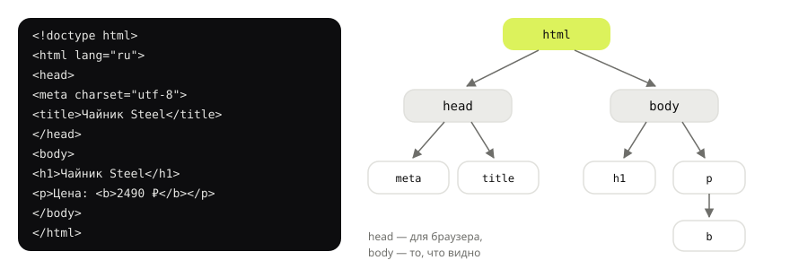

## Теория
**HTML** — язык разметки: он говорит браузеру, что есть что на странице. Это заголовок, это абзац, это ссылка. Разметка состоит из **тегов**: `<p>` открывает абзац, `</p>` закрывает, а между ними — содержимое. Тег вместе с содержимым называется **элементом**. У тега бывают **атрибуты** — дополнительные настройки в открывающем теге: `<html lang="ru">`. Элементы вкладываются друг в друга, поэтому страница — это **дерево**.

У каждой страницы один и тот же каркас. `<!doctype html>` говорит браузеру «это современный HTML». Корень `<html>` содержит две части. `<head>` — служебная информация для браузера: кодировка, заголовок вкладки, подключённые стили. `<body>` — всё, что видит покупатель. Шаблоны Django — это такой же HTML, в который сервер подставляет данные. Поэтому чем лучше вы понимаете каркас, тем легче будет с шаблонами.

## Наглядно
**Рисунок 1.** Каркас страницы товара и дерево, которое из него строит браузер.



**Таблица 1.** Части каркаса.

| Часть | Зачем | Без неё |
|---|---|---|
| `<!doctype html>` | режим современного HTML | браузер включит «режим совместимости», и вёрстка поедет |
| `<html lang="ru">` | корень и язык страницы | неверные переносы и озвучка для незрячих |
| `<meta charset="utf-8">` | кодировка текста | кириллица может превратиться в «кракозябры» |
| `<title>` в `<head>` | заголовок вкладки и поисковой выдачи | во вкладке — адрес вместо названия |
| `<body>` | видимое содержимое | — |

**Таблица 2.** Термины.

| Термин | Пример | Что это |
|---|---|---|
| тег | `<p>`, `</p>` | метка в угловых скобках |
| элемент | `<p>Текст</p>` | открывающий тег + содержимое + закрывающий |
| пустой элемент | `<meta …>`, ``, `<br>` | без содержимого и без закрывающего тега |
| атрибут | `lang="ru"` | имя и значение внутри открывающего тега |
| вложенность | `<p>Цена: <b>2490 ₽</b></p>` | `b` — дочерний элемент `p` |

## На практике
Задача: собрать каркас страницы товара и разобраться, что браузер делает с ошибками разметки.

### Шаг 1. Пишем каркас
Минимальная правильная страница выглядит так:
```html
<!doctype html>
<html lang="ru">
<head>
  <meta charset="utf-8">
  <title>Чайник Steel — магазин</title>
</head>
<body>
  <h1>Чайник Steel</h1>
  <p>Цена: <b>2490 ₽</b></p>
</body>
</html>
```
Отступы браузеру не нужны, они для людей: по ним видно, что внутри чего.

### Шаг 2. Закрываем теги в обратном порядке
Вложенные элементы закрываются в обратном порядке — как скобки в выражении:
```html
<p>Цена: <b>2490 ₽</b></p>
```
Запись `<p><b>2490 ₽</p></b>` неверна. Браузер её «починит» по своим правилам, и результат не всегда совпадёт с задуманным.

### Шаг 3. Смотрим, как браузер исправляет ошибки
HTML не падает с ошибкой, как Python, — браузер молча перестраивает дерево. Например, абзац `<p>` не может содержать блоки вроде `<div>`. Разработчик написал:
```html
<p class="info">Цена: <div class="price">2490 ₽</div></p>
```
Браузер закроет `<p>` перед `<div>`, и в дереве получится: пустой абзац, отдельный `div` с ценой и ещё один пустой абзац из лишнего `</p>`. Стили и проверки, которые ищут цену «внутри абзаца», её не найдут. Для куска текста внутри абзаца есть строчный элемент `<span>`.

### Шаг 4. Проверяем дерево в DevTools
Что получилось на самом деле, видно во вкладке **Elements**: там дерево после исправлений браузера. Если элемент «не на своём месте» — сравните Elements с исходным кодом (`Ctrl+U`).

## Частые ошибки
- **`<title>` внутри `<body>`.** Браузер оставит его в `body`, и вкладка покажет адрес страницы. Служебные теги — только в `<head>`.
- **Нет `<meta charset="utf-8">`.** Если сервер не прислал кодировку в заголовке, браузер угадывает её, и кириллица превращается ⠫Каталог». `meta charset` ставят первым в `<head>`.
- **Блок внутри абзаца.** `<p><div>…</div></p>` — браузер разорвёт абзац. Внутри `p` — только текст и строчные элементы (`span`, `b`, `a`).
- **Атрибут без кавычек с пробелом.** `<html lang=ru RU>` — `RU` станет отдельным атрибутом. Значения всегда в кавычках.
- **Надежда на сообщение об ошибке.** Браузер ничего не скажет о неверной разметке. Проверяйте дерево в Elements или валидатором.

## Итог
**Каркас**
- `<!doctype html>` → `<html lang="ru">` → `<head>` (служебное) + `<body>` (видимое).
- В `<head>` первым — `<meta charset="utf-8">`, затем `<title>`.

**Элементы**
- Элемент = открывающий тег + содержимое + закрывающий; пустые элементы (`meta`, `img`, `br`) закрывающего тега не имеют.
- Атрибуты — в открывающем теге: `имя="значение"`, всегда в кавычках.
- Вложенные теги закрываются в обратном порядке.

**Ошибки разметки**
- Браузер не сообщает об ошибках, а молча перестраивает дерево.
- Внутри `<p>` — только строчные элементы; `<div>` разорвёт абзац.
- Настоящее дерево — во вкладке Elements.

## Вопросы на собеседовании
<details><summary>Зачем нужен `<!doctype html>`?</summary>

Он включает стандартный режим отрисовки. Без него браузер переходит в «режим совместимости» (quirks mode) и имитирует ошибки старых браузеров: иначе считает размеры блоков, иначе наследует стили. Для HTML5 doctype — одна короткая строка.
</details>

<details><summary>Что должно быть в `<head>`?</summary>

Служебная информация, которую пользователь не видит на странице: кодировка (`<meta charset>`), заголовок (`<title>`), настройки для мобильных (`<meta name="viewport">`), подключение стилей (`<link>`), описание для поисковиков. Содержимое страницы — только в `<body>`.
</details>

<details><summary>Чем тег отличается от элемента?</summary>

Тег — это метка разметки: `<p>` или `</p>`. Элемент — узел дерева документа: открывающий тег, содержимое и закрывающий тег. В DOM существуют элементы, а теги остаются только в исходном тексте.
</details>

<details><summary>Что браузер делает с некорректным HTML?</summary>

Не останавливается, а исправляет его по алгоритму из стандарта HTML. Закрывает незакрытые теги, переносит элементы туда, где они допустимы, разрывает абзацы перед блоками. Поэтому ошибка в разметке проявляется не сообщением, а «странной» вёрсткой.
</details>
