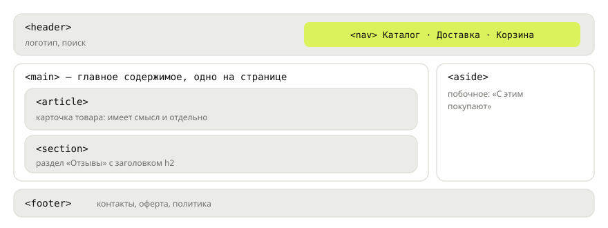

## Теория
Теги выбирают по **смыслу**, а не по виду: это и есть **семантика**. `<h1>` — главный заголовок страницы, а не «крупный жирный текст». `<ul>` — список, а не «строчки с точками». Как элемент выглядит, решает CSS, и его можно поменять одной строкой. А смысл разметки читают те, кто не смотрит на картинку. Поисковик понимает по `h1`, о чём страница. Программа экранного доступа для незрячих зачитывает список как список и даёт перейти к основному содержимому. Браузер в режиме чтения убирает меню и подвал.

Для текста есть заголовки `<h1>`–`<h6>`, абзацы `<p>`, списки `<ul>` (без порядка) и `<ol>` (по порядку) с пунктами `<li>`, выделение `<strong>` (важно) и `<em>` (акцент). Для областей страницы — `<header>`, `<nav>`, `<main>`, `<article>`, `<section>`, `<aside>`, `<footer>`. Если смыслового тега нет, берут нейтральные `<div>` (блок) и `<span>` (кусок текста). Они ничего не значат и нужны только для оформления.

## Наглядно
**Рисунок 1.** Области страницы товара и семантические теги для них.



**Таблица 1.** Смысловые теги и когда их брать.

| Тег | Смысл | Пример в магазине |
|---|---|---|
| `h1` | главный заголовок, один на странице | название товара на его карточке |
| `h2`–`h6` | заголовки разделов по уровням | «Характеристики», «Отзывы» |
| `p` | абзац текста | описание товара |
| `ul` / `ol` + `li` | список без порядка / по шагам | преимущества товара / шаги оформления |
| `strong` / `em` | важное / акцент | «Последний товар на складе» |
| `header` / `footer` | шапка / подвал страницы или блока | логотип и поиск / контакты |
| `nav` | основная навигация | меню каталога |
| `main` | основное содержимое, один на странице | карточка товара |
| `article` | самостоятельный блок | карточка товара, отзыв |
| `section` | раздел с заголовком | «Отзывы» |
| `aside` | побочное | «С этим товаром покупают» |
| `div` / `span` | без смысла, для оформления | обёртка сетки, кусок текста для стиля |

## На практике
Задача: сверстать страницу «О магазине» так, чтобы её смысл был понятен не только глазами.

### Шаг 1. Задаём заголовки по уровням
Один `h1` — тема страницы, разделы — `h2`, подразделы — `h3`. Уровни не пропускаем и не выбираем «по размеру»:
```html
<h1>О магазине</h1>
<h2>Доставка</h2>
<h2>Оплата</h2>
<h3>Картой онлайн</h3>
```
Размер шрифта потом задаст CSS. Если `h2` выглядит слишком крупным, это решается стилем, а не тегом `h4`.

### Шаг 2. Оформляем списки
Преимущества магазина не связаны порядком — это `ul`. Шаги оформления заказа — `ol`, браузер сам их пронумерует:
```html
<ul>
  <li>Доставка за 1 день</li>
  <li>Возврат 30 дней</li>
</ul>
<ol>
  <li>Положите товар в корзину</li>
  <li>Укажите адрес</li>
  <li>Оплатите заказ</li>
</ol>
```
Списки из строчек через `<br>` с ручными «—» и «1.» — частая ошибка: для поисковика и экранного доступа это просто абзац.

### Шаг 3. Размечаем области страницы
Каркас страницы из рисунка 1 в коде выглядит так:
```html
<header>
  <a href="/">Магазин</a>
  <nav>
    <a href="/catalog/">Каталог</a>
    <a href="/delivery/">Доставка</a>
  </nav>
</header>
<main>
  <h1>О магазине</h1>
  <section>
    <h2>Доставка</h2>
    <p>Привезём за 1 день.</p>
  </section>
</main>
<footer>
  <p>shop.example, 2026</p>
</footer>
```
Тот же каркас из одних `div` выглядел бы так же. Но браузер, поисковик и экранный диктор уже не нашли бы на нём меню и основное содержимое.

### Шаг 4. Выбираем между `div` и смысловым тегом
Правило простое: сначала ищем тег по смыслу. Блок, нужный только для оформления, например обёртка для двух колонок, — `div`. Кусок текста, который нужно покрасить, — `span`.

## Частые ошибки
- **Тег по размеру шрифта.** `h4`, потому что «`h2` слишком большой», ломает структуру. Уровень выбирают по смыслу, размер задаёт CSS.
- **Несколько `h1`.** На странице товара `h1` — название товара. Названия разделов — `h2`.
- **Списки через `<br>`.** `— пункт<br>— пункт` — для программ это один абзац. Для списков есть `ul`/`ol`.
- **`<b>` и `<i>` вместо смысла.** Важное — `strong`, акцент — `em`. `b` и `i` — просто начертание без значения.
- **«Дивная» вёрстка.** Страница из одних `div` работает, но меню, основное содержимое и подвал на ней не найти без глаз.

## Итог
**Принцип**
- Тег выбирают по смыслу, вид задаёт CSS.
- Семантику читают поисковики, экранный доступ, режим чтения браузера.

**Текст**
- Один `h1` на страницу, разделы — `h2`, глубже — `h3`; уровни не пропускаем.
- `p` — абзац; `ul` — список без порядка, `ol` — по шагам, пункты — `li`.
- `strong` — важное, `em` — акцент.

**Области страницы**
- `header`, `nav`, `main` (один), `article`, `section` (с заголовком), `aside`, `footer`.
- `div` и `span` — когда смыслового тега нет и блок нужен только для оформления.

## Вопросы на собеседовании
<details><summary>Что такое семантическая вёрстка и зачем она?</summary>

Разметка тегами по смыслу содержимого: заголовок — `h1`–`h6`, навигация — `nav`, основное содержимое — `main`, список — `ul`/`ol`. Она нужна для доступности (экранный доступ понимает структуру), SEO (поисковики понимают, что главное) и поддержки кода: сразу видно, где что.
</details>

<details><summary>Чем `section` отличается от `article` и `div`?</summary>

`article` — самостоятельный блок, понятный и вне страницы: карточка товара, отзыв, пост. `section` — тематический раздел страницы, обычно с заголовком. `div` смысла не несёт и нужен для группировки ради оформления.
</details>

<details><summary>Чем `strong` отличается от `b`?</summary>

`strong` означает «это важно», и экранный доступ может выделить такой текст голосом. `b` только меняет начертание и смысла не несёт. Выглядят они по умолчанию одинаково — оба жирные.
</details>
