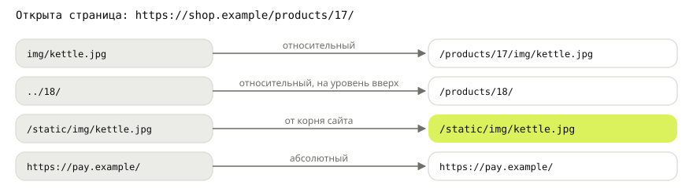

## Теория
Ссылка `<a href="…">текст</a>` — то, ради чего HTML вообще придумали: переход на другую страницу одним кликом. Картинка `` встраивает изображение. Оба элемента ссылаются на другой адрес, и важно понимать, **от чего этот адрес отсчитывается**. **Абсолютный** адрес содержит схему и домен (`https://pay.example/`). Адрес **от корня** начинается с `/` (`/catalog/`) и отсчитывается от домена текущего сайта. **Относительный** (`img/kettle.jpg`, `../18/`) отсчитывается от папки текущей страницы, поэтому на разных страницах ведёт в разные места.

У картинки обязателен атрибут `alt` — текст вместо изображения. Его прочитает экранный доступ, его покажет браузер, если картинка не загрузилась, по нему поисковик поймёт, что на фото. `alt` описывает содержимое («Стальной чайник Steel, 1,7 л»), а не повторяет имя файла. Для чисто декоративной картинки `alt` оставляют пустым: `alt=""`.

## Наглядно
**Рисунок 1.** Куда ведут пути со страницы `https://shop.example/products/17/`.



**Таблица 1.** Атрибуты ссылок и картинок.

| Атрибут | Пример | Что делает |
|---|---|---|
| `href` | `href="/catalog/"` | куда ведёт ссылка |
| `href="#id"` | `href="#reviews"` | прокрутка к элементу с `id="reviews"` на этой странице |
| `href="mailto:…"`, `"tel:…"` | `href="tel:+78001234567"` | открыть почту или звонок |
| `target="_blank"` | | открыть в новой вкладке (используйте редко) |
| `src` | `src="/static/img/kettle.jpg"` | адрес изображения |
| `alt` | `alt="Чайник Steel"` | текст вместо картинки; обязателен |
| `width`, `height` | `width="400" height="300"` | размер заранее — страница не «прыгает» при загрузке |

## На практике
Задача: сделать меню магазина и фото на карточке товара так, чтобы они работали на любой странице сайта.

### Шаг 1. Проверяем, куда ведёт путь
Браузер достраивает путь от адреса текущей страницы. Python делает то же самое функцией `urljoin`:
```python
from urllib.parse import urljoin

page = "https://shop.example/products/17/"
for href in ["img/kettle.jpg", "../18/", "/catalog/", "https://pay.example/"]:
    print(href, "→", urljoin(page, href))
```
Результат:
```
img/kettle.jpg → https://shop.example/products/17/img/kettle.jpg
../18/ → https://shop.example/products/18/
/catalog/ → https://shop.example/catalog/
https://pay.example/ → https://pay.example/
```
Относительный `img/kettle.jpg` ведёт внутрь `/products/17/` — такой картинки там нет, будет 404. Путь от корня одинаков на любой странице.

### Шаг 2. Делаем меню
Меню есть на каждой странице, поэтому ссылки в нём — от корня:
```html
<nav>
  <a href="/">Главная</a>
  <a href="/catalog/">Каталог</a>
  <a href="/cart/">Корзина</a>
</nav>
```
Если бы ссылка была `href="catalog/"`, со страницы `/products/17/` она вела бы на `/products/17/catalog/`. В Django адреса в шаблонах обычно строит тег ``, и он всегда даёт путь от корня.

### Шаг 3. Вставляем фото товара
У фото — путь от корня, описание и размеры:
```html

```
`width` и `height` браузер знает до загрузки файла и сразу оставляет под картинку место. Иначе текст под ней «прыгнет», когда фото догрузится.

### Шаг 4. Пишем текст ссылки
Текст ссылки должен говорить, куда она ведёт. Экранный доступ показывает список всех ссылок страницы, и десять «Подробнее» в нём бесполезны:
```html
<a href="/products/17/">Чайник Steel</a>
```
Ссылку на внешний сайт пишем абсолютным адресом. Если открываем её в новой вкладке, добавляем `rel="noopener"`:
```html
<a href="https://pay.example/" target="_blank" rel="noopener">Условия оплаты</a>
```
`noopener` не даёт чужой вкладке управлять вашей страницей. Современные браузеры включают его сами, но в старых он нужен явно.

## Частые ошибки
- **Относительные пути в общих частях.** `href="catalog/"` в меню работает только на главной. В шапке, подвале и меню — пути от корня.
- **`alt` = имя файла.** `alt="IMG_2041.jpg"` ничего не сообщает. Описывайте, что на картинке.
- **Атрибут без кавычек.** `alt=Чайник Steel` — значением станет только «Чайник», а `Steel` — отдельный пустой атрибут. Значения пишем в кавычках.
- **Ссылка вместо кнопки.** `<a href="#">Удалить</a>` с действием — неправильно: переход по ссылке — это GET. Действия, меняющие данные, — кнопка в форме с POST (раздел «Формы»).
- **Картинка без размеров.** Без `width`/`height` вёрстка сдвигается при загрузке, и покупатель промахивается мимо кнопки.

## Итог
**Пути**
- Абсолютный: `https://pay.example/` — другой сайт.
- От корня: `/catalog/` — одинаков на любой странице сайта; для меню и статики.
- Относительный: `img/a.jpg`, `../18/` — от папки текущей страницы.

**Ссылки**
- `<a href="…">понятный текст</a>`; `#id` — к месту на странице.
- В новой вкладке — `target="_blank" rel="noopener"`, и только для внешних сайтов.

**Картинки**
- ``, без закрывающего тега.
- `alt` описывает содержимое; у декоративной картинки — `alt=""`.
- Значения атрибутов — всегда в кавычках.

## Вопросы на собеседовании
<details><summary>Чем относительный путь отличается от пути от корня?</summary>

Путь от корня (`/static/a.jpg`) отсчитывается от домена и одинаков на любой странице сайта. Относительный (`static/a.jpg`, `../a.jpg`) отсчитывается от папки текущего URL. Поэтому один и тот же код ведёт в разные места на `/` и на `/products/17/`.
</details>

<details><summary>Зачем атрибут `alt`?</summary>

Это текстовая замена изображения. Её зачитывает экранный доступ, показывает браузер, если картинка не загрузилась, и учитывает поисковик. Для декоративных картинок `alt=""` — тогда экранный доступ их пропускает. Отсутствие `alt` считается ошибкой доступности.
</details>

<details><summary>Почему действие «удалить» нельзя делать обычной ссылкой?</summary>

Переход по ссылке — GET-запрос. GET по смыслу безопасен, и браузеры, роботы и расширения могут открывать ссылки сами: предзагрузка, проверка ссылок. Удаление, добавление в корзину, выход из аккаунта меняют данные и делаются формой с POST и защитой от CSRF.
</details>
