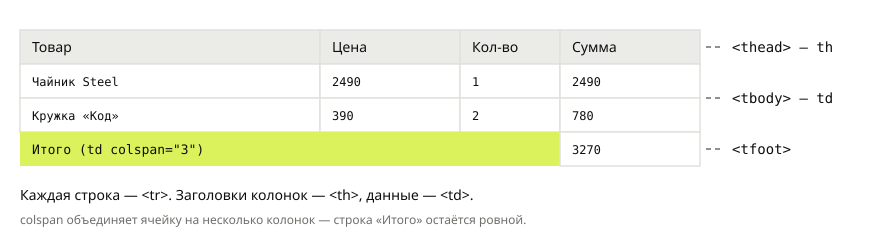

## Теория
Таблица в HTML — для **табличных данных**: строки и колонки, где на пересечении стоит значение. Это позиции заказа, сравнение тарифов доставки, история заказов в личном кабинете. Таблица собирается из строк `<tr>`. В каждой строке — ячейки: `<th>` для заголовков, `<td>` для данных. Строки группируются по смыслу: `<thead>` — шапка, `<tbody>` — данные, `<tfoot>` — итог. Подпись таблицы — `<caption>`.

Заголовочные ячейки `th` — не просто «жирный текст». По ним экранный доступ объявляет, к какой колонке относится значение: «Сумма: 780». Ячейка может растянуться на несколько колонок атрибутом `colspan` или строк — `rowspan`. Для раскладки страницы — колонок, сетки карточек — таблицы не используют: это задача CSS (Flexbox, раздел «CSS»).

## Наглядно
**Рисунок 1.** Таблица позиций заказа: шапка с `th`, строки данных с `td`, итог в `tfoot` с ячейкой на три колонки.



**Таблица 1.** Элементы таблицы.

| Тег | Что это |
|---|---|
| `table` | вся таблица |
| `caption` | подпись, первым внутри `table` |
| `thead` / `tbody` / `tfoot` | шапка / данные / итог |
| `tr` | строка |
| `th` | ячейка-заголовок колонки или строки |
| `td` | ячейка с данными |
| `colspan="3"` / `rowspan="2"` | ячейка на 3 колонки / на 2 строки |

## На практике
Задача: показать покупателю позиции заказа с итогом.

### Шаг 1. Делаем шапку
Названия колонок — в `thead`, ячейками `th`:
```html
<table>
  <caption>Заказ №1042</caption>
  <thead>
    <tr><th>Товар</th><th>Цена</th><th>Кол-во</th><th>Сумма</th></tr>
  </thead>
```

### Шаг 2. Заполняем строки
Каждая позиция — строка `tr` в `tbody`. Ячеек в строке столько же, сколько колонок:
```html
  <tbody>
    <tr><td>Чайник Steel</td><td>2490</td><td>1</td><td>2490</td></tr>
    <tr><td>Кружка «Код»</td><td>390</td><td>2</td><td>780</td></tr>
  </tbody>
```
В шаблоне Django эти строки будет выводить цикл `` по позициям заказа: одна строка разметки — сколько угодно позиций.

### Шаг 3. Добавляем итог
Строка «Итого» короче остальных: подпись и сумма. Чтобы сумма встала под колонкой «Сумма», подпись растягиваем на три колонки:
```html
  <tfoot>
    <tr><td colspan="3">Итого</td><td>3270</td></tr>
  </tfoot>
</table>
```
Без `colspan` в строке было бы две ячейки. Сумма встала бы во вторую колонку, под «Цена», а справа осталась бы дыра.

### Шаг 4. Помним про невидимый `tbody`
Если не написать `tbody`, браузер добавит его сам: каждый `tr` вне `thead`/`tfoot` окажется внутри `tbody`. Поэтому CSS-селектор `table > tr` ничего не найдёт — между `table` и `tr` всегда есть `tbody`. Пишите `tbody` явно, а в селекторах используйте `table tr`.

## Частые ошибки
- **`<td><b>` вместо `<th>`.** Заголовок колонки, выделенный жирным, для программ — обычные данные. Шапка — `th` в `thead`.
- **Разное число ячеек в строках.** Колонки «съезжают». Короткую строку дополняют `colspan`.
- **Таблица для раскладки.** Сетка карточек или «две колонки» таблицей — устаревший приём: такая вёрстка не перестраивается на телефоне. Раскладка — CSS.
- **`table > tr` в CSS.** Браузер вставляет `tbody`, поэтому прямого потомка `tr` у `table` не бывает.

## Итог
**Когда таблица**
- Только для табличных данных: строки × колонки. Раскладка страницы — CSS.

**Структура**
- `table` → `caption` → `thead` / `tbody` / `tfoot` → `tr` → `th` / `td`.
- `th` — заголовок колонки, `td` — данные.
- Браузер сам добавляет `tbody`, если его нет; селектор `table > tr` не сработает.

**Объединение ячеек**
- `colspan="N"` — ячейка на N колонок, `rowspan="N"` — на N строк.
- Сумма ячеек с учётом `colspan` в каждой строке должна совпадать.

## Вопросы на собеседовании
<details><summary>Почему таблицы не используют для раскладки страницы?</summary>

Таблица описывает данные, а не расположение: экранный доступ читает её как таблицу с колонками. Её сетку нельзя перестроить под телефон, а код раскладки на таблицах громоздкий. Раскладку делают CSS-инструментами — Flexbox и Grid.
</details>

<details><summary>Зачем `th`, если можно сделать текст жирным?</summary>

`th` задаёт смысл: это заголовок колонки (или строки). По нему экранный доступ объявляет, к чему относится значение ячейки. Таблицу с `th` легче стилизовать и разбирать программно. Жирный `td` такой информации не несёт.
</details>

<details><summary>Что делает `colspan`?</summary>

Растягивает ячейку на несколько колонок. Например, подпись «Итого» на три колонки, чтобы сумма встала под колонкой «Сумма». `rowspan` делает то же по вертикали.
</details>
