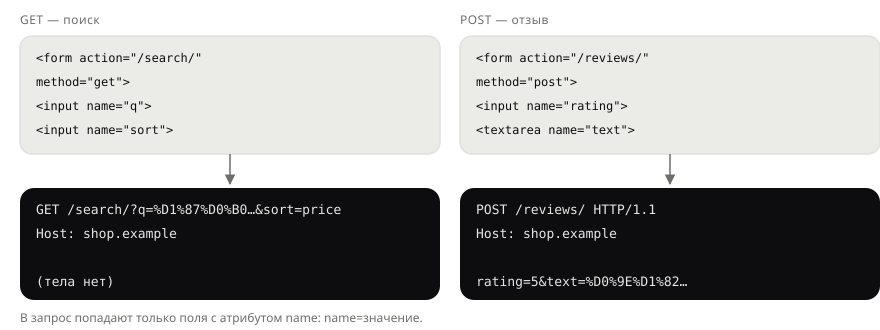

## Теория
**Форма** — единственный способ в чистом HTML отправить на сервер данные, которые ввёл покупатель. Элемент `<form>` собирает поля и при нажатии кнопки превращает их в HTTP-запрос. Атрибут `action` — куда отправить (путь), `method` — каким методом: `get` (по умолчанию) или `post`. Каждое поле попадает в запрос парой `name=значение`. Поле **без атрибута `name` не отправляется** вовсе, сколько бы покупатель в него ни ввёл.

Метод решает, где окажутся данные. У **GET-формы** поля уходят в query-параметры URL: `/search/?q=чайник&sort=price`. Так делают поиск и фильтры — результат можно сохранить ссылкой. У **POST-формы** поля уходят в тело запроса. Так отправляют всё, что меняет данные: заказ, отзыв, вход. На стороне Django поля GET-формы окажутся в `request.GET`, POST-формы — в `request.POST`, а ключами будут те самые `name`.

## Наглядно
**Рисунок 1.** Одна и та же разметка полей превращается в разные запросы в зависимости от `method`.



**Таблица 1.** Атрибуты формы и кнопки.

| Атрибут | Пример | Что делает |
|---|---|---|
| `action` | `action="/search/"` | куда отправить; без него — на адрес текущей страницы |
| `method` | `method="post"` | `get` (по умолчанию) или `post` |
| `name` у поля | `name="q"` | ключ в запросе; без `name` поле не отправляется |
| `value` у поля | `value="price"` | значение по умолчанию или для скрытого поля |
| `<button>` | `<button>Найти</button>` | внутри формы по умолчанию отправляет её (`type="submit"`) |
| `type="button"` | `<button type="button">` | обычная кнопка, форму не отправляет |

## На практике
Задача: сделать поиск по каталогу и форму отзыва о товаре.

### Шаг 1. Делаем поиск через GET
Поиск ничего не меняет, а результат удобно отправить ссылкой — значит, GET:
```html
<form action="/search/" method="get">
  <input name="q" placeholder="Что ищем?">
  <select name="sort">
    <option value="price">Сначала дешёвые</option>
    <option value="-price">Сначала дорогие</option>
  </select>
  <button>Найти</button>
</form>
```
Покупатель ввёл «чайник» и нажал «Найти». Браузер перейдёт на `/search/?q=%D1%87%D0%B0%D0%B9%D0%BD%D0%B8%D0%BA&sort=price`. Значения он закодирует сам, как в теме «URL».

### Шаг 2. Делаем отзыв через POST
Отзыв создаёт запись в базе — значит, POST:
```html
<form action="/products/17/reviews/" method="post">
  <input name="rating" value="5">
  <textarea name="text"></textarea>
  <button>Отправить отзыв</button>
</form>
```
Адрес не меняется на `?text=…`. Поля уходят в тело запроса, в том же формате `name=значение&…`, а `Content-Type` будет `application/x-www-form-urlencoded`. После сохранения сервер ответит редиректом (PRG, тема «Методы и коды ответа»).

### Шаг 3. Проверяем, что ушло
Тело POST-формы — те же пары, что query. Разберём его так же, как сервер:
```python
from urllib.parse import parse_qs

body = "rating=5&text=%D0%9E%D1%82%D0%BB%D0%B8%D1%87%D0%BD%D0%BE"
print(parse_qs(body))
```
Результат:
```
{'rating': ['5'], 'text': ['Отлично']}
```
В Django то же самое лежит в `request.POST`: `request.POST["text"]` → `"Отлично"`. Ключи — это атрибуты `name` полей.

### Шаг 4. Отделяем кнопки, которые не отправляют
Любой `<button>` внутри формы по умолчанию — кнопка отправки. Кнопка «Показать пароль» отправила бы форму. Обычной кнопке указывают тип:
```html
<button type="button">Показать пароль</button>
<button type="submit">Войти</button>
```

## Частые ошибки
- **Поле без `name`.** Покупатель всё ввёл, а в `request.POST` пусто. Для отправки нужен `name`, а не `id`.
- **GET для изменений.** Форма заказа с `method="get"` кладёт данные в URL: они попадут в историю и логи, а повтор ссылки создаст новый заказ. Изменения — POST.
- **Забытый `method`.** По умолчанию — GET. Форма входа без `method="post"` отправит пароль в адресной строке.
- **`<button>` без типа.** Кнопка внутри формы отправляет её. Для вспомогательных кнопок — `type="button"`.
- **Ожидание чисел.** Всё, что пришло из формы, — строки: `request.POST["rating"]` — это `"5"`. Числа из них делает сервер, а Django-формы делают это сами.

## Итог
**Форма**
- `<form action="куда" method="get|post">` собирает поля и отправляет их кнопкой.
- В запрос попадает каждое поле с `name` — парой `name=значение`.

**GET и POST**
- GET-форма — поля в URL (`?q=…`): поиск, фильтры. В Django — `request.GET`.
- POST-форма — поля в теле: заказ, отзыв, вход. В Django — `request.POST`.
- `method` по умолчанию — `get`.

**Кнопки**
- `<button>` в форме отправляет её; вспомогательная кнопка — `type="button"`.

## Вопросы на собеседовании
<details><summary>Что произойдёт, если у поля формы нет атрибута `name`?</summary>

Поле не попадёт в запрос: браузер отправляет только поля с `name`. Атрибут `id` нужен для `label` и CSS, но ключом в запросе не служит. Это частая причина пустого `request.POST`.
</details>

<details><summary>Когда форма отправляется методом GET, а когда POST?</summary>

GET — когда запрос только читает данные и его можно повторять и сохранить ссылкой: поиск, фильтры, сортировка. POST — когда запрос меняет состояние на сервере или содержит секреты: заказ, отзыв, вход, регистрация. POST-формы в Django ещё и защищают CSRF-токеном.
</details>

<details><summary>В каком формате браузер отправляет данные POST-формы?</summary>

По умолчанию `application/x-www-form-urlencoded`: пары `name=значение` через `&`, значения закодированы, как query в URL. Для отправки файлов используют `multipart/form-data`: тело делится на части, каждая со своими заголовками.
</details>
