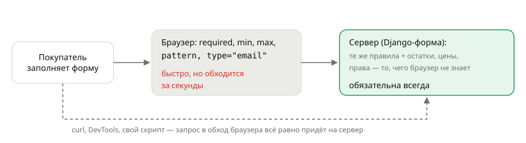

## Теория
Браузер умеет проверять поля сам, без строчки JavaScript. Достаточно атрибутов: `required` — поле обязательно, `min` и `max` — границы числа, `minlength` и `maxlength` — длина текста, `pattern` — регулярное выражение для значения. Встроенную проверку дают и типы полей: `type="email"` не пропустит строку без `@`. Если что-то не так, браузер не отправит форму и покажет подсказку прямо у поля. Покупатель узнаёт об ошибке сразу, без запроса к серверу.

Но это **удобство, а не защита**. Атрибуты лежат в HTML у покупателя и убираются в DevTools за секунду, а запрос можно отправить вообще без браузера. Поэтому сервер проверяет те же правила заново — и ещё то, чего браузер знать не может: хватит ли товара на складе, действует ли промокод, можно ли этому покупателю это делать. В Django это делают формы: правила полей описываются в одном месте и проверяются на сервере всегда.

## Наглядно
**Рисунок 1.** Два уровня проверки: браузер подсказывает, сервер решает.



**Таблица 1.** Атрибуты проверки.

| Атрибут | Пример | Что проверяет |
|---|---|---|
| `required` | `<input name="email" required>` | поле не пустое |
| `min`, `max` | `<input type="number" min="1" max="99">` | число в границах |
| `step` | `step="1"` | шаг числа: только целые |
| `minlength`, `maxlength` | `<textarea maxlength="1000">` | длина текста; `maxlength` просто не даёт ввести больше |
| `pattern` | `pattern="\d{6}"` | значение целиком подходит под регулярное выражение |
| `type="email"` | | есть `@` и домен |
| `novalidate` у формы | `<form novalidate>` | отключить проверку браузера |

## На практике
Задача: поле количества в корзине (от 1 до 99) и поле почтового индекса (ровно 6 цифр).

### Шаг 1. Ограничиваем количество
Количество — обязательное целое число от 1 до 99:
```html
<label for="qty">Количество</label>
<input type="number" id="qty" name="quantity" value="1" min="1" max="99" required>
```
Введёт покупатель 150 — браузер не отправит форму и подскажет «Значение должно быть меньше или равно 99».

### Шаг 2. Задаём формат индекса
Индекс — ровно 6 цифр. Регулярное выражение в `pattern` проверяет **всё значение целиком**, как будто вокруг стоят `^` и `$`:
```html
<label for="postcode">Индекс</label>
<input id="postcode" name="postcode" pattern="\d{6}" inputmode="numeric" required>
```
`inputmode="numeric"` открывает на телефоне цифровую клавиатуру. При этом поле остаётся текстовым: `type="number"` отбросил бы ведущие нули индекса.

### Шаг 3. Проверяем шаблон так же, как браузер
Браузер применяет `pattern` ко всей строке. В Python так работает `re.fullmatch`:
```python
import re

for value in ["101000", "10100", "1010001", "10100a"]:
    print(value, bool(re.fullmatch(r"\d{6}", value)))
```
Результат:
```
101000 True
10100 False
1010001 False
10100a False
```
Семь цифр не проходят: шаблон должен совпасть со всем значением, а не с его куском.

### Шаг 4. Повторяем проверку на сервере
Обойти браузер проще простого: убрать `max="99"` в DevTools или отправить запрос из `curl`:
```bash
curl -d "quantity=100000" https://shop.example/cart/add/17/
```
Если сервер поверит, в заказе окажется 100 000 чайников или отрицательное количество. Поэтому в Django-форме те же ограничения пишут ещё раз (`min_value=1`, `max_value=99`). Там же проверяют остаток на складе — о нём браузер не знает ничего.

## Частые ошибки
- **Проверка только в браузере.** Любое ограничение в HTML снимается. Сервер проверяет всё, что пришло.
- **`type="number"` для кодов.** Индекс, номер карты, артикул — не числа: `type="number"` срежет ведущие нули и покажет стрелки. Нужен текст с `pattern` и `inputmode="numeric"`.
- **`^…$` в `pattern`.** Не ошибка, но лишнее: браузер и так сравнивает всё значение.
- **`maxlength` вместо проверки на сервере.** Ограничение длины в HTML не мешает отправить мегабайт текста через `curl`. В базе у поля своя длина, и сервер должен её проверить.
- **Подсказки только браузерные.** Сервер, отказав, должен сам вернуть форму с понятными ошибками у полей. Django-формы делают это из коробки.

## Итог
**Атрибуты проверки**
- `required`, `min`/`max`/`step`, `minlength`/`maxlength`, `pattern`, проверяющие типы (`email`).
- `pattern` сравнивает всё значение целиком, как `re.fullmatch`.
- `inputmode` меняет клавиатуру телефона, не меняя тип поля.

**Роль проверки в браузере**
- Быстрая подсказка покупателю, форма с ошибкой не уходит.
- Не защита: атрибуты снимаются в DevTools, запрос шлётся без браузера.

**Сервер**
- Проверяет те же правила заново плюс то, что знает только он: остатки, цены, права.
- В Django — формы с описанием полей.

## Вопросы на собеседовании
<details><summary>Зачем проверять данные на сервере, если браузер уже проверил?</summary>

Браузер под контролем пользователя: атрибуты проверки удаляются, JavaScript отключается, запросы отправляются напрямую. Серверная проверка — единственная, которую нельзя обойти. Клиентская нужна для удобства — ошибки видны мгновенно, без лишнего запроса.
</details>

<details><summary>Как работает атрибут `pattern`?</summary>

Значение поля сравнивается с регулярным выражением целиком, как будто шаблон обёрнут в `^(?:…)$`. Пустое значение `pattern` не проверяет — для этого нужен `required`. Синтаксис — регулярные выражения JavaScript.
</details>

<details><summary>Почему почтовый индекс не делают `type="number"`?</summary>

Это код, а не число: с ним не считают, он может начинаться с нуля, а `type="number"` срежет ведущие нули. К тому же в нём появляются стрелки и прокрутка колесом. Для кодов используют текстовое поле с `pattern` и `inputmode="numeric"`.
</details>
