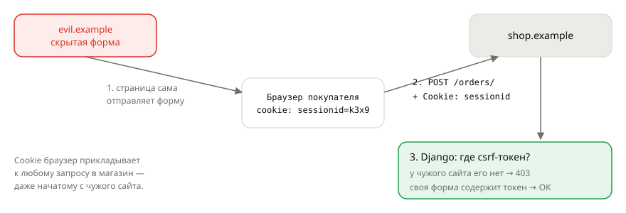

## Теория
Браузер прикладывает cookie магазина к **любому** запросу в магазин, кто бы его ни начал. Этим пользуется атака **CSRF** (подделка межсайтового запроса). Покупатель вошёл в магазин, а потом открыл страницу злоумышленника `evil.example`. На ней спрятана форма с `action="https://shop.example/orders/"` и `method="post"`, и скрипт отправляет её сам при загрузке. Запрос уходит из браузера покупателя вместе с его `sessionid`. Сервер видит обычный POST от вошедшего пользователя и выполняет его: оформляет заказ, меняет адрес доставки, выходит из аккаунта.

Защита — **CSRF-токен**. Сервер кладёт в каждую свою форму скрытое поле со случайным значением, связанным с сессией покупателя, и при каждом POST проверяет его. Чужой сайт не может прочитать страницы магазина, поэтому токена не знает, и его форма получает 403. В Django это встроено: `CsrfViewMiddleware` проверяет каждый POST, а тег `` в шаблоне вставляет скрытое поле. Дополнительно браузеры не прикладывают cookies с атрибутом `SameSite=Lax` к POST с чужих сайтов. Но токен остаётся основной защитой.

## Наглядно
**Рисунок 1.** Чужая страница отправляет форму в магазин, браузер прикладывает cookie сессии. Сервер отсекает запрос, потому что в нём нет токена.



**Таблица 1.** Что защищает от CSRF и что — нет.

| Мера | Защищает? | Почему |
|---|---|---|
| CSRF-токен в POST-формах | да | чужой сайт не знает значение |
| `SameSite=Lax` у cookie сессии | частично | помогает в современных браузерах, но не везде и не для всех запросов |
| изменения только через POST | обязательно | GET-запрос чужой сайт отправит обычной картинкой ``, и токен его не прикрывает |
| HTTPS | нет | шифрует канал, но запрос всё равно уходит из браузера жертвы |
| проверка `Referer` вручную | слабо | заголовок может отсутствовать |
| «пароль на важные действия» | дополнительно | для смены пароля и почты |

## На практике
Задача: понять, почему в каждой POST-форме Django стоит ``, и защитить кнопку «Выйти».

### Шаг 1. Смотрим на атаку
Страница злоумышленника выглядит безобидно, но содержит форму:
```html
<form action="https://shop.example/account/email/" method="post" id="f">
  <input type="hidden" name="email" value="attacker@evil.example">
</form>
<script>document.getElementById("f").submit()</script>
```
Если магазин не проверяет токен, почта покупателя тихо сменится на почту злоумышленника. После этого он восстановит пароль и заберёт аккаунт.

### Шаг 2. Добавляем токен в свою форму
В шаблоне Django в каждую POST-форму ставят тег:
```html
<form action="/account/email/" method="post">
  
  <input type="email" name="email">
  <button>Сохранить</button>
</form>
```
В готовом HTML тег превращается в скрытое поле:
```html
<input type="hidden" name="csrfmiddlewaretoken" value="Hk3…длинная случайная строка…">
```
Django сверяет его с cookie `csrftoken` браузера. У формы злоумышленника поля нет — ответ `403 Forbidden`.

### Шаг 3. Убираем действия с GET
Токен проверяется только у POST (и других «изменяющих» методов). Ссылка «Выйти» в виде `<a href="/logout/">` — это GET. Злоумышленник выкинет покупателя из аккаунта картинкой ``. Поэтому выход, удаление, добавление в корзину — это формы с POST и токеном:
```html
<form action="/logout/" method="post">
  
  <button>Выйти</button>
</form>
```
В Django 5 встроенный `LogoutView` принимает только POST — именно поэтому.

## Частые ошибки
- **Забытый ``.** Своя форма получает `403 Forbidden (CSRF token missing)`. Решение — добавить тег, а не отключать проверку.
- **`@csrf_exempt` «чтобы заработало».** Отключение проверки открывает view для атаки. Исключения — только для запросов, которые приходят не из браузера и защищены иначе (например, подписанные webhooks).
- **Изменения через GET.** Токен не проверяется у GET. Любая ссылка или картинка на чужом сайте выполнит действие.
- **Токен в GET-форме поиска.** Не нужен: поиск ничего не меняет, а токен попадёт в URL и в логи.
- **«У нас HTTPS, CSRF не страшен».** Запрос уходит из браузера самой жертвы по тому же HTTPS.

## Итог
**Атака**
- Браузер прикладывает cookies сайта к любому запросу в него, даже начатому чужой страницей.
- Чужая страница может сама отправить POST-форму от имени вошедшего покупателя.

**Защита**
- Каждая POST-форма содержит CSRF-токен — скрытое поле со значением, которого чужой сайт не знает.
- Django: `CsrfViewMiddleware` проверяет POST, `` вставляет поле, без него — 403.
- Всё, что меняет данные, — только POST: GET токеном не защищён.
- `SameSite=Lax` у cookies — дополнительный слой, не замена токену.

## Вопросы на собеседовании
<details><summary>Что такое CSRF и как от него защищаются?</summary>

Cross-Site Request Forgery — чужой сайт заставляет браузер пользователя отправить запрос на ваш сайт. Браузер прикладывает cookies, и запрос выглядит легитимным. Защита: изменения только не-GET методами, в каждой форме — CSRF-токен, неизвестный чужому сайту, плюс `SameSite` у cookies сессии.
</details>

<details><summary>Как устроена CSRF-защита в Django?</summary>

`CsrfViewMiddleware` выдаёт браузеру cookie `csrftoken`. Тег `` вставляет в форму скрытое поле `csrfmiddlewaretoken` с замаскированным значением токена. При каждом POST/PUT/PATCH/DELETE middleware сверяет поле (или заголовок `X-CSRFToken` у AJAX) с cookie. Нет совпадения — ответ 403. Для HTTPS дополнительно проверяется заголовок `Origin`/`Referer`.
</details>

<details><summary>Почему токен защищает, если cookie злоумышленник тоже «отправляет»?</summary>

Злоумышленник не отправляет cookie сам — её прикладывает браузер жертвы, а прочитать её чужой сайт не может. Значение токена нужно вписать в тело формы, а узнать его можно, только прочитав страницу или cookie магазина. Это запрещает политика одного источника (same-origin policy).
</details>

<details><summary>Почему выход из аккаунта делают через POST?</summary>

Выход меняет состояние: завершает сессию. GET-ссылку на `/logout/` чужой сайт вызовет картинкой, и пользователя выкинет из аккаунта. С POST и токеном такой запрос отсекается. Поэтому в Django 5 `LogoutView` принимает только POST.
</details>
