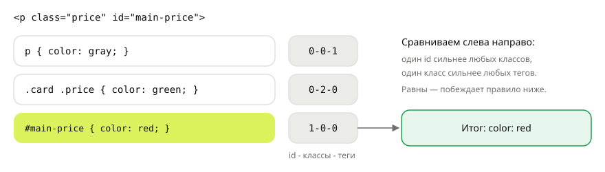

## Теория
HTML отвечает за смысл страницы, CSS — за её вид: цвета, шрифты, отступы, расположение блоков. Стили пишут в отдельном файле и подключают в `<head>` тегом `<link rel="stylesheet" href="style.css">`. Один файл стилей обслуживает все страницы сайта: поменяли цвет кнопки — он поменялся везде. В Django такие файлы лежат в `static/` и подключаются тегом ``.

Стиль состоит из **правил**. Правило — это селектор (каким элементам) и блок объявлений в фигурных скобках (что сделать): `.price { color: green; }`. Основные селекторы:
- **тег** — `p`, `h2`: все элементы с этим тегом;
- **класс** — `.price`: все элементы с `class="price"`. У элемента может быть несколько классов через пробел;
- **id** — `#cart`: один элемент с `id="cart"`;
- **вложенность** — `.card .price`: элементы `.price` где угодно внутри `.card`; `.card > .price` — только прямые дети;
- **несколько сразу** — `h1, h2`: правило для обоих;
- **состояние** — `a:hover`: ссылка под курсором.

Если несколько правил задают одно свойство одному элементу, работает **каскад**. Побеждает правило с большей **специфичностью**: id сильнее любого числа классов, класс сильнее любого числа тегов. Если специфичность равна, побеждает правило, написанное ниже. Атрибут `style="…"` прямо в теге сильнее любого селектора. Поэтому им не пользуются: такой стиль не переопределить из файла, и он не повторяется на других страницах.

Часть свойств **наследуется**: цвет текста и шрифт, заданные `body`, получат все элементы внутри. Отступы, рамки и фон не наследуются.

## Наглядно
**Рисунок 1.** Три правила спорят за цвет одной цены.



**Таблица 1.** Селекторы и их специфичность (id — классы — теги).

| Селектор | Что выбирает | Специфичность |
|---|---|---|
| `p` | все абзацы | 0-0-1 |
| `.price` | элементы с классом `price` | 0-1-0 |
| `p.price` | абзацы с классом `price` | 0-1-1 |
| `.card .price` | `.price` внутри `.card` | 0-2-0 |
| `a:hover` | ссылка под курсором (псевдокласс считается как класс) | 0-1-1 |
| `#cart` | элемент с `id="cart"` | 1-0-0 |
| `style="…"` | этот элемент | сильнее любого селектора |

## На практике
Задача: на карточке товара выделить цену, а старую цену зачеркнуть.

### Шаг 1. Подключаем файл стилей
В `<head>` страницы добавляем ссылку на файл:
```html
<head>
  <meta charset="utf-8">
  <title>Кружка «Код»</title>
  <link rel="stylesheet" href="style.css">
</head>
```
Путь — относительно страницы, как у картинок и ссылок. Без `rel="stylesheet"` браузер файл не применит.

### Шаг 2. Размечаем карточку классами
Классы называют по смыслу, а не по виду — `price`, а не `green-bold`:
```html
<article class="card">
  <h2 class="card-title">Кружка «Код»</h2>
  <p class="price">499 ₽</p>
  <p class="price price-old">699 ₽</p>
</article>
```
У старой цены два класса: она тоже цена, но особая.

### Шаг 3. Пишем правила
Общие стили — для `.price`, особенность — для `.price-old`:
```css
.card .price {
  font-weight: 700;
  color: #2e7d32;
}

.card .price-old {
  color: #6e6e6a;
  text-decoration: line-through;
}
```
Специфичность обоих правил одинакова (0-2-0). Второе ниже, поэтому старая цена серая, но жирность берёт из первого правила — его никто не перебил.

### Шаг 4. Проверяем в DevTools
Вкладка Elements → выбрать старую цену → панель Styles. Там видны все правила, которые подходят элементу. Перебитые объявления зачёркнуты: так быстро находят, почему стиль «не работает».

## Частые ошибки
- **Файл не подключён или путь неверный.** Стили «не применяются», а в DevTools во вкладке Network у `style.css` — 404.
- **Точка в HTML.** Пишут `class=".price"`. Точка нужна только в селекторе CSS, в атрибуте — просто `price`.
- **Пробел между тегом и классом.** `p .price` — «`.price` внутри `p`», а `p.price` — «абзац с классом `price`». Один пробел меняет смысл.
- **id для оформления.** `#price` можно использовать на странице один раз, а специфичность id потом не перебить классом. Для стилей — классы.
- **`style="…"` и `!important`.** Оба ломают каскад: правило из файла уже не переопределит такой стиль. Это обходной путь, а не решение.

## Итог
**Подключение**
- `<link rel="stylesheet" href="style.css">` в `<head>`; путь — относительно страницы.
- Один файл стилей на все страницы; в Django — из `static/`.

**Селекторы**
- Тег `p`, класс `.price`, id `#cart`, вложенность `.card .price`, прямой ребёнок `.card > .price`, группа `h1, h2`, состояние `a:hover`.
- Оформляем классами, названными по смыслу.

**Каскад**
- Побеждает большая специфичность: id → классы → теги.
- При равной — правило ниже.
- `style="…"` сильнее селекторов — поэтому его избегают.
- Цвет и шрифт наследуются, отступы и фон — нет.

## Вопросы на собеседовании
<details><summary>Что такое специфичность селектора?</summary>

Вес селектора, по которому браузер решает спор правил за одно свойство. Считается тройкой: число id, число классов (а также атрибутов и псевдоклассов), число тегов. Сравнивают слева направо: `#a` (1-0-0) сильнее `.a.b.c` (0-3-0). При равенстве побеждает правило, объявленное позже.
</details>

<details><summary>Чем класс отличается от id?</summary>

id уникален на странице и нужен для якорей (`#reviews`), связи `label` с полем и выбора элемента из JavaScript. Класс повторяется и предназначен для оформления. У id высокая специфичность — правила на id трудно переопределить, поэтому стили на нём не строят.
</details>

<details><summary>Почему не стоит писать стили в атрибуте `style`?</summary>

Такой стиль относится к одному элементу и не повторяется на других страницах. Его не переопределить правилом из файла без `!important`. Оформление смешивается с разметкой, и при смене дизайна приходится править каждый шаблон.
</details>
