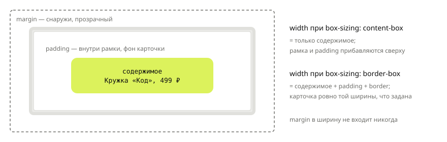

## Теория
Для браузера каждый элемент — прямоугольник из четырёх слоёв. В центре — **содержимое** (текст, картинка). Вокруг — **padding**, внутренний отступ; фон элемента закрашивает и его. Дальше — **border**, рамка. Снаружи — **margin**, внешний отступ до соседей; он прозрачный.

Отступы задают на все стороны сразу или по одной: `padding: 16px` — со всех сторон, `padding: 8px 16px` — сверху/снизу 8, слева/справа 16, `margin-top: 24px` — только сверху. `margin: 0 auto` у блока с заданной шириной ставит его по центру.

**`box-sizing`** решает, что значит `width`. По умолчанию (`content-box`) — ширина только содержимого: карточка с `width: 240px`, `padding: 16px` и рамкой 1px займёт 274px. С `border-box` padding и рамка входят в `width`, и карточка ровно 240px. Поэтому почти все сайты начинают стили с правила `*, *::before, *::after { box-sizing: border-box; }`.

**`display`** определяет, как элемент встаёт в поток:
- `block` — с новой строки, на всю ширину родителя; `width`, `height` и вертикальные отступы работают. Так ведут себя `div`, `p`, `h1`, `section`, `article`.
- `inline` — в строке текста, ширина — по содержимому; `width` и `height` игнорируются, вертикальный `margin` не сдвигает соседей. Так ведут себя `a`, `span`, `strong`.
- `inline-block` — стоит в строке, но размеры и отступы работают как у блока. Так делают кнопку из ссылки.
- `none` — элемента нет на странице вовсе.

Ещё одна особенность: вертикальные `margin` соседних блоков **схлопываются** — между абзацами с `margin: 16px 0` будет 16px, а не 32.

## Наглядно
**Рисунок 1.** Слои блока: содержимое, padding, border, margin.



**Таблица 1.** Сколько места займёт карточка `width: 240px; padding: 16px; border: 1px solid`.

| `box-sizing` | Содержимое | Вся карточка с рамкой |
|---|---|---|
| `content-box` (по умолчанию) | 240px | 240 + 2·16 + 2·1 = 274px |
| `border-box` | 240 − 32 − 2 = 206px | 240px |

**Таблица 2.** Значения `display`.

| Значение | Новая строка | `width`/`height` | Примеры по умолчанию |
|---|---|---|---|
| `block` | да | работают | `div`, `p`, `h1`, `ul`, `form` |
| `inline` | нет | игнорируются | `a`, `span`, `strong`, `label` |
| `inline-block` | нет | работают | `button`, `input`, `img` (ведёт себя так же) |
| `none` | — | — | элемент скрыт |

## На практике
Задача: карточка товара шириной 240px с рамкой, внутренним отступом и кнопкой-ссылкой «В корзину».

### Шаг 1. Включаем удобный подсчёт ширины
Первое правило файла стилей:
```css
*,
*::before,
*::after {
  box-sizing: border-box;
}
```
Теперь `width` — это вся ширина карточки вместе с рамкой.

### Шаг 2. Оформляем карточку
Рамка, скругление, отступы внутри и снаружи:
```css
.card {
  width: 240px;
  padding: 16px;
  border: 1px solid #e0e0dc;
  border-radius: 12px;
  margin-bottom: 24px;
}
```
Карточка занимает ровно 240px: на текст остаётся 240 − 32 − 2 = 206px.

### Шаг 3. Делаем ссылку кнопкой
Ссылка — строчный элемент, ей не задать высоту и отступы сверху-снизу. Переводим в `inline-block`:
```css
.card .buy {
  display: inline-block;
  padding: 8px 16px;
  border-radius: 999px;
  background-color: #2e7d32;
  color: #ffffff;
  text-decoration: none;
}
```
`border-radius: 999px` — «таблетка»: скругление больше половины высоты.

### Шаг 4. Убираем лишний отступ
У последнего абзаца в карточке нижний `margin` браузера прибавляется к padding, и снизу пусто. Убираем его:
```css
.card p:last-child {
  margin-bottom: 0;
}
```
В DevTools (Elements → Computed) блоковая модель нарисована схемой: видно, откуда взялся каждый пиксель.

## Частые ошибки
- **Карточки «не влезают в ряд».** Ширина посчитана без padding и рамки. Лечится `box-sizing: border-box`.
- **`width` у ссылки или `span`.** У строчного элемента ширина игнорируется — нужен `display: inline-block` или `block`.
- **Отступы через `margin` вместо `padding`.** Фон и рамка закрывают только padding. Отступ текста от рамки — padding, отступ карточки от соседей — margin.
- **Двойной отступ не получился.** Вертикальные `margin` соседей схлопываются: берётся больший, а не сумма.
- **`height` у карточки с текстом.** Длинное название не влезет и вылезет за рамку. Высоту обычно не задают — её определяет содержимое.

## Итог
**Слои блока**
- Содержимое → padding (с фоном) → border → margin (прозрачный).
- Сокращения: `padding: 8px 16px` — вертикаль и горизонталь.

**Ширина**
- `content-box`: `width` — только содержимое.
- `border-box`: `width` включает padding и рамку — так удобнее, ставят на весь сайт.

**display**
- `block` — на всю ширину с новой строки; `inline` — в строке, без размеров; `inline-block` — в строке, с размерами; `none` — скрыт.
- Вертикальные `margin` соседей схлопываются.

## Вопросы на собеседовании
<details><summary>Что такое блоковая модель CSS?</summary>

Каждый элемент — прямоугольник: содержимое, вокруг padding, затем border и снаружи margin. Размеры элемента складываются из этих слоёв; какие из них входят в `width`, определяет `box-sizing`.
</details>

<details><summary>Чем `content-box` отличается от `border-box`?</summary>

При `content-box` `width` — ширина только содержимого, padding и рамка прибавляются сверху. При `border-box` они входят в `width`, и элемент занимает ровно заданную ширину. Второй вариант предсказуемее, его включают для всех элементов.
</details>

<details><summary>Чем `inline` отличается от `inline-block`?</summary>

Оба стоят в строке текста. У `inline` не работают `width`, `height`, а вертикальные отступы не раздвигают строки. `inline-block` ведёт себя внутри как блок: размеры и все отступы работают.
</details>
