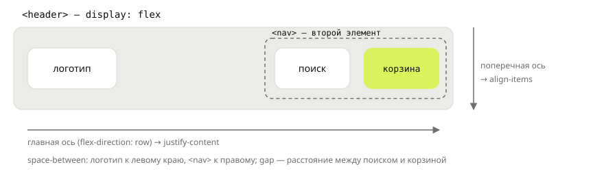

## Теория
Блоки по умолчанию встают друг под другом. Чтобы поставить их в ряд и выровнять, есть **Flexbox**: родителю пишут `display: flex`, и его прямые дети становятся флекс-элементами. Внуки не затрагиваются — у них своя раскладка.

У флекс-контейнера две оси. **Главная** задаётся `flex-direction`: `row` (по умолчанию) — слева направо, `column` — сверху вниз. **Поперечная** — перпендикулярна ей. Свойства контейнера:
- `justify-content` — расстановка по главной оси: `flex-start` (в начало), `center`, `flex-end`, `space-between` (крайние к краям, остальное место — поровну между элементами);
- `align-items` — выравнивание по поперечной оси: `stretch` (по умолчанию — растянуть), `center`, `flex-start`, `flex-end`;
- `gap` — расстояние между элементами, без отступов по краям;
- `flex-wrap: wrap` — переносить элементы на новую строку, если не помещаются. Без него элементы сжимаются в одну строку.

Свойства элемента: `flex: 1` — занять всё свободное место (несколько таких элементов делят его поровну), `flex-shrink: 0` — не сжиматься, `margin-left: auto` — отодвинуть элемент и всё после него в конец ряда.

## Наглядно
**Рисунок 1.** Шапка магазина как флекс-контейнер.



**Таблица 1.** Частые задачи и решение на Flexbox.

| Задача | Контейнеру | Элементу |
|---|---|---|
| логотип слева, корзина справа | `justify-content: space-between` | — |
| всё по вертикали по центру строки | `align-items: center` | — |
| поле поиска занимает всё свободное место | — | `flex: 1` |
| карточки в ряд с переносом | `flex-wrap: wrap; gap: 16px` | ширина карточки |
| элементы друг под другом с равными отступами | `flex-direction: column; gap: 8px` | — |
| одну кнопку прижать вправо | — | `margin-left: auto` |

## На практике
Задача: шапка магазина — логотип слева, справа поиск и корзина, всё по центру по высоте.

### Шаг 1. Разметка
Два прямых ребёнка у шапки: логотип и навигация:
```html
<header class="site-header">
  <a class="logo" href="/">Чайник.ру</a>
  <nav class="header-nav">
    <a href="/search/">Поиск</a>
    <a href="/cart/">Корзина (2)</a>
  </nav>
</header>
```
Flexbox раскладывает только прямых детей — поэтому поиск и корзина собраны в один `<nav>`.

### Шаг 2. Ставим в ряд и разводим по краям
Шапке — `display: flex` и расстановка по главной оси:
```css
.site-header {
  display: flex;
  justify-content: space-between;
  align-items: center;
  padding: 12px 24px;
}
```
`space-between` прижал логотип влево, `<nav>` вправо. `align-items: center` выровнял их по середине высоты, даже если логотип крупнее ссылок.

### Шаг 3. Раскладываем ссылки внутри nav
`<nav>` тоже становится флекс-контейнером — для своих детей:
```css
.header-nav {
  display: flex;
  gap: 16px;
}
```
`gap` ставит 16px только между ссылками. С `margin-right` у каждой ссылки остался бы лишний отступ после последней.

### Шаг 4. Ряд карточек с переносом
Тот же приём для каталога: карточки фиксированной ширины переносятся на новую строку:
```css
.catalog {
  display: flex;
  flex-wrap: wrap;
  gap: 16px;
}

.catalog .card {
  width: 240px;
}
```
Без `flex-wrap` браузер сжал бы все карточки в одну строку.

## Частые ошибки
- **`display: flex` у элемента, а не у родителя.** Flexbox включают контейнеру, расставляются его дети.
- **Ждут, что раскладка дойдёт до внуков.** Флекс-элементы — только прямые дети. Для вложенного ряда — свой `display: flex`.
- **Перепутаны оси.** При `flex-direction: column` главная ось вертикальная: `justify-content` двигает вверх-вниз, `align-items` — влево-вправо.
- **Отступы `margin` вместо `gap`.** Получаются лишние поля у крайних элементов, а при переносе ряды слипаются.
- **Нет `flex-wrap`.** Карточки сжимаются и сплющиваются, вместо того чтобы перейти на новую строку.

## Итог
**Контейнер**
- `display: flex` — дети в ряд; `flex-direction: column` — в колонку.
- `justify-content` — по главной оси, `align-items` — по поперечной.
- `gap` — расстояния между элементами; `flex-wrap: wrap` — перенос.

**Элементы**
- `flex: 1` — занять свободное место; `margin-left: auto` — прижать вправо; `flex-shrink: 0` — не сжиматься.
- Раскладка действует только на прямых детей.

## Вопросы на собеседовании
<details><summary>Чем `justify-content` отличается от `align-items`?</summary>

`justify-content` распределяет элементы по главной оси (при `row` — по горизонтали), `align-items` выравнивает их по поперечной (при `row` — по вертикали). При `flex-direction: column` оси меняются местами.
</details>

<details><summary>Что делает `flex: 1`?</summary>

Разрешает элементу расти и занимать свободное место контейнера. Если `flex: 1` у нескольких элементов, место делится между ними поровну; у элемента с `flex: 2` доля будет вдвое больше.
</details>

<details><summary>Когда Flexbox, а когда Grid?</summary>

Flexbox раскладывает по одной оси: шапка, панель кнопок, ряд с переносом. Grid задаёт сетку сразу по строкам и колонкам — макет страницы, таблица карточек с выровненными колонками. На практике их сочетают: сетка страницы на Grid, элементы внутри — на Flexbox.
</details>
