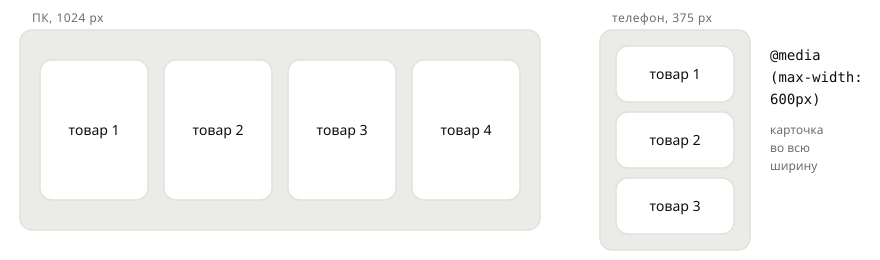

## Теория
Половина покупателей открывает магазин с телефона. Адаптивная страница одна для всех экранов, но перестраивается под ширину: на ПК — четыре карточки в ряд, на телефоне — одна.

Первое, что нужно, — тег **viewport** в `<head>`: `<meta name="viewport" content="width=device-width, initial-scale=1">`. Без него телефон делает вид, что экран шириной 980px, и показывает уменьшенную копию страницы для ПК. С ним ширина страницы равна ширине экрана, и стили для узких экранов начинают работать.

Стили для отдельных ширин пишут в **медиазапросах**: `@media (max-width: 600px) { … }` — правила внутри действуют, только пока ширина окна не больше 600px. Медиазапрос не создаёт новые правила с особой силой. Специфичность у них обычная, поэтому медиазапросы ставят **ниже** основных стилей — тогда при равной специфичности они побеждают. Точки перелома выбирают по содержимому: там, где вёрстка начинает ломаться, а не по моделям телефонов.

Для сетки карточек удобен **Grid**: `display: grid; grid-template-columns: repeat(4, 1fr);` — четыре равные колонки. `1fr` — одна доля свободного места. В медиазапросе меняется одна строка — число колонок.

Ещё два правила адаптивности: картинкам — `max-width: 100%`, чтобы не вылезали за экран, а фиксированную ширину в `px` у крупных блоков заменить на `%` или `max-width`.

## Наглядно
**Рисунок 1.** Один каталог на двух экранах.



**Таблица 1.** Что меняется в каталоге по ширине экрана.

| Ширина окна | Колонок | Правило |
|---|---|---|
| больше 900px | 4 | основное: `repeat(4, 1fr)` |
| 601–900px | 2 | `@media (max-width: 900px)` |
| до 600px | 1 | `@media (max-width: 600px)` |

## На практике
Задача: каталог из карточек — 4 в ряд на ПК, 2 на планшете, 1 на телефоне.

### Шаг 1. Тег viewport
В `<head>` каждой страницы магазина:
```html
<meta name="viewport" content="width=device-width, initial-scale=1">
```
В Django его пишут один раз — в базовом шаблоне, от которого наследуются все страницы.

### Шаг 2. Сетка для ПК
Основное правило — четыре равные колонки с зазором:
```css
.catalog {
  display: grid;
  grid-template-columns: repeat(4, 1fr);
  gap: 16px;
}

.card img {
  max-width: 100%;
}
```
У карточек нет ширины в `px`: колонку задаёт сетка, карточка её заполняет.

### Шаг 3. Медиазапросы ниже основного правила
Сначала планшет, потом телефон — более узкое условие последним:
```css
@media (max-width: 900px) {
  .catalog {
    grid-template-columns: repeat(2, 1fr);
  }
}

@media (max-width: 600px) {
  .catalog {
    grid-template-columns: 1fr;
  }
}
```
На ширине 375px подходят оба медиазапроса; побеждает последний, потому что специфичность одинаковая.

### Шаг 4. Проверяем в DevTools
Кнопка «Toggle device toolbar» (Ctrl+Shift+M) показывает страницу на ширине телефона. Ширину можно тянуть мышкой и смотреть, где ломается вёрстка. В тренажёре для этого переключатель «ПК / Телефон 375».

## Частые ошибки
- **Нет тега viewport.** Телефон показывает мелкую копию страницы для ПК, и медиазапросы на `max-width: 600px` не срабатывают.
- **Медиазапрос выше основного правила.** Специфичность равная — основное правило ниже и перебивает медиазапрос.
- **Порядок медиазапросов.** `max-width: 600px` раньше `max-width: 900px` — на телефоне победит планшетный, потому что он ниже.
- **Ширина в `px` у крупных блоков.** `width: 1000px` вылезает за экран телефона, появляется горизонтальная прокрутка.
- **Картинки без `max-width: 100%`.** Фото шириной 1200px распирает карточку на телефоне.

## Итог
**Основа**
- `<meta name="viewport" content="width=device-width, initial-scale=1">` — без него адаптивности нет.
- Ширины — в `%`, `fr` или `max-width`; картинкам — `max-width: 100%`.

**Медиазапросы**
- `@media (max-width: 600px) { … }` — правила для узких окон.
- Специфичность обычная: медиазапросы — ниже основных стилей, более узкие — последними.
- Точки перелома — там, где ломается вёрстка.

**Grid для каталога**
- `display: grid; grid-template-columns: repeat(4, 1fr); gap: 16px`.
- В медиазапросе меняется только число колонок.

## Вопросы на собеседовании
<details><summary>Зачем нужен meta viewport?</summary>

Без него мобильный браузер рисует страницу на виртуальной ширине около 980px и уменьшает её до экрана. Стили для узких экранов не срабатывают, текст мелкий. `width=device-width` приравнивает ширину страницы к ширине экрана.
</details>

<details><summary>Что такое mobile first?</summary>

Подход, при котором основные стили пишут для телефона, а для широких экранов добавляют медиазапросы с `min-width`. Телефон получает самый простой CSS, а сложная раскладка включается, только когда есть место.
</details>

<details><summary>Что значит `1fr` в Grid?</summary>

Одна доля свободного места контейнера. `repeat(4, 1fr)` — четыре равные колонки, `2fr 1fr` — первая колонка вдвое шире второй. Зазоры `gap` вычитаются до деления.
</details>
