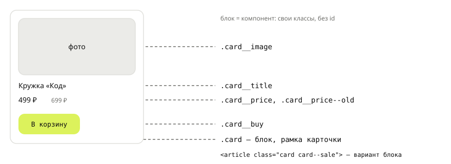

## Теория
Страница магазина состоит из повторяющихся кусков: карточка товара, кнопка, шапка, форма поиска. Такой кусок называют **компонентом**: у него своя разметка и свои стили, и он выглядит одинаково, где бы ни стоял — в каталоге, в корзине, в блоке «С этим покупают».

Чтобы компонент не зависел от места, стили привязывают к его **собственным классам**, а не к тегам и не к родителям. Правило `.catalog article h2` ломается, как только карточку поставят вне каталога или заменят `h2` на `h3`. Правило `.card__title` работает везде.

Для имён удобна схема **БЭМ** (блок, элемент, модификатор), здесь — на уровне идеи:
- **блок** — сам компонент: `card`;
- **элемент** — часть блока, через два подчёркивания: `card__title`, `card__price`, `card__buy`. Отдельно от блока элемент не используют;
- **модификатор** — вариант блока или элемента, через два дефиса: `card--sale` (карточка со скидкой), `card__price--old` (старая цена). Модификатор ставят **рядом** с основным классом: `class="card card--sale"`.

Селекторы получаются короткими, в один класс: специфичность у всех одинаковая (0-1-0), и стили не воюют друг с другом. По имени класса сразу видно, к какому компоненту он относится.

Компонент — это и будущий кусок шаблона Django: разметку карточки вынесут в `_product_card.html` и подключат через `` везде, где нужна карточка.

## Наглядно
**Рисунок 1.** Карточка товара: блок, элементы и модификатор.



**Таблица 1.** Селекторы, привязанные к месту, и селекторы компонента.

| Привязан к месту | Компонент | Что не так с первым |
|---|---|---|
| `.catalog article h2` | `.card__title` | ломается вне каталога и при смене тега |
| `.card p:nth-child(3)` | `.card__price` | ломается, если добавить абзац |
| `#sale-card` | `.card--sale` | id один на странице, высокая специфичность |
| `.card .price.old` | `.card__price--old` | непонятно, чей это `old` |

## На практике
Задача: сверстать карточку товара, которую можно поставить в любое место сайта, и вариант со скидкой.

### Шаг 1. Разметка
Карточка — `article`: самостоятельный кусок содержимого. Каждой части — класс-элемент:
```html
<article class="card">
  
  <h3 class="card__title">
    <a href="/products/mug-code/">Кружка «Код»</a>
  </h3>
  <p class="card__price">499 ₽</p>
  <a class="card__buy" href="/cart/add/7/">В корзину</a>
</article>
```
Название — ссылка на страницу товара; `alt` у фото обязателен.

### Шаг 2. Стили блока и элементов
Каждый селектор — один класс:
```css
.card {
  display: flex;
  flex-direction: column;
  gap: 8px;
  padding: 16px;
  border: 1px solid #e0e0dc;
  border-radius: 12px;
}

.card__image {
  max-width: 100%;
  border-radius: 8px;
}

.card__title {
  font-size: 1rem;
  margin: 0;
}

.card__price {
  font-weight: 700;
  margin: 0;
}
```
Колонка с `gap` даёт равные отступы между частями — без `margin` у каждой.

### Шаг 3. Вариант со скидкой
Модификатор блока и модификатор элемента:
```html
<article class="card card--sale">
  <h3 class="card__title">Чайник Steel</h3>
  <p class="card__price">1 990 ₽</p>
  <p class="card__price card__price--old">2 490 ₽</p>
</article>
```
В стилях — только отличия:
```css
.card--sale {
  border-color: #d93025;
}

.card__price--old {
  font-weight: 400;
  color: #6e6e6a;
  text-decoration: line-through;
}
```
`.card__price--old` стоит ниже `.card__price`, специфичность равная — поэтому жирность и цвет перебиваются.

## Частые ошибки
- **Стили через родителя и теги.** `.catalog .card h3` перестаёт работать в корзине. У каждой части — свой класс.
- **Модификатор без основного класса.** `class="card--sale"` без `card` теряет все базовые стили карточки.
- **Имена по виду.** `card__red-border` врёт, когда дизайнер сделает рамку оранжевой. Имя — по смыслу: `card--sale`.
- **Элемент элемента.** `card__price__old` — лишняя вложенность. Элементы всегда принадлежат блоку: `card__price--old` или `card__old-price`.
- **Внешние отступы у компонента.** `margin` у `.card` мешает поставить карточку в другое место. Расстояния между карточками задаёт контейнер (`gap` у каталога).

## Итог
**Компонент**
- Повторяющийся кусок страницы со своей разметкой и стилями.
- Стили — на собственных классах, не на тегах и не на родителях.
- В Django — отдельный кусок шаблона, подключается ``.

**Имена по БЭМ**
- Блок `card`, элемент `card__title`, модификатор `card--sale` / `card__price--old`.
- Модификатор — рядом с основным классом.
- Селекторы в один класс — одинаковая специфичность, предсказуемый каскад.

**Расстояния**
- Внутри компонента — `padding` и `gap`; между компонентами — у контейнера.

## Вопросы на собеседовании
<details><summary>Что такое БЭМ и зачем он нужен?</summary>

Соглашение об именах классов: блок (`card`), элемент блока (`card__title`), модификатор (`card--sale`). Каждый стиль привязан к одному классу, поэтому специфичность одинаковая, стили не перебивают друг друга неожиданно, а по имени видно, к какому компоненту относится класс.
</details>

<details><summary>Почему не стоит писать селекторы вида `.catalog article h2`?</summary>

Они зависят от места и структуры: карточка вне каталога или с другим тегом заголовка теряет стили. К тому же такая специфичность выше одного класса, и перебить её потом сложнее. Класс самого элемента от окружения не зависит.
</details>

<details><summary>Чем модификатор отличается от отдельного блока?</summary>

Модификатор — вариант того же компонента: карточка со скидкой остаётся карточкой и наследует все её стили, меняя только отличия. Отдельный блок нужен, когда у компонента другой смысл и разметка, а не только оформление.
</details>
