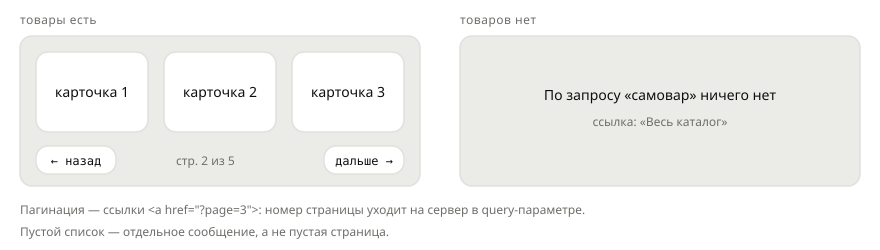

## Теория
Каталог — это **список одинаковых карточек**. По смыслу это список, поэтому разметка — `ul` с `li`: экранные чтения объявят «список, 12 элементов», а покупатель с клавиатурой быстро пройдёт по нему. Внутри каждого `li` — тот же компонент карточки из прошлой темы. Раскладку задаёт контейнер: Grid или Flexbox с `gap` — сами карточки о соседях ничего не знают.

В Django такой список получается циклом в шаблоне: `` выводит одну и ту же разметку карточки для каждого товара. Поэтому вёрстку каталога делают так, чтобы любая карточка выглядела одинаково при любом названии и цене — длинное название не должно ломать ряд.

У каталога есть ещё два состояния, о которых часто забывают:
- **Пустое состояние.** Поиск ничего не нашёл, категория пустая. Пустая страница выглядит как ошибка сайта. Нужно сообщение («По запросу «самовар» ничего нет») и выход — ссылка на весь каталог.
- **Пагинация.** Тысячу товаров не выводят одной страницей: долго грузится и тяжело листать. Каталог делят на страницы, а переходы — это **обычные ссылки** с номером страницы в query-параметре: `?page=3`. Ссылку можно открыть в новой вкладке, сохранить и отправить; сервер по номеру выбирает нужные товары. Текущую страницу отмечают `aria-current="page"`, а ссылку «назад» на первой странице не показывают.

## Наглядно
**Рисунок 1.** Каталог с товарами и пагинацией и каталог без товаров.



**Таблица 1.** Части страницы каталога.

| Часть | Разметка | Зачем |
|---|---|---|
| список товаров | `ul.catalog > li > article.card` | смысл списка, одинаковые карточки |
| пустое состояние | `p.catalog-empty` + ссылка | покупатель понимает, что ничего не сломалось |
| пагинация | `nav` с подписью и ссылками `?page=N` | страницу можно открыть, сохранить, отправить |
| текущая страница | `aria-current="page"` | видно и экранным чтениям, и в стилях |

## На практике
Задача: страница каталога — список карточек, сообщение для пустого результата и переход по страницам.

### Шаг 1. Список карточек
Список без маркеров, раскладка — сеткой:
```html
<ul class="catalog">
  <li><article class="card">…</article></li>
  <li><article class="card">…</article></li>
  <li><article class="card">…</article></li>
</ul>
```
Стили контейнера:
```css
.catalog {
  display: grid;
  grid-template-columns: repeat(3, 1fr);
  gap: 16px;
  list-style: none;
  padding: 0;
  margin: 0;
}
```
`list-style: none` убирает маркеры, `padding: 0` — отступ, который браузер даёт спискам по умолчанию.

### Шаг 2. Длинное название не ломает ряд
Карточки в одном ряду должны быть одной высоты, а кнопки — внизу. Карточка — колонка, кнопку прижимает `margin-top: auto`:
```css
.card {
  display: flex;
  flex-direction: column;
  height: 100%;
}

.card__buy {
  margin-top: auto;
}
```
Ячейки сетки в одном ряду и так одной высоты, `height: 100%` растягивает карточку на всю ячейку.

### Шаг 3. Пустое состояние
Вместо списка — сообщение и выход:
```html
<p class="catalog-empty">
  По запросу «самовар» ничего нет.
  <a href="/catalog/">Весь каталог</a>
</p>
```
В Django оба варианта живут в одном шаблоне: у цикла `` есть ветка `` — она выводится, когда список пустой.

### Шаг 4. Пагинация ссылками
Навигация по страницам — `nav` с подписью для экранных чтений:
```html
<nav class="pagination" aria-label="Страницы каталога">
  <a href="?page=1">← Назад</a>
  <a href="?page=1">1</a>
  <a href="?page=2" aria-current="page">2</a>
  <a href="?page=3">3</a>
  <a href="?page=3">Дальше →</a>
</nav>
```
Текущую страницу выделяют стилем по атрибуту — отдельный класс не нужен:
```css
.pagination a[aria-current="page"] {
  font-weight: 700;
  text-decoration: none;
}
```
Если в адресе уже есть поиск (`?q=чайник`), ссылки пагинации должны его сохранять: `?q=чайник&page=2`. Иначе вторая страница покажет весь каталог.

## Частые ошибки
- **Каталог из `div`.** Список карточек — это список: `ul`/`li` сообщают его смысл экранным чтениям.
- **Пагинация кнопками со скриптом.** Страницу нельзя открыть в новой вкладке, отправить ссылкой, её не найдёт поисковик. Нужны ссылки `?page=N`.
- **Потерянный фильтр.** Ссылка `?page=2` на странице поиска сбрасывает `q`. Все параметры запроса переносятся в ссылки страниц.
- **Пустая страница вместо сообщения.** Покупатель думает, что сайт сломался, и уходит.
- **Отступы у карточек.** `margin` у каждой карточки даёт лишние поля по краям каталога. Расстояние — `gap` контейнера.

## Итог
**Список**
- `ul.catalog > li > .card`, маркеры и отступы списка убраны в CSS.
- Раскладка — сетка или Flexbox с `gap` у контейнера.
- Карточки одной высоты, кнопка внизу — `flex-direction: column` + `margin-top: auto`.

**Пустое состояние**
- Сообщение и ссылка «куда дальше»; в Django — ``.

**Пагинация**
- `nav` с `aria-label`, ссылки `?page=N`, текущая — `aria-current="page"`.
- Параметры поиска и фильтров сохраняются в ссылках страниц.

## Вопросы на собеседовании
<details><summary>Почему пагинацию делают ссылками, а не кнопками?</summary>

Страница с номером — это отдельный адрес: его можно открыть в новой вкладке, добавить в закладки, отправить, проиндексировать. Переход — обычный GET-запрос, сервер берёт номер из query-параметра. Кнопки со скриптом ничего из этого не дают.
</details>

<details><summary>Почему каталог размечают списком?</summary>

Это и есть список однотипных элементов. `ul`/`li` передают смысл экранным чтениям («список, 12 элементов») и поисковикам, а вид списка полностью меняется в CSS.
</details>

<details><summary>Что такое пустое состояние и зачем его продумывать?</summary>

То, что видит пользователь, когда данных нет: пустой поиск, пустая корзина, нет заказов. Без него страница выглядит сломанной. Хорошее пустое состояние объясняет, что произошло, и предлагает следующий шаг.
</details>
