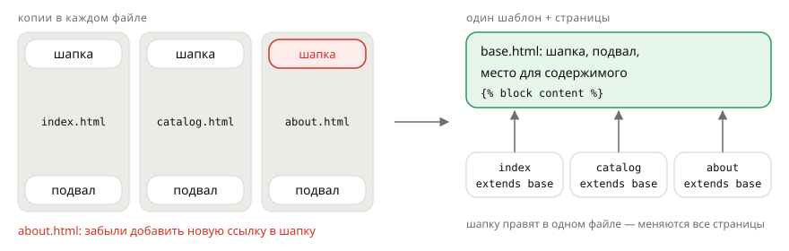

## Теория
У магазина десятки страниц: главная, каталог, товар, корзина, «О нас». На каждой — одинаковые `<head>` (кодировка, `viewport`, подключение стилей), шапка с логотипом и корзиной, подвал с контактами. Меняется только середина.

Если сайт собран из статических HTML-файлов, общие части приходится **копировать** в каждый файл. Пока страниц три, это терпимо. Потом в шапку добавляют ссылку «Доставка» — и правят все файлы. Где-то забыли, где-то опечатались: шапки начинают **расходиться**, на одной странице нет `viewport`, на другой подключён старый файл стилей. Ошибку никто не замечает, пока покупатель не попадёт именно на эту страницу.

Решение — **шаблон**: общий каркас страницы хранится в одном файле, а страницы описывают только свою середину. В Django это наследование шаблонов:
- `base.html` содержит весь каркас — `<head>`, шапку, подвал — и «дырку» ``;
- страница начинается с `` и заполняет только ``;
- повторяющиеся куски внутри страниц (карточка товара) выносят в отдельные файлы и подключают ``.

Шапку правят в одном файле — меняются все страницы. Шаблоны собирает сервер: браузер получает обычный готовый HTML, такой же, как при ручной вёрстке.

Для «моя страница отмечена в меню» в шаблоне используют переменную от view: ссылка текущего раздела получает `aria-current="page"` или класс-модификатор.

## Наглядно
**Рисунок 1.** Копии в каждом файле и один базовый шаблон.



**Таблица 1.** Что общее, а что своё у страницы.

| Часть | Где живёт в Django | Меняется от страницы к странице |
|---|---|---|
| `<head>`: кодировка, `viewport`, стили | `base.html` | только `<title>` — через свой `` |
| шапка, меню, подвал | `base.html` | отметка текущего раздела |
| середина страницы | шаблон страницы, `` | целиком |
| карточка товара | `_product_card.html`, `` | данные товара |

## На практике
Задача: у магазина три страницы — главная, каталог, «О нас». Посмотрим, во что превращается копирование, и как будет выглядеть то же самое на шаблонах.

### Шаг 1. Копии расходятся
Через месяц после запуска шапка «О нас» отличается от остальных: новую ссылку «Доставка» туда не добавили:
```html
<!-- index.html и catalog.html -->
<nav>
  <a href="/catalog/">Каталог</a>
  <a href="/delivery/">Доставка</a>
  <a href="/cart/">Корзина</a>
</nav>

<!-- about.html -->
<nav>
  <a href="/catalog/">Каталог</a>
  <a href="/cart/">Корзина</a>
</nav>
```
Сравнивать файлы вручную — ненадёжно. Нужна одна копия.

### Шаг 2. Базовый шаблон
Весь каркас — в одном файле, середина — блоком:
```html
<!doctype html>
<html lang="ru">
<head>
  <meta charset="utf-8">
  <meta name="viewport" content="width=device-width, initial-scale=1">
  <title>Чайник.ру</title>
  <link rel="stylesheet" href="/static/css/style.css">
</head>
<body>
  <header class="site-header">
    <a class="logo" href="/">Чайник.ру</a>
    <nav>
      <a href="/catalog/">Каталог</a>
      <a href="/delivery/">Доставка</a>
      <a href="/cart/">Корзина</a>
    </nav>
  </header>
  <main></main>
  <footer>© Чайник.ру</footer>
</body>
</html>
```
Это `base.html`. Теги `` браузер никогда не увидит: сервер заменит их до отправки.

### Шаг 3. Страница описывает только своё
Страница «О нас» становится короткой:
```html


О нас — Чайник.ру


  <h1>О нас</h1>
  <p>Продаём чайники с 2015 года.</p>

```
Шапка, подвал и `viewport` приходят из `base.html`. Ссылку «Доставка» добавили один раз — она есть везде.

### Шаг 4. Что получает браузер
Сервер склеивает базовый шаблон и страницу и отправляет обычный HTML — тот же, что вы верстали руками в этом курсе. Поэтому всё из прошлых разделов — семантика, формы, классы, адаптивность — работает в шаблонах без изменений. Синтаксис шаблонов подробно разбирается в курсе Django.

## Частые ошибки
- **Копирование шапки в каждый файл.** Копии расходятся; рано или поздно одна страница окажется без `viewport` или со старой ссылкой.
- **`<head>` на каждой странице свой.** Забыли подключить стили или `viewport` на одной странице — она выглядит сломанной на телефоне. `<head>` — в базовом шаблоне.
- **Одинаковый `<title>` у всех страниц.** Во вкладках и в поисковике все страницы называются «Чайник.ру». Заголовок — отдельным блоком, своим у каждой страницы.
- **Ждут, что браузер «поймёт» шаблон.** Открытый напрямую `base.html` покажет `` текстом. Шаблоны собирает сервер.

## Итог
**Проблема копий**
- Общие `<head>`, шапка и подвал на каждой странице; при копировании они расходятся.

**Шаблон**
- `base.html` — каркас с ``.
- Страница: `` и свои блоки (`content`, `title`).
- Повторяющиеся куски — ``.

**Результат**
- Общие части правятся в одном месте.
- Браузер получает обычный готовый HTML: вся вёрстка курса работает в шаблонах.

## Вопросы на собеседовании
<details><summary>Зачем нужно наследование шаблонов?</summary>

Чтобы общий каркас страниц — `<head>`, шапка, подвал — существовал в одном экземпляре. Страницы переопределяют только свои блоки. Изменение каркаса сразу действует на весь сайт, и страницы не расходятся.
</details>

<details><summary>Чем `extends` отличается от `include`?</summary>

`extends` — страница берёт базовый шаблон целиком и заполняет его блоки: «моя страница — это каркас, но с такой серединой». `include` — вставка готового куска (карточки, формы) в любое место шаблона.
</details>

<details><summary>Где выполняются шаблоны Django — в браузере или на сервере?</summary>

На сервере. View передаёт данные в шаблон, Django подставляет их, выполняет циклы и условия и отправляет готовый HTML. Браузер о шаблонах ничего не знает.
</details>
