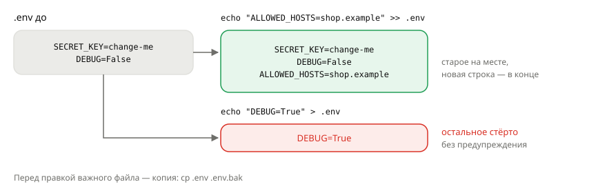

## Теория
На сервере нет VS Code: файлы правят прямо в терминале. Два способа.

**Редактор `nano`** — простой, подсказки внизу экрана (`^` — это `Ctrl`):
- `nano .env` — открыть (нет файла — создастся при сохранении);
- стрелки — двигаться, текст набирается сразу;
- `Ctrl+O`, затем `Enter` — сохранить (Write **O**ut);
- `Ctrl+X` — выйти (если не сохранили — спросит, `Y`/`N`);
- `Ctrl+W` — поиск, `Ctrl+K` — вырезать строку.

**Редактор `vim`** открывается по умолчанию в некоторых командах (`git commit` без `-m`, `crontab -e` на части систем) — и пугает новичков. Он **модальный**: в обычном режиме клавиши — команды, набор текста — после `i`. Выход: `Esc`, затем `:q!` и `Enter` — выйти без сохранения, `:wq` — сохранить и выйти. Этого достаточно, чтобы не застрять.

**Запись из командной строки** — быстрее редактора для одной строки и годится для скриптов:
- `echo "текст" > файл` — **заменить** содержимое файла (или создать файл);
- `echo "текст" >> файл` — **дописать** строку в конец.

`>` и `>>` отличаются одним символом, а результат — полностью разный: `>` вместо `>>` молча стирает весь файл. Перед правкой важного файла делают копию: `cp .env .env.bak`.

Две ловушки записи:
- **кавычки**: в двойных кавычках `$имя` заменяется значением переменной (`"$HOME"` → `/home/shop`), а неизвестная переменная — пустотой. Пароль `x7$kq9` в двойных кавычках превратится в `x7`. Секреты пишут в одинарных кавычках — там всё буквально;
- **`sudo` и `>`**: в `sudo echo "…" >> /etc/nginx/nginx.conf` с правами `root` выполняется только `echo`, а запись в файл (`>>`) делает ваша оболочка — без прав. Ответ: `Permission denied`. Решение — `echo "…" | sudo tee -a файл` (`tee -a` дописывает в файл и повторяет строку на экране) или `sudo nano файл`.

## Наглядно
**Рисунок 1.** `>` заменяет файл, `>>` дописывает в конец.



**Таблица 1.** Как изменить файл.

| Задача | Команда |
|---|---|
| поправить несколько строк | `nano .env` → `Ctrl+O`, `Enter`, `Ctrl+X` |
| дописать строку | `echo 'KEY=value' >> .env` |
| заменить файл целиком | `echo 'KEY=value' > .env` |
| дописать в чужой файл | `echo '…' \| sudo tee -a /etc/…` |
| открыть системный файл | `sudo nano /etc/nginx/nginx.conf` |
| выйти из `vim` без сохранения | `Esc`, `:q!`, `Enter` |
| копия перед правкой | `cp .env .env.bak` |

## На практике
Задача: добавить в `.env` магазина домен сайта и пароль базы, а в настройки Nginx — размер загружаемых файлов. Команды выполнены в терминале сервера, пользователь `shop`.

### Шаг 1. Дописать строку
Что сейчас в `.env` и добавление домена:
```bash
cd /srv/shop
cat .env
echo "ALLOWED_HOSTS=shop.example" >> .env
cat .env
```
Результат:
```
SECRET_KEY=change-me
DEBUG=False
SECRET_KEY=change-me
DEBUG=False
ALLOWED_HOSTS=shop.example
```
Новая строка — в конце, старые на месте.

### Шаг 2. Пароль с `$`
Пароль базы `x7$kq9` двумя способами:
```bash
echo "DB_PASSWORD=x7$kq9" >> .env
echo 'DB_PASSWORD=x7$kq9' >> .env
tail -n 2 .env
```
Результат:
```
DB_PASSWORD=x7
DB_PASSWORD=x7$kq9
```
В двойных кавычках оболочка заменила `$kq9` значением несуществующей переменной — пустотой. Правильная — вторая строка; первую надо удалить в `nano`.

### Шаг 3. Одна лишняя `>`
Ошибка в одном символе — вместо `>>` написали `>`:
```bash
echo "DEBUG=True" > .env
cat .env
```
Результат:
```
DEBUG=True
```
Ключ, домен и пароль пропали. Если копии нет — восстанавливать придётся вручную; поэтому перед правкой — `cp .env .env.bak`.

### Шаг 4. Системный файл
Добавить строку в настройки Nginx:
```bash
echo "client_max_body_size 10m;" >> /etc/nginx/nginx.conf
sudo echo "client_max_body_size 10m;" >> /etc/nginx/nginx.conf
```
Результат:
```
bash: /etc/nginx/nginx.conf: Permission denied
bash: /etc/nginx/nginx.conf: Permission denied
```
Обе ошибки — от `bash`: запись `>>` делает оболочка пользователя `shop`, `sudo` достался только `echo`. Через `tee`:
```bash
echo "client_max_body_size 10m;" | sudo tee -a /etc/nginx/nginx.conf
```
Результат:
```
client_max_body_size 10m;
```
`tee -a` дописал строку в файл с правами `root` и повторил её на экране. На настоящем сервере эту директиву ставят внутрь блока `http { … }` — для такой правки удобнее `sudo nano` (курс «Nginx и деплой»).

## Частые ошибки
- **`>` вместо `>>`.** Файл стёрт без предупреждения. Копия `.bak` перед правкой, `>` — только когда замена задумана.
- **Двойные кавычки с `$`.** Пароль обрезается молча. Секреты — в одинарных кавычках или через `nano`.
- **`sudo echo … > файл`.** `Permission denied`: запись делает оболочка без прав. `| sudo tee -a файл` или `sudo nano`.
- **Застрять в `vim`.** `Esc`, `:q!`, `Enter`. Чтобы Git открывал `nano`: `git config --global core.editor nano`.
- **Закрыть `nano` без сохранения.** На вопрос «Save modified buffer?» ответили `N` — изменений нет. `Ctrl+O` до выхода.
- **Пробелы вокруг `=` в `.env`.** `DEBUG = False` часть инструментов прочитает иначе (bash — как команду `DEBUG`). Формат — `KEY=value` без пробелов.

## Итог
**Редакторы**
- `nano`: `Ctrl+O` `Enter` — сохранить, `Ctrl+X` — выйти. `vim`: `Esc` `:q!` — выйти, `:wq` — сохранить.

**Из командной строки**
- `>` — заменить, `>>` — дописать; секреты — в одинарных кавычках.
- В файл root — `| sudo tee -a`, а не `sudo echo … >>`.

## Вопросы на собеседовании
<details><summary>Чем `>` отличается от `>>`?</summary>

Оба перенаправляют вывод команды в файл. `>` открывает файл с обрезанием до нуля (создаёт, если нет) — старое содержимое пропадает; `>>` открывает для дописывания в конец. Защититься от случайной перезаписи можно опцией оболочки `set -o noclobber`.
</details>

<details><summary>Почему `sudo echo "x" > /etc/file` не работает и как правильно?</summary>

Перенаправление выполняет текущая оболочка до запуска команды, с правами обычного пользователя; `sudo` повышает права только для `echo`. Правильно — `echo "x" | sudo tee /etc/file` (или `tee -a` для дописывания) либо `sudo sh -c 'echo x > /etc/file'`.
</details>

<details><summary>Чем одинарные кавычки отличаются от двойных в bash?</summary>

В одинарных всё буквально. В двойных оболочка подставляет переменные (`$HOME`), результаты команд (`$(date)`) и обрабатывает `\`; пробелы сохраняются. Значения со знаком `$` (пароли) пишут в одинарных кавычках.
</details>

## Глубже
Как один файл может быть сразу в двух папках — ссылки, следующая тема. Переменные окружения и `.env` — раздел «Процессы, сервисы, сеть».
