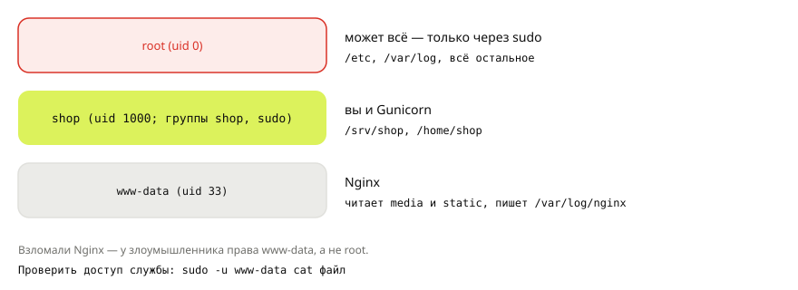

## Теория
Linux — многопользовательская система: у каждого файла есть владелец, у каждой запущенной программы — пользователь, от имени которого она работает. Права (следующая тема) решают, что этому пользователю можно.

На сервере магазина три вида пользователей:
- **`root`** (номер `uid=0`) — администратор: может всё, проверки прав на него не действуют. Под `root` не работают постоянно — одна опечатка в `rm` может стереть систему;
- **обычные пользователи** — люди и сайты: `shop` (`uid=1000`) — вы и приложение магазина (Gunicorn запускается от `shop`), домашняя папка — `/home/shop`;
- **системные пользователи** — у каждой службы свой: `www-data` — Nginx, `postgres` — PostgreSQL. Под ними нельзя войти (оболочка `/usr/sbin/nologin`), они нужны, чтобы служба видела только свои файлы. Взломали Nginx — злоумышленник получил права `www-data`, а не `root`.

**Группа** — набор пользователей с общими правами на файлы. У каждого пользователя есть основная группа (обычно с тем же именем) и дополнительные: кто в группе **`sudo`**, тому разрешено выполнять команды от имени `root`.

**`sudo команда`** — выполнить одну команду от `root`: система спросит **ваш** пароль (не пароль `root`) и запишет действие в журнал. **`sudo -u www-data команда`** — от имени другого пользователя: так проверяют, видит ли Nginx файл.

Кто есть кто:
- `whoami` — имя текущего пользователя;
- `id` — номер, основная группа, все группы; `id www-data` — про другого пользователя;
- `/etc/passwd` — список пользователей (имя, номер, домашняя папка, оболочка); пароли (хеши) — в `/etc/shadow`, читать его может только `root`.

## Наглядно
**Рисунок 1.** Кто работает на сервере магазина и к каким файлам ходит.



**Таблица 1.** Пользователи сервера магазина.

| Пользователь | uid | Кто это | С какими файлами работает |
|---|---|---|---|
| `root` | 0 | администратор | все; только через `sudo` |
| `shop` | 1000 | вы и Gunicorn | `/srv/shop`, `/home/shop` |
| `www-data` | 33 | Nginx | читает `media`, `static`; пишет `/var/log/nginx` |
| `postgres` | — | PostgreSQL | `/var/lib/postgresql` |

## На практике
Задача: разобраться, под кем вы работаете на сервере и что видит Nginx. Команды выполнены в терминале сервера.

### Шаг 1. Кто я
Имя и группы:
```bash
whoami
id
```
Результат:
```
shop
uid=1000(shop) gid=1000(shop) groups=1000(shop),27(sudo)
```
Группа `sudo` — значит, `shop` может выполнять команды от `root`.

### Шаг 2. Другие пользователи
Nginx и администратор:
```bash
id www-data
id root
```
Результат:
```
uid=33(www-data) gid=33(www-data) groups=33(www-data)
uid=0(root) gid=0(root) groups=0(root)
```
Те же сведения лежат в `/etc/passwd`, по строке на пользователя (настоящий Ubuntu):
```bash
grep -E "^(root|www-data):" /etc/passwd
```
Результат:
```
root:x:0:0:root:/root:/bin/bash
www-data:x:33:33:www-data:/var/www:/usr/sbin/nologin
```
Поля через `:` — имя, пароль (`x` — он в `/etc/shadow`), uid, gid, описание, домашняя папка, оболочка. У `www-data` оболочка `nologin`: войти под ним нельзя.

### Шаг 3. sudo — на одну команду
Создать файл в настройках Nginx:
```bash
echo "x" > /etc/nginx/x.conf
sudo touch /etc/nginx/x.conf
ls -l /etc/nginx/x.conf
sudo whoami
```
Результат:
```
bash: /etc/nginx/x.conf: Permission denied
-rw-r--r-- 1 root root 0 Nov 21 15:45 /etc/nginx/x.conf
root
```
Файл, созданный через `sudo`, принадлежит `root`. После команды вы снова `shop`: `sudo` не «входит» в `root`, а выполняет одну команду.

### Шаг 4. Глазами Nginx
Новое фото товара загрузили вручную под `root`, и сайт отвечает на него 403. Проверим от имени `www-data`:
```bash
cd /srv/shop
sudo -u www-data cat media/products/new-watch.jpg > /dev/null
ls -l media/products/new-watch.jpg
```
Результат:
```
cat: media/products/new-watch.jpg: Permission denied
-rw------- 1 root root 716800 Nov 21 15:45 media/products/new-watch.jpg
```
Файл принадлежит `root`, и читать его может только он — Nginx не может отдать фото. Как читать эти права и как их исправить — следующие две темы.

## Частые ошибки
- **Работать под `root`.** Любая ошибка — с правами на всё. Обычный пользователь и `sudo` на отдельные команды.
- **`sudo` ко всему подряд.** Файлы, созданные через `sudo`, принадлежат `root` — потом их не может изменить ни `shop`, ни Gunicorn. `sudo` — только там, где без него `Permission denied`.
- **Запускать сайт от `root`.** Взлом приложения — сразу полный доступ к серверу. Gunicorn — от отдельного пользователя (`shop`), Nginx — от `www-data`.
- **Проверять доступ от своего имени.** У `shop` файл открывается, а у Nginx — нет. Проверяют от имени службы: `sudo -u www-data …`.
- **Путать пароль `sudo`.** Спрашивается пароль **вашего** пользователя; у `root` на Ubuntu пароля по умолчанию нет вовсе.

## Итог
**Пользователи**
- `root` — всё; обычные (`shop`) — люди и приложения; системные (`www-data`, `postgres`) — службы, без входа.

**Группы**
- Общие права для нескольких пользователей; группа `sudo` — право на `sudo`.

**Команды**
- `whoami`, `id [пользователь]`, `sudo команда`, `sudo -u пользователь команда`; список — `/etc/passwd`.

## Вопросы на собеседовании
<details><summary>Зачем службам отдельные системные пользователи?</summary>

Принцип наименьших привилегий: служба получает доступ только к своим файлам. Если Nginx взломают, злоумышленник получит права `www-data` — сможет читать статику, но не базу данных, не код другого сайта и не системные файлы. По той же причине приложение не запускают от `root`.
</details>

<details><summary>Чем `sudo` отличается от входа под `root` (`su`)?</summary>

`sudo` выполняет одну команду с правами `root` после ввода пароля **своего** пользователя, каждое действие пишется в журнал, а права настраиваются в `/etc/sudoers` (можно разрешить только определённые команды). `su` открывает оболочку `root` по паролю `root` — все дальнейшие команды выполняются с полными правами, без следа, кто именно их ввёл.
</details>

<details><summary>Где хранятся пользователи и пароли в Linux?</summary>

`/etc/passwd` — пользователи: имя, uid, gid, домашняя папка, оболочка; читать может каждый. `/etc/shadow` — хеши паролей и сроки их действия, доступ только у `root`. Группы — `/etc/group`.
</details>

## Глубже
Как читать `-rw-------` и менять права — следующая тема. Как сменить владельца фото, чтобы Nginx его отдал, — тема «Владельцы».
