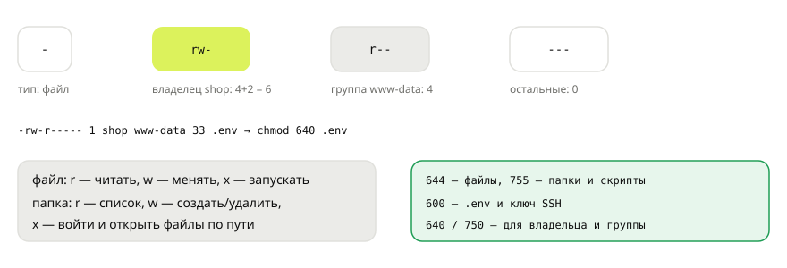

## Теория
У каждого файла и папки — три набора прав для трёх кругов:
- **u** (user) — владелец;
- **g** (group) — группа файла;
- **o** (others) — все остальные.

В каждом наборе три права.

**Таблица 1.** Права для файла и для папки.

| Право | Для файла | Для папки |
|---|---|---|
| **`r`** (read) | читать содержимое | видеть список имён |
| **`w`** (write) | изменять | создавать, удалять и переименовывать файлы внутри |
| **`x`** (execute) | запускать как программу | заходить внутрь и открывать файлы по пути |

Права видны в первой колонке `ls -l`:
```
-rw-r----- 1 shop www-data 33 Nov 21 15:46 .env
```
Первый символ — тип (`-` файл, `d` папка, `l` ссылка), дальше три тройки: владелец `rw-`, группа `r--`, остальные `---`. Потом — число ссылок, владелец `shop`, группа `www-data`.

Linux проверяет **одну** тройку: если вы владелец — тройку владельца, иначе если в группе файла — тройку группы, иначе — «остальных». `root` проверки не проходит вовсе.

**`chmod`** меняет права, двумя способами:
- **буквами**: кому (`u`, `g`, `o`, `a` — все), что сделать (`+` добавить, `-` убрать, `=` задать), какие права: `chmod u+x deploy.sh`, `chmod go-r .env`, `chmod a-w config.ini`;
- **числом** — три цифры, по одной на тройку, каждая — сумма `r=4`, `w=2`, `x=1`: `rw-` = 6, `r--` = 4, `rwx` = 7, `r-x` = 5. `chmod 640 .env` — `rw-r-----`.

Права, которые встречаются на сервере постоянно:
- `644` (`rw-r--r--`) — обычный файл: владелец меняет, остальные читают;
- `600` (`rw-------`) — секреты: `.env`, приватный ключ SSH (SSH откажется работать с ключом, у которого права шире);
- `755` (`rwxr-xr-x`) — папки и скрипты;
- `640` / `750` — файл и папка, которые нужны группе (например, `www-data`), но не всем.

Права `777` — «всем всё» — на сервере не ставят: любой пользователь и любая взломанная служба изменят файл.

Менять права может только владелец файла (и `root`).

## Наглядно
**Рисунок 1.** Как читать права в `ls -l` и переводить их в число.



**Таблица 2.** Частые права.

| Число | Буквы | Для чего |
|---|---|---|
| `644` | `rw-r--r--` | обычные файлы: код, шаблоны, фото |
| `600` | `rw-------` | `.env`, ключ SSH |
| `640` | `rw-r-----` | файл для владельца и группы |
| `755` | `rwxr-xr-x` | папки, скрипты |
| `750` | `rwxr-x---` | папка для владельца и группы |
| `700` | `rwx------` | личная папка (`~/.ssh`) |
| `777` | `rwxrwxrwx` | никогда на сервере |

## На практике
Задача: сделать скрипт деплоя запускаемым и закрыть `.env` от посторонних. Команды выполнены в терминале сервера из `/srv/shop`, пользователь `shop`.

### Шаг 1. Прочитать права
Файлы проекта и папка с фото:
```bash
cd /srv/shop
ls -l .env deploy.sh
ls -ld media
```
Результат:
```
-rw-r--r-- 1 shop shop 33 Nov 21 15:46 .env
-rw-r--r-- 1 shop shop 53 Nov 21 15:46 deploy.sh
drwxr-xr-x 4 shop shop 4096 Nov 21 15:46 media
```
`.env` с секретами читают все (`r--` у остальных), а у скрипта нет `x` ни у кого. `-d` у `ls` показывает саму папку, а не её содержимое.

### Шаг 2. Разрешить запуск
Запуск скрипта без права `x` и с ним:
```bash
./deploy.sh v2
chmod u+x deploy.sh
ls -l deploy.sh
./deploy.sh v2
```
Результат:
```
bash: ./deploy.sh: Permission denied
-rwxr--r-- 1 shop shop 53 Nov 21 15:46 deploy.sh
Деплой магазина: v2
```
`u+x` добавил право запуска только владельцу. Код выхода у «Permission denied» при запуске — 126: файл есть, но запускать нельзя.

### Шаг 3. Закрыть секреты
`.env` — только владельцу:
```bash
chmod 600 .env
ls -l .env
sudo -u www-data cat .env
```
Результат:
```
-rw------- 1 shop shop 33 Nov 21 15:46 .env
cat: .env: Permission denied
```
Gunicorn работает от `shop` и `.env` прочитает, а Nginx (`www-data`) и другие пользователи — нет.

### Шаг 4. Права папки
Папка с фото без права `x` для остальных и папка без `x` совсем:
```bash
chmod 700 media
sudo -u www-data ls media
chmod 644 media
ls media
ls media/products
chmod 755 media
```
Результат:
```
ls: cannot open directory 'media': Permission denied
products  tmp
ls: cannot access 'media/products': Permission denied
```
С `700` Nginx не может даже заглянуть в папку — фото не отдаются. С `644` у папки есть `r` — имена видны, — но нет `x`: войти внутрь и открыть что-то по пути нельзя даже владельцу. У папок `r` и `x` идут вместе: `755` или `750`.

## Частые ошибки
- **`chmod 777` «чтобы заработало».** Ошибка прав исчезает, но файл может изменить кто угодно. Найти, **кому** нужен доступ, и дать только ему.
- **`.env` с правами `644`.** Секреты читает любой пользователь сервера. `600` (или `640` с группой приложения).
- **Папка без `x`.** `chmod 644 -R media` убирает `x` у папок — Nginx не войдёт ни в одну. Папкам — `755`, файлам — `644`.
- **Ключ SSH с правами `644`.** SSH отказывается: `UNPROTECTED PRIVATE KEY FILE!`. Ключ — `600`, папка `~/.ssh` — `700`.
- **Права на файл в порядке, а на папку — нет.** Чтобы открыть `/srv/shop/media/x.jpg`, нужен `x` на каждой папке пути: `/srv`, `/srv/shop`, `/srv/shop/media`.
- **`chmod` чужого файла без `sudo`.** `Operation not permitted`: права меняет владелец; если владелец не вы — сначала разобраться, почему (тема «Владельцы»).

## Итог
**Чтение**
- `-rwxr-x---`: тип, тройки владельца, группы, остальных; проверяется одна тройка.

**Смысл**
- Файл: `r` читать, `w` менять, `x` запускать. Папка: `r` список, `w` создавать/удалять, `x` входить.

**chmod**
- Буквами: `u+x`, `go-r`, `a-w`. Числом: `r4 w2 x1` — `644`, `600`, `755`, `640`.

## Вопросы на собеседовании
<details><summary>Что значат права `755` и `644`?</summary>

Каждая цифра — сумма прав для владельца, группы и остальных: `r=4`, `w=2`, `x=1`. `755` = `rwxr-xr-x`: владелец всё, остальные читают и входят/запускают — типично для папок и скриптов. `644` = `rw-r--r--`: владелец читает и пишет, остальные только читают — обычные файлы.
</details>

<details><summary>Что означает право `x` для папки?</summary>

Право войти в папку и обращаться к файлам внутри по пути (в том числе узнать их свойства). Без `x` даже при `r` видны только имена, а открыть файл нельзя; без `r`, но с `x`, файл открывается, если знать его имя. Поэтому у папок `r` и `x` обычно ставят вместе.
</details>

<details><summary>Почему удалить файл может тот, у кого нет прав на сам файл?</summary>

Удаление — изменение папки (из неё убирается имя), поэтому нужно право `w` на папку, а не на файл. Чтобы в общей папке нельзя было удалять чужие файлы, ставят бит sticky (`t`, как у `/tmp`: `drwxrwxrwt`).
</details>

## Глубже
Почему `.env` для группы `www-data` и фото, загруженное под `root`, требуют смены владельца, а не прав, — следующая тема. Ключи SSH — раздел «Процессы, сервисы, сеть».
