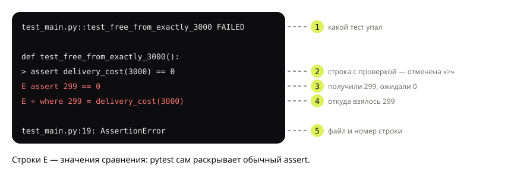

## Теория
Функцию стоимости доставки проверили руками: вызвали с парой сумм, посмотрели на ответ — работает. Через месяц кто-то поменял `>=` на `>`, и заказы ровно на 3000 ₽ стали платить за доставку. Руками это уже никто не перепроверял. **Тест** — это код, который вызывает ваш код и проверяет результат. Его запускают после каждого изменения, и он за секунду проверяет то, что руками проверяли бы полчаса. Тесты дают смелость менять код: сломали — узнали сразу. А ещё они показывают, как функцией пользоваться, — это документация, которая не устаревает.

Простейшая проверка — оператор **`assert`**: `assert условие, "сообщение"`. Если условие истинно, ничего не происходит; если ложно — `AssertionError` с сообщением. Но программа из одних `assert` останавливается на первой упавшей проверке и не показывает, какое значение получилось.

Поэтому тесты пишут для **pytest** — самого популярного инструмента для тестов в Python. Правила простые:
- тесты лежат в файлах `test_*.py`, тест — функция с именем `test_…`;
- внутри — обычный `assert`: pytest сам покажет при падении, какие значения сравнивались;
- pytest находит все тесты, запускает каждый отдельно и пишет итог: `PASSED` — прошёл, `FAILED` — упал. Упавший тест не мешает остальным.

Хороший тест проверяет **одно поведение** и устроен в три шага (Arrange — Act — Assert): подготовить данные, вызвать код, проверить результат. Имя теста говорит, что проверяется: `test_free_from_exactly_3000` понятнее, чем `test_2`. Особенно важны **граничные случаи** — ровно на границе условия, пустой список, ноль: именно там прячутся ошибки вроде `>` вместо `>=`.

В тренажёре: в песочнице Python появляется кнопка «Запустить тесты», когда в коде есть функция `test_…`, — код запускается как файл `test_main.py`. На своём компьютере pytest ставят через `pip` и запускают командой `pytest -v` в папке проекта.

## Наглядно
**Рисунок 1.** Как читать упавший тест: pytest показывает строку проверки, получившиеся значения и место в файле.



**Таблица 1.** Что pytest считает тестом.

| Что | Правило | Пример |
|---|---|---|
| Файл | `test_*.py` или `*_test.py` | `test_cart.py` |
| Функция | имя начинается с `test` | `def test_empty_cart():` |
| Класс с тестами | имя начинается с `Test`, без `__init__` | `class TestDelivery:` |
| Проверка | обычный `assert` | `assert total == 300` |

## На практике
Задача: доставка стоит 299 ₽, а от 3000 ₽ — бесплатно. Проверить функцию `delivery_cost` сначала через `assert`, потом тестами pytest, и найти баг на границе.

### Шаг 1. Просто assert
Пишем проверки прямо в программе. В функции уже ошибка: `>` вместо `>=`:
```python
FREE_FROM = 3000


def delivery_cost(total):
    if total > FREE_FROM:
        return 0
    return 299


assert delivery_cost(500) == 299
assert delivery_cost(3000) == 0, "от 3000 ₽ доставка бесплатна"
print("все проверки прошли")
```
Результат:
```
Traceback (most recent call last):
  File "main.py", line 11, in <module>
    assert delivery_cost(3000) == 0, "от 3000 ₽ доставка бесплатна"
           ^^^^^^^^^^^^^^^^^^^^^^^^
AssertionError: от 3000 ₽ доставка бесплатна
```
Ошибку нашли, но программа остановилась на первой проверке, и неизвестно, что вернула функция.

### Шаг 2. Тесты pytest
Исправляем функцию и пишем три теста: обычный заказ, большой и ровно на границе:

Файл `test_main.py`:
```python
FREE_FROM = 3000


def delivery_cost(total):
    if total >= FREE_FROM:
        return 0
    return 299


def test_small_order_pays_delivery():
    assert delivery_cost(500) == 299


def test_big_order_free():
    assert delivery_cost(4500) == 0


def test_free_from_exactly_3000():
    assert delivery_cost(3000) == 0
```
Запускаем кнопкой «Запустить тесты» (или `pytest -v`).

Результат:
```
============================= test session starts ==============================
collecting ... collected 3 items

test_main.py::test_small_order_pays_delivery PASSED                      [ 33%]
test_main.py::test_big_order_free PASSED                                 [ 66%]
test_main.py::test_free_from_exactly_3000 PASSED                         [100%]

============================== 3 passed in 0.00s ===============================
```
pytest нашёл три функции `test_…` и запустил каждую. Время у вас будет другим.

### Шаг 3. Тест ловит регрессию
Кто-то «упростил» условие обратно до `if total > FREE_FROM:`. Запускаем те же тесты.

Результат:
```
============================= test session starts ==============================
collecting ... collected 3 items

test_main.py::test_small_order_pays_delivery PASSED                      [ 33%]
test_main.py::test_big_order_free PASSED                                 [ 66%]
test_main.py::test_free_from_exactly_3000 FAILED                         [100%]

=================================== FAILURES ===================================
_________________________ test_free_from_exactly_3000 __________________________

    def test_free_from_exactly_3000():
>       assert delivery_cost(3000) == 0
E       assert 299 == 0
E        +  where 299 = delivery_cost(3000)

test_main.py:19: AssertionError
=========================== short test summary info ============================
FAILED test_main.py::test_free_from_exactly_3000 - assert 299 == 0
========================= 1 failed, 2 passed in 0.01s ==========================
```
Два теста прошли, один упал — и pytest показал всё нужное: `delivery_cost(3000)` вернула 299, а ожидали 0. Без теста на границу (`3000`) баг бы не заметили: 500 и 4500 работают при обоих вариантах условия.

## Частые ошибки
- **Тест только на «удобные» значения.** 500 и 4500 проходят и с ошибкой в условии. Проверяйте границы: ровно 3000, 2999, пустую корзину, ноль.
- **Имя без `test`.** Функцию `check_delivery()` pytest не найдёт и не запустит — тест молча не работает.
- **`assert` со скобками и запятой.** `assert (delivery_cost(3000) == 0, "сообщение")` проверяет непустой кортеж — он всегда истинный, тест никогда не упадёт. Сообщение пишут без скобок: `assert условие, "сообщение"`.
- **Много проверок разного в одном тесте.** Упадёт первая — остальные не выполнятся, и непонятно, что ещё сломано. Одно поведение — один тест.
- **Тест, который ни разу не падал.** Убедитесь, что тест умеет ловить ошибку: временно сломайте код и посмотрите, что он упал.

## Итог
**Зачем**
- Тест — код, проверяющий код; запускается после каждого изменения и ловит регрессии.

**assert**
- `assert условие, "сообщение"` — ложное условие даёт `AssertionError`.
- В программе останавливается на первой ошибке и не показывает значений.

**pytest**
- Файлы `test_*.py`, функции `test_…`, внутри — обычный `assert`.
- Каждый тест запускается отдельно; итог — `PASSED` / `FAILED` и сводка.
- При падении показывает строку проверки и фактические значения (`where 299 = delivery_cost(3000)`).

**Хороший тест**
- Одно поведение, понятное имя, три шага: подготовить, вызвать, проверить.
- Граничные случаи — обязательно.

## Вопросы на собеседовании
<details><summary>Зачем писать автоматические тесты?</summary>

Чтобы быстро и одинаково проверять код после каждого изменения: тесты ловят регрессии, когда новое изменение ломает старое поведение. Они дают уверенность при рефакторинге и показывают, как пользоваться кодом. Ручная проверка медленная и со временем перестаёт выполняться.
</details>

<details><summary>Как pytest находит тесты?</summary>

Ищет файлы `test_*.py` и `*_test.py`, в них — функции с именем, начинающимся с `test`, и классы `Test…` без `__init__` с такими методами. Правила можно изменить в настройках, но обычно используют соглашение по умолчанию.
</details>

<details><summary>Почему pytest показывает значения в упавшем assert?</summary>

pytest переписывает операторы `assert` в тестовых модулях при импорте: перед проверкой он запоминает значения частей выражения. Поэтому в отчёте видно и левую, и правую часть сравнения, и откуда взялось значение (`where 299 = delivery_cost(3000)`), — без отдельных методов вроде `assertEqual`.
</details>

<details><summary>Что такое граничные случаи и почему их тестируют?</summary>

Значения на краях условий: ровно на пороге (3000 при `>= 3000`), сразу до и после него, пустой ввод, ноль, максимум. Ошибки чаще всего именно там — `>` вместо `>=`, деление на ноль, пустой список. Значения «из середины» обычно работают при любом варианте кода.
</details>

## Глубже
Фикстуры, проверка одного теста на многих значениях и проверка исключений — следующая тема «pytest глубже». Тесты страниц и моделей — в курсе Django.
