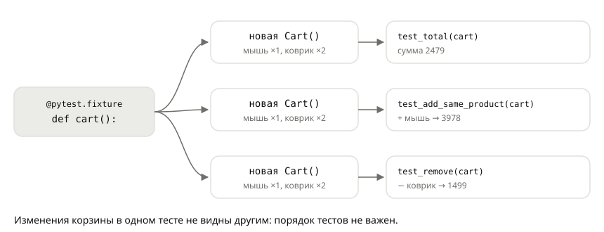

## Теория
Первые тесты быстро обрастают повторами: пять почти одинаковых функций, которые отличаются только числами; одна и та же подготовка корзины в начале каждого теста; проверка «здесь должна быть ошибка» через `try/except`. У pytest на каждый случай есть свой инструмент.

**`@pytest.mark.parametrize`** — один тест на много наборов данных. Декоратор получает имена аргументов строкой и список наборов значений; pytest запускает тест отдельно для каждого набора и подписывает его значениями: `test_apply_promo[999-SALE25-750]`. Упал один набор — остальные всё равно проверятся, а в отчёте видно, какой именно.

**`pytest.raises`** — проверка, что код выбрасывает исключение: `with pytest.raises(ValueError):` + вызов внутри блока. Если исключения не было или оно другого типа, тест падает. Аргумент `match="текст"` дополнительно проверяет сообщение — регулярным выражением, как `re.search`. Код в блоке после строки, выбросившей исключение, не выполняется, поэтому внутри `with` пишут ровно один вызов.

**Фикстура** — функция с декоратором `@pytest.fixture`, которая готовит данные для тестов: корзину с товарами, пользователя, файл. Тест получает её результат, просто указав **имя фикстуры параметром**: `def test_total(cart):`. pytest сам вызывает фикстуру **перед каждым тестом заново**, поэтому тесты не влияют друг на друга: один добавил товар в корзину — другой получит свежую. Если после теста нужно прибраться (закрыть файл, удалить запись), фикстура пишет `yield значение` вместо `return`: код после `yield` выполнится после теста. Общие фикстуры проекта кладут в файл `conftest.py` — pytest находит его сам, импортировать не нужно.

## Наглядно
**Рисунок 1.** pytest вызывает фикстуру перед каждым тестом: каждый тест получает свою корзину.



**Таблица 1.** Инструменты pytest.

| Задача | Инструмент | Пример |
|---|---|---|
| Один тест — много наборов данных | `@pytest.mark.parametrize` | `@pytest.mark.parametrize("total, expected", [(500, 299), (3000, 0)])` |
| Проверить исключение | `pytest.raises` | `with pytest.raises(ValueError, match="не найден"):` |
| Общая подготовка данных | `@pytest.fixture` | `def test_total(cart):` |
| Подготовка и уборка | фикстура с `yield` | `yield cart` + код уборки после |
| Фикстуры для всех тестов проекта | `conftest.py` | без импорта в тестах |

## На практике
Задача: протестировать промокоды магазина — скидку по известному коду и ошибки для неизвестного кода и пустого заказа, — а потом корзину с общей подготовкой данных.

### Шаг 1. Один тест — три набора
Функция `apply_promo` и тест с тремя наборами: сумма, промокод, ожидаемый результат:

Файл `test_main.py`:
```python
import pytest

PROMO = {"WELCOME10": 10, "SALE25": 25}


def apply_promo(total, code):
    if total <= 0:
        raise ValueError("сумма заказа должна быть больше нуля")
    if code not in PROMO:
        raise ValueError(f"промокод {code} не найден")
    return total - total * PROMO[code] // 100


@pytest.mark.parametrize(
    "total, code, expected",
    [
        (1000, "WELCOME10", 900),
        (1000, "SALE25", 750),
        (999, "SALE25", 750),
    ],
)
def test_apply_promo(total, code, expected):
    assert apply_promo(total, code) == expected
```
Запускаем «Запустить тесты».

Результат:
```
============================= test session starts ==============================
collecting ... collected 3 items

test_main.py::test_apply_promo[1000-WELCOME10-900] PASSED                [ 33%]
test_main.py::test_apply_promo[1000-SALE25-750] PASSED                   [ 66%]
test_main.py::test_apply_promo[999-SALE25-750] PASSED                    [100%]

============================== 3 passed in 0.00s ===============================
```
Одна функция — три теста; в квадратных скобках — значения набора.

### Шаг 2. Упал один набор
Ошибиться можно и в самом тесте. Допустим, в третьем наборе ожидали `749` вместо `750`.

Результат:
```
test_main.py::test_apply_promo[1000-WELCOME10-900] PASSED                [ 33%]
test_main.py::test_apply_promo[1000-SALE25-750] PASSED                   [ 66%]
test_main.py::test_apply_promo[999-SALE25-749] FAILED                    [100%]

=================================== FAILURES ===================================
_______________________ test_apply_promo[999-SALE25-749] _______________________

total = 999, code = 'SALE25', expected = 749
...
>       assert apply_promo(total, code) == expected
E       AssertionError: assert 750 == 749
E        +  where 750 = apply_promo(999, 'SALE25')
```
pytest показал значения набора (`total = 999, code = 'SALE25', expected = 749`) и результат функции. Скидка `999 * 25 // 100` — это 249 (деление нацело округляет вниз), значит 750 верно, а ошибка — в тесте. Вывод сокращён: многоточие заменяет повтор декоратора.

### Шаг 3. Ошибка — тоже результат
Неизвестный промокод и нулевая сумма должны давать `ValueError`. Добавляем в тот же файл:
```python
def test_unknown_code():
    with pytest.raises(ValueError, match="не найден"):
        apply_promo(1000, "FREE100")


def test_zero_total():
    with pytest.raises(ValueError):
        apply_promo(0, "SALE25")
```
Вывод pytest для новых тестов:
```
test_main.py::test_unknown_code PASSED                                   [ 50%]
test_main.py::test_zero_total PASSED                                     [100%]
```
`match` проверил ещё и текст: тест не пройдёт, если выбросится `ValueError` про сумму вместо ошибки про промокод.

### Шаг 4. Ошибки не было
Кто-то решил «не пугать покупателя» и заменил ошибку на нулевую скидку: `percent = PROMO.get(code, 0)`. Тест это ловит.

Результат:
```
test_main.py::test_unknown_code FAILED                                   [ 50%]
test_main.py::test_zero_total PASSED                                     [100%]

=================================== FAILURES ===================================
______________________________ test_unknown_code _______________________________

    def test_unknown_code():
>       with pytest.raises(ValueError, match="не найден"):
E       Failed: DID NOT RAISE <class 'ValueError'>
```
`DID NOT RAISE` — блок `with` завершился без исключения. Здесь и в шаге 2 вывод показан без заголовка и итоговой сводки.

### Шаг 5. Корзина из фикстуры
Три теста корзины начинаются с одной подготовки — выносим её в фикстуру `cart`:

Файл `test_main.py`:
```python
import pytest


class Cart:
    def __init__(self):
        self.items = {}

    def add(self, product_id, price, qty=1):
        old = self.items.get(product_id, (price, 0))[1]
        self.items[product_id] = (price, old + qty)

    def remove(self, product_id):
        del self.items[product_id]

    def total(self):
        return sum(p * q for p, q in self.items.values())


@pytest.fixture
def cart():
    cart = Cart()
    cart.add(4, 1499)
    cart.add(7, 490, qty=2)
    return cart


def test_total(cart):
    assert cart.total() == 2479


def test_add_same_product(cart):
    cart.add(4, 1499)
    assert cart.total() == 3978


def test_remove(cart):
    cart.remove(7)
    assert cart.total() == 1499
```
Результат:
```
============================= test session starts ==============================
collecting ... collected 3 items

test_main.py::test_total PASSED                                          [ 33%]
test_main.py::test_add_same_product PASSED                               [ 66%]
test_main.py::test_remove PASSED                                         [100%]

============================== 3 passed in 0.00s ===============================
```
`test_add_same_product` добавил мышь, но `test_remove` получил корзину без неё: фикстура создала новую корзину для каждого теста. Будь корзина одной переменной модуля, результат зависел бы от порядка тестов.

## Частые ошибки
- **Несколько вызовов в `pytest.raises`.** Ошибку выбросила первая строка — вторая не выполнилась и ничего не проверила. В блоке — один вызов.
- **`pytest.raises(Exception)`.** Пройдёт от любой ошибки, включая опечатку `NameError` в самом коде. Указывайте точный тип и `match`.
- **Общий изменяемый объект на уровне модуля.** Тесты меняют одну корзину и начинают зависеть от порядка запуска. Подготовка — в фикстуре.
- **Вызов фикстуры как функции.** `cart = cart()` в тесте — ошибка: фикстуру не вызывают, а указывают параметром `def test_total(cart):`.
- **Ожидаемое значение посчитали той же формулой, что в коде.** `expected = total - total * 25 // 100` повторит ошибку функции. В тесте — готовые числа, посчитанные отдельно.

## Итог
**parametrize**
- `@pytest.mark.parametrize("a, b, expected", [(…), (…)])` — тест на каждый набор.
- В отчёте — набор в квадратных скобках; упавший набор не мешает остальным.

**raises**
- `with pytest.raises(Тип, match="текст"):` — тест падает, если ошибки не было (`DID NOT RAISE`) или она другая.
- В блоке — один вызов.

**Фикстуры**
- `@pytest.fixture` готовит данные; тест получает их параметром с именем фикстуры.
- Вызывается заново для каждого теста; `yield` — для уборки после теста; общие — в `conftest.py`.

## Вопросы на собеседовании
<details><summary>Что такое фикстура в pytest и как она передаётся в тест?</summary>

Функция с `@pytest.fixture`, которая готовит данные или ресурс для теста. pytest смотрит на имена параметров теста, находит фикстуры с такими именами, вызывает их и передаёт результат. По умолчанию фикстура вызывается для каждого теста заново (`scope="function"`); можно реже — на модуль или весь запуск.
</details>

<details><summary>Как выполнить код уборки после теста?</summary>

Написать фикстуру с `yield`: код до `yield` — подготовка, значение `yield` получает тест, код после — уборка. Она выполнится, даже если тест упал. Это аналог `setUp`/`tearDown` из `unittest`.
</details>

<details><summary>Зачем `parametrize`, если можно написать цикл в тесте?</summary>

В цикле первый же упавший набор останавливает тест, и остальные не проверяются; в отчёте один тест вместо нескольких. С `parametrize` каждый набор — отдельный тест со своим именем и результатом: видно, какие наборы падают, и их можно запускать по отдельности.
</details>

<details><summary>Как проверить, что функция выбрасывает исключение?</summary>

`with pytest.raises(ValueError, match="шаблон"):` и вызов функции внутри. Тест упадёт, если исключения не было или оно другого типа. `match` проверяет сообщение регулярным выражением. `as exc_info` даёт доступ к самому исключению для дополнительных проверок.
</details>

## Глубже
Подмена внешних сервисов в тестах — следующая тема «Подмена зависимостей». Фикстуры с базой данных и тестовым клиентом — в курсе Django.
