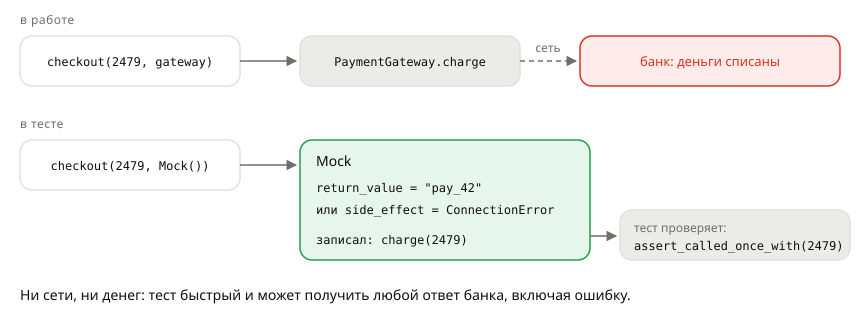

## Теория
Оформление заказа списывает деньги через платёжный шлюз банка и отправляет покупателю письмо. Тест такого кода не должен ходить в настоящий банк и рассылать настоящие письма: это медленно, стоит денег, зависит от сети и чужого сервера, а результат «банк недоступен» по заказу не получить. Поэтому в тестах **внешние зависимости подменяют** объектом-заглушкой, которая ведёт себя как надо тесту и запоминает, как её вызывали.

Проще всего подменять то, что функция **получает параметром** — как платёжный шлюз в `checkout(total, gateway)` (композиция из раздела «ООП»): в бою передают настоящий шлюз, в тесте — заглушку. Готовая заглушка есть в стандартной библиотеке — **`unittest.mock.Mock`**:
- любой атрибут и метод `Mock` создаётся при первом обращении: `gateway.charge(2479)` работает без описания класса;
- `gateway.charge.return_value = "pay_42"` — что вернёт вызов;
- `gateway.charge.side_effect = ConnectionError(...)` — вызов выбросит исключение (так проверяют обработку ошибок банка);
- после вызова Mock помнит аргументы: `gateway.charge.assert_called_once_with(2479)` падает, если метод вызвали не один раз или с другими аргументами; `call_count`, `call_args`, `assert_not_called()` — для других проверок.

Когда зависимость не передаётся параметром, а импортирована внутри модуля (`from notify import send_email`), её подменяют **`unittest.mock.patch`**: `with patch("orders.send_email") as fake:` на время блока заменяет имя на Mock и потом возвращает настоящее. Главное правило — **патчить там, где имя используют**, а не там, где его определили. `from notify import send_email` копирует ссылку на функцию в модуль `orders`; подмена `notify.send_email` её уже не затронет, и `orders` вызовет настоящую функцию.

Подменяют только внешнее — сеть, почту, время, случайность. Собственную логику (скидки, корзину) тестируют настоящей: тест, где замокано всё, проверяет только сам себя.

## Наглядно
**Рисунок 1.** В работе `checkout` получает настоящий платёжный шлюз, в тесте — Mock, который возвращает заданный ответ и записывает вызовы.



**Таблица 1.** Возможности `Mock`.

| Нужно | Как | Пример |
|---|---|---|
| Задать результат вызова | `return_value` | `gateway.charge.return_value = "pay_42"` |
| Выбросить исключение | `side_effect` | `gateway.charge.side_effect = ConnectionError()` |
| Проверить единственный вызов | `assert_called_once_with(…)` | `gateway.charge.assert_called_once_with(2479)` |
| Проверить, что не вызывали | `assert_not_called()` | `gateway.refund.assert_not_called()` |
| Сколько раз и с чем вызывали | `call_count`, `call_args` | `assert gateway.charge.call_count == 1` |
| Подменить импортированное имя | `patch("модуль.имя")` | `with patch("orders.send_email") as fake:` |

## На практике
Задача: протестировать оформление заказа без настоящего банка, затем — отправку письма без настоящей почты.

### Шаг 1. Шлюз параметром — заглушка в тесте
`checkout` списывает сумму через шлюз и возвращает статус заказа. Два теста: успешная оплата и недоступный банк:

Файл `test_main.py`:
```python
from unittest.mock import Mock


def checkout(total, gateway):
    try:
        payment_id = gateway.charge(total)
    except ConnectionError:
        return {"status": "payment_failed"}
    return {"status": "paid", "payment_id": payment_id}


def test_checkout_charges_total():
    gateway = Mock()
    gateway.charge.return_value = "pay_42"

    order = checkout(2479, gateway)

    assert order == {"status": "paid", "payment_id": "pay_42"}
    gateway.charge.assert_called_once_with(2479)


def test_checkout_payment_failed():
    gateway = Mock()
    gateway.charge.side_effect = ConnectionError("банк недоступен")

    order = checkout(2479, gateway)

    assert order == {"status": "payment_failed"}
```
Результат:
```
============================= test session starts ==============================
collecting ... collected 2 items

test_main.py::test_checkout_charges_total PASSED                         [ 50%]
test_main.py::test_checkout_payment_failed PASSED                        [100%]

============================== 2 passed in 0.02s ===============================
```
Ни одного запроса в банк, а проверены оба исхода. «Банк недоступен» получили одной строкой `side_effect`.

### Шаг 2. Mock ловит неверный вызов
Допустим, в `checkout` по ошибке списывают сумму со скидкой: `gateway.charge(round(total * 0.9))`. Статус заказа тот же, но `assert_called_once_with` показывает разницу.

Результат (вывод сокращён):
```
test_main.py::test_checkout_charges_total FAILED                         [ 50%]
test_main.py::test_checkout_payment_failed PASSED                        [100%]
...
E           AssertionError: expected call not found.
E           Expected: charge(2479)
E             Actual: charge(2231)
```
Без проверки вызова тест бы прошёл: заказ «оплачен», а списали не ту сумму. В полном выводе pytest показывает ещё и код `unittest.mock`, в котором сработала проверка, — его можно пропускать.

### Шаг 3. patch — где используют
Письмо отправляет функция из модуля `notify`, а заказ создаёт модуль `orders`. Настоящая `send_email` в примере выбрасывает ошибку, чтобы случайный вызов из теста было видно:

Файл `notify.py`:
```python
def send_email(to, text):
    raise RuntimeError("настоящее письмо из теста!")
```

Файл `orders.py`:
```python
from notify import send_email


def place_order(email, total):
    send_email(email, f"Заказ на {total} ₽ принят")
    return "created"
```

Файл `test_orders.py`:
```python
from unittest.mock import patch

from orders import place_order


def test_place_order_sends_email():
    with patch("orders.send_email") as fake_send:
        assert place_order("anna@example.com", 2479) == "created"
    fake_send.assert_called_once_with(
        "anna@example.com", "Заказ на 2479 ₽ принят"
    )
```
Запускаем `pytest -v test_orders.py`.

Результат:
```
============================= test session starts ==============================
collecting ... collected 1 item

test_orders.py::test_place_order_sends_email PASSED                      [100%]

============================== 1 passed in 0.00s ===============================
```

### Шаг 4. patch не там
Меняем цель на `patch("notify.send_email")` — «ведь функция определена в `notify`».

Результат (вывод сокращён):
```
test_orders.py::test_place_order_sends_email FAILED                      [100%]
...
orders.py:5: in place_order
    send_email(email, f"Заказ на {total} ₽ принят")
...
    def send_email(to, text):
>       raise RuntimeError("настоящее письмо из теста!")
E       RuntimeError: настоящее письмо из теста!
```
Подменили имя в `notify`, а `orders` хранит свою ссылку, полученную при `from notify import send_email`, и вызвал настоящую функцию. На реальном проекте покупатель получил бы письмо из тестов.

## Частые ошибки
- **Патчат там, где определено.** `from notify import send_email` в `orders` → патчить `orders.send_email`. Если же в `orders` написано `import notify` и вызов `notify.send_email(...)`, то правильно `notify.send_email`.
- **Проверка без скобок.** `fake.assert_called_once` без `()` — просто ссылка на метод: ничего не вызывается и не проверяется, тест проходит всегда. Опечатки вроде `fake.called_once_with(...)` Python 3.12 ловит сам (`AttributeError: … is not a valid assertion`), а забытые скобки — нет.
- **Проверили результат, но не вызов.** Заглушка вернёт `"pay_42"` при любых аргументах — без `assert_called_once_with` не узнать, что списали не ту сумму.
- **Мокают собственную логику.** Если подменить и расчёт скидки, и корзину, тест проверяет только заглушки. Подменяют внешние сервисы, своё тестируют настоящим.
- **Заглушка разрешает несуществующие методы.** `Mock()` примет и `gateway.chrage(...)` с опечаткой. `Mock(spec=PaymentGateway)` разрешает только методы настоящего класса.

## Итог
**Зачем**
- Тест не обращается к сети, почте, банку: заглушка быстрая, бесплатная и даёт любой сценарий, включая ошибки.

**Mock**
- Атрибуты и методы создаются сами; `return_value` — результат, `side_effect` — исключение.
- `assert_called_once_with(…)`, `assert_not_called()`, `call_count` — проверки вызовов.

**patch**
- `with patch("модуль.имя") as fake:` подменяет имя на время блока.
- Патчат в модуле, где имя **используют**.

**Что подменять**
- Внешние зависимости — да; собственную логику — нет. Удобнее всего — зависимость параметром.

## Вопросы на собеседовании
<details><summary>Что такое mock и зачем он в тестах?</summary>

Объект-заглушка вместо настоящей зависимости: платёжного шлюза, почты, внешнего API. Он возвращает заданные ответы (или выбрасывает ошибки) и запоминает вызовы, которые потом проверяют. Тесты с моками быстрые, не зависят от сети и чужих серверов и могут воспроизвести редкие сценарии вроде «банк недоступен».
</details>

<details><summary>Почему patch нужно применять там, где объект используется?</summary>

`from notify import send_email` создаёт в модуле `orders` своё имя `send_email`, указывающее на функцию. `patch` заменяет имя в указанном модуле: подмена `notify.send_email` не меняет ссылку, уже сохранённую в `orders`. Поэтому патчат `orders.send_email` — имя, по которому код его ищет при вызове.
</details>

<details><summary>Чем `return_value` отличается от `side_effect`?</summary>

`return_value` — значение, которое вернёт вызов. `side_effect` — поведение при вызове: исключение (выбросится), список (каждый вызов вернёт следующий элемент) или функция (вызовется с теми же аргументами, её результат станет результатом). Если задан `side_effect`, он важнее `return_value`.
</details>

<details><summary>Как избежать того, что Mock принимает несуществующие методы?</summary>

Создавать заглушку по образцу настоящего класса: `Mock(spec=PaymentGateway)` или `create_autospec(PaymentGateway)` — тогда обращение к несуществующему атрибуту даёт `AttributeError`, а `create_autospec` проверяет ещё и аргументы вызова. Так тест не разойдётся с настоящим интерфейсом.
</details>

## Глубже
Как устроена передача зависимостей и почему она упрощает тесты — раздел «Проектирование кода». Тесты страниц Django с подменой внешних сервисов — в курсе Django.
