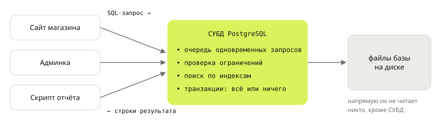

## Теория
**База данных** — организованное хранилище данных приложения: пользователи, товары, заказы. Работает с ней не сам сайт, а отдельная программа — **СУБД** (система управления базами данных). В курсе это **PostgreSQL**: её чаще всего берут для Django-проектов, и её же используют в тренажёре.

Почему бы не хранить заказы в JSON-файле? Пока сайт открывает один человек, это работает. Но в магазине одновременно оформляют заказы десятки покупателей, админка меняет цены, скрипт строит отчёт. СУБД решает то, что с файлом пришлось бы писать самому:
- **одновременная работа** — два запроса на запись не затрут изменения друг друга;
- **целостность** — нельзя создать заказ несуществующего покупателя или товар с отрицательной ценой: база проверяет правила сама;
- **транзакции** — «создать заказ и списать остатки» выполняется целиком или не выполняется вовсе, даже если сервер упал посередине;
- **быстрый поиск** — найти заказы одного покупателя среди миллиона не перебором, а по индексу;
- **один источник** — сайт, админка и аналитик видят одни и те же данные.

Говорят с СУБД на **SQL** (Structured Query Language). SQL — **декларативный** язык: в запросе пишут, *что* нужно получить, а не *как* это искать. Как именно пройти по таблице, какой индекс взять — решает СУБД. Запросы читаются почти как английская фраза: `SELECT name FROM products WHERE stock = 0` — «выбери названия из товаров, где остаток ноль».

Разные СУБД (PostgreSQL, MySQL, SQLite) понимают один стандарт SQL с небольшими отличиями. Курс написан для PostgreSQL 16; где синтаксис особый — это сказано.

## Наглядно
**Рисунок 1.** Приложения говорят с базой только через СУБД.



**Таблица 1.** Файл с данными и СУБД.

| Задача | JSON-файл | СУБД |
|---|---|---|
| два заказа одновременно | один перезапишет другой | обе записи сохранятся |
| найти товар по названию | прочитать и перебрать весь файл | поиск по индексу |
| заказ на несуществующего покупателя | запишется молча | ошибка: нарушен внешний ключ |
| сбой посреди оформления заказа | половина данных записана | транзакция откатится целиком |
| доступ админки и отчётов | каждый читает файл по-своему | один язык запросов — SQL |

## На практике
Задача: найти товары, которых нет на складе, — сначала «вручную» в Python, потом одним запросом SQL.

### Шаг 1. Данные в памяти программы
Если товары лежат в списке словарей, искать приходится циклом: программа сама решает, как перебирать:
```python
products = [
    {"name": "Ноутбук Nimbus Air", "stock": 0},
    {"name": "Беспроводная мышь", "stock": 12},
    {"name": "USB-хаб на 4 порта", "stock": 0},
]

for product in products:
    if product["stock"] == 0:
        print(product["name"])
```
Результат:
```
Ноутбук Nimbus Air
USB-хаб на 4 порта
```
Пока товаров три, это работает. Когда их сто тысяч и они в файле, каждая проверка — чтение всего файла.

### Шаг 2. Тот же вопрос на SQL
В запросе описываем только результат — какие колонки и какое условие:
```sql
SELECT name, price
FROM products
WHERE stock = 0;
```
Результат:
```
           name           |  price
--------------------------+----------
 Ноутбук Nimbus Air       | 54990.00
 USB-хаб на 4 порта       |  1499.00
 Футболка с принтом       |  1790.00
 Книга «Алгоритмы просто» |  1890.00
(4 rows)
```
Так результат выводит `psql` — консольный клиент PostgreSQL. Цикла нет: как найти строки, решает СУБД. Разбирать `SELECT` и `WHERE` будем в следующем разделе.

### Шаг 3. Где это в Django
Django-сайт не читает файлы базы. Он отправляет PostgreSQL такие же SQL-запросы — их собирает ORM из кода вроде `Product.objects.filter(stock=0)`. Зная SQL, вы понимаете, что ORM делает за вас, и видите, когда она делает это плохо.

## Частые ошибки
- **«SQL — это база данных».** SQL — язык запросов. База — данные, СУБД — программа, которая их хранит и выполняет запросы.
- **Хранить данные сайта в файлах.** Файл не защищает от одновременной записи, не проверяет правила и не умеет быстро искать.
- **Писать запрос как алгоритм.** В SQL не перебирают строки циклом, а описывают нужный результат одним запросом.
- **Считать, что все СУБД одинаковы.** Основа общая, но функции, типы и детали синтаксиса отличаются. Примеры курса — для PostgreSQL.

## Итог
**База и СУБД**
- База данных — хранилище данных приложения; СУБД — программа, которая им управляет. В курсе — PostgreSQL 16.
- СУБД даёт одновременную работу, целостность, транзакции, быстрый поиск и общий доступ.

**SQL**
- Язык запросов к реляционным базам.
- Декларативный: пишем, что получить, а как — решает СУБД.
- Django ORM превращает код на Python в SQL-запросы.

## Вопросы на собеседовании
<details><summary>Чем база данных отличается от СУБД?</summary>

База данных — сами данные и их структура: таблицы, связи, ограничения. СУБД — программа, которая хранит базу на диске, выполняет запросы, проверяет ограничения, управляет транзакциями и одновременным доступом. PostgreSQL, MySQL, SQLite — СУБД.
</details>

<details><summary>Что значит «SQL — декларативный язык»?</summary>

Запрос описывает результат, а не шаги его получения. План выполнения — какие индексы взять, в каком порядке соединять таблицы — строит планировщик СУБД. В императивном коде, например в цикле на Python, порядок действий задаёт программист.
</details>

<details><summary>Почему данные веб-приложения не хранят в файлах?</summary>

Файл не решает одновременную запись: два процесса затрут изменения друг друга. Он не проверяет правила данных, не умеет транзакций и быстрого поиска. Всё это пришлось бы писать самому — а СУБД делает это надёжно и давно.
</details>
