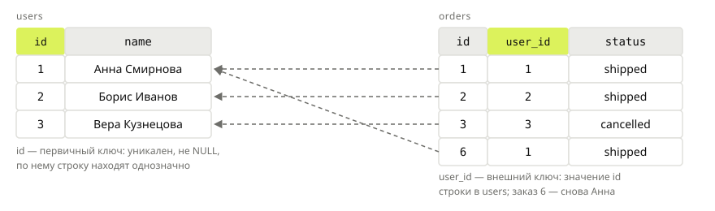

## Теория
PostgreSQL — **реляционная** СУБД: данные лежат в **таблицах**, а таблицы связаны между собой. Каждая таблица описывает одну сущность магазина: `users` — покупателей, `products` — товары, `orders` — заказы.

- **Столбец** (поле, колонка) — одно свойство сущности: `email`, `price`. У столбца есть имя и **тип**: `integer`, `text`, `numeric`, `boolean`, `timestamptz`. В столбец типа `integer` строку не записать — база вернёт ошибку.
- **Строка** (запись) — одна сущность: один покупатель, один товар. Порядка у строк нет: без явной сортировки база может вернуть их в любом порядке.
- **Схема** — описание всей базы: какие таблицы, столбцы, типы, ключи и ограничения.
- **NULL** — «значение неизвестно или отсутствует»: город, который покупатель не указал. Это не пустая строка и не ноль. Подробно — в теме про NULL.

**Первичный ключ** (primary key, PK) — столбец, по которому строку находят однозначно. Его значения уникальны и не бывают NULL. В магазине у каждой таблицы ключ — `id`: целое число, которое база выдаёт сама. Почему не `email`? Он может измениться, а ключ должен оставаться прежним всю жизнь строки: на него ссылаются другие таблицы.

**Внешний ключ** (foreign key, FK) — столбец, в котором хранится первичный ключ строки из другой таблицы. В `orders.user_id` лежит `id` покупателя из `users`: так заказ «знает» своего покупателя, а данные покупателя не копируются в каждый заказ. Внешний ключ — это ещё и **правило**: база не даст записать `user_id = 999`, если такого покупателя нет, и не даст удалить покупателя, у которого есть заказы (что именно происходит при удалении, задаётся в схеме). Внешний ключ может разрешать NULL — связь необязательная: `orders.promo_code_id` пустой, если заказ без промокода.

## Наглядно
**Рисунок 1.** Внешний ключ `orders.user_id` указывает на первичный ключ `users.id`.



**Таблица 1.** Термины и где они в магазине.

| Термин | Другие названия | В магазине |
|---|---|---|
| таблица | отношение | `users`, `orders` |
| строка | запись, кортеж | покупатель Анна Смирнова |
| столбец | поле, атрибут, колонка | `email`, `price` |
| первичный ключ | PK | `users.id` |
| внешний ключ | FK | `orders.user_id` → `users.id` |
| NULL | «нет значения» | `users.city` у Дарьи Соколовой |

## На практике
Задача: понять, как заказ «знает» своего покупателя и что для этого хранится в таблицах.

### Шаг 1. Смотрим на заказы
Первые шесть заказов магазина:
```sql
SELECT *
FROM orders
WHERE id <= 6;
```
Результат:
```
 id | user_id | promo_code_id |  status   |       created_at
----+---------+---------------+-----------+------------------------
  1 |       1 |             4 | shipped   | 2025-11-28 10:15:00+03
  2 |       2 |             4 | shipped   | 2025-11-29 14:40:00+03
  3 |       3 |               | cancelled | 2025-11-29 18:05:00+03
  4 |       8 |             4 | shipped   | 2025-11-30 23:50:00+03
  5 |       4 |               | shipped   | 2025-12-01 00:10:00+03
  6 |       1 |               | shipped   | 2025-12-05 12:00:00+03
(6 rows)
```
Имени и почты покупателя в заказе нет — только число `user_id`. Пустое место в `promo_code_id` — это NULL: заказ без промокода.

### Шаг 2. Находим покупателя по ключу
У заказов 1 и 6 `user_id = 1`. Это покупательница с `id = 1` в `users`:
```sql
SELECT id, name, city
FROM users
WHERE id = 1;
```
Результат:
```
 id |     name      |  city
----+---------------+--------
  1 | Анна Смирнова | Москва
(1 row)
```
Анна указана один раз, а ссылаются на неё сколько угодно заказов. Сменит она имя — правится одна строка, и все заказы «увидят» новое имя. Соединять таблицы одним запросом научимся в разделе про JOIN.

### Шаг 3. База охраняет связь
Попробуем создать заказ несуществующему покупателю:
```sql
INSERT INTO orders (user_id) VALUES (999);
```
Результат:
```
ERROR:  insert or update on table "orders" violates foreign key constraint "orders_user_id_fkey"
DETAIL:  Key (user_id)=(999) is not present in table "users".
```
Заказ не записан. Такую проверку в JSON-файле пришлось бы писать самому — и не забыть её ни в одном месте кода.

### Шаг 4. Цена в заказе — своя
В позициях заказа (`order_items`) есть своя колонка `price`, хотя цена есть и у товара. Это цена **на момент покупки**: товар потом подешевеет, а в старом заказе должна остаться сумма, которую заплатил покупатель. Это осознанное повторение данных — подробно разберём в разделе «Проектирование БД».

## Частые ошибки
- **Ключ по данным, которые меняются.** Email, телефон, название товара меняются; на них нельзя опереться как на постоянный адрес строки. Ключ — отдельный `id`.
- **Копировать данные вместо ссылки.** Имя и почта покупателя в каждом заказе: при смене почты придётся править сотни строк, и где-нибудь останется старая.
- **Ждать порядка строк.** Строки таблицы не упорядочены. Нужен порядок — пишут `ORDER BY`.
- **Путать NULL с пустой строкой или нулём.** `''` — известное пустое значение, `0` — число, NULL — значения нет.
- **Внешний ключ «на бумаге».** Если связь не объявлена в схеме, база не проверит её, и в данных появятся заказы «ничьих» покупателей.

## Итог
**Таблица**
- Одна сущность магазина; столбцы — свойства с типами, строки — отдельные сущности.
- Порядка строк нет; NULL — отсутствие значения.

**Первичный ключ**
- Уникален и не NULL, не меняется; в магазине — `id`, его выдаёт база.

**Внешний ключ**
- Хранит первичный ключ строки другой таблицы: `orders.user_id` → `users.id`.
- База не даёт сослаться на несуществующую строку.
- Может быть NULL, если связь необязательная (`promo_code_id`).

## Вопросы на собеседовании
<details><summary>Чем первичный ключ отличается от внешнего?</summary>

Первичный ключ однозначно определяет строку своей таблицы: значения уникальны, не NULL. Внешний ключ хранит значение первичного ключа другой (или той же) таблицы и задаёт связь; база проверяет, что такая строка существует. В таблице один первичный ключ и сколько угодно внешних.
</details>

<details><summary>Почему в качестве первичного ключа обычно берут суррогатный `id`, а не email?</summary>

Естественные данные меняются: почта, телефон, название. Изменение ключа пришлось бы распространять на все ссылающиеся таблицы. Суррогатный `id` ничего не значит и поэтому не меняется, он компактен и одинаков по устройству во всех таблицах.
</details>

<details><summary>Может ли внешний ключ быть NULL?</summary>

Да, если столбец не объявлен `NOT NULL`. NULL означает «связи нет»: заказ без промокода. Если связь обязательна — у каждого заказа есть покупатель — внешний ключ делают `NOT NULL`.
</details>
