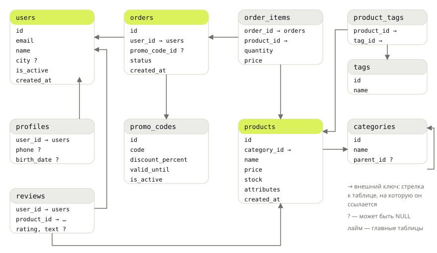

## Теория
Все задачи курса работают с одной базой — интернет-магазином. В ней 10 таблиц: покупатели и их профили, каталог (категории, товары, теги), заказы с позициями, промокоды и отзывы. Учебных данных немного — 13 покупателей, 22 товара, 34 заказа, — чтобы результат любого запроса помещался на экран и его можно было проверить глазами.

Главные таблицы:
- `users` — покупатели: почта, имя, город (может быть не указан), активен ли аккаунт;
- `products` — товары: категория, название, цена, остаток на складе, характеристики;
- `orders` — заказы: покупатель, промокод (если был), статус (`new`, `paid`, `shipped`, `cancelled`), время создания;
- `order_items` — позиции заказа: какой товар, сколько штук, по какой цене купили.

Остальные дополняют их: `profiles` — телефон и дата рождения (у покупателя может не быть профиля), `categories` — дерево категорий («Электроника» → «Компьютеры» → «Ноутбуки»), `tags` и `product_tags` — метки товаров («хит», «новинка»), `promo_codes` — скидки, `reviews` — отзывы с оценкой от 1 до 5.

Посмотреть таблицу целиком позволяет самый короткий запрос: `SELECT * FROM имя_таблицы`. Звёздочка — «все столбцы в том порядке, в каком они объявлены в таблице». Для знакомства с данными это удобно. В коде приложения столбцы обычно перечисляют явно — это будет в следующем разделе.

Даты в учебных данных фиксированы (ноябрь 2025 — апрель 2026), время — московское. Поэтому ответы задач не зависят от того, в какой день вы их решаете.

## Наглядно
**Рисунок 1.** Таблицы магазина и внешние ключи между ними.



**Таблица 1.** Как читать результат запроса.

| Что видно | Что значит |
|---|---|
| пустая ячейка | NULL — значения нет |
| `t` / `f` | `true` / `false` — так PostgreSQL выводит `boolean` |
| `64990.00` | `numeric(10,2)` — деньги хранятся точно, с двумя знаками после точки |
| `2025-11-28 10:15:00+03` | `timestamptz` — момент времени с часовым поясом |
| `2030-12-31` | `date` — только дата |
| `(9 rows)` | сколько строк вернул запрос |

## На практике
Задача: познакомиться с базой магазина — найти таблицы в тренажёре и прочитать две из них целиком.

### Шаг 1. Схема в тренажёре
Откройте тренажёр SQL. Под редактором — свёрнутая полоса «Схема базы»: в ней все таблицы, их столбцы и число строк. Отметки: `PK` — первичный ключ, `FK` и стрелка — внешний ключ и таблица, на которую он ссылается, `?` — столбец может быть NULL. Держите схему открытой, пока пишете запросы: имена столбцов лучше подсматривать, чем угадывать.

### Шаг 2. Категории
Читаем таблицу категорий целиком:
```sql
SELECT * FROM categories;
```
Результат:
```
 id |    name     | parent_id
----+-------------+-----------
  1 | Электроника |
  2 | Компьютеры  |         1
  3 | Ноутбуки    |         2
  4 | Аксессуары  |         2
  5 | Смартфоны   |         1
  6 | Одежда      |
  7 | Футболки    |         6
  8 | Обувь       |         6
  9 | Книги       |
(9 rows)
```
`parent_id` — внешний ключ на эту же таблицу: «Ноутбуки» (3) лежат в «Компьютерах» (2), те — в «Электронике» (1). У корневых категорий родителя нет — NULL. Так в одной таблице хранится дерево любой глубины.

### Шаг 3. Промокоды
Читаем промокоды:
```sql
SELECT * FROM promo_codes;
```
Результат:
```
 id |    code     | discount_percent | valid_until | is_active
----+-------------+------------------+-------------+-----------
  1 | WELCOME10   |               10 | 2030-12-31  | t
  2 | SUMMER25    |               25 | 2025-08-31  | t
  3 | VIP15       |               15 | 2030-12-31  | f
  4 | BLACKFRIDAY |               30 | 2025-11-30  | t
  5 | NEWYEAR20   |               20 | 2026-01-15  | t
(5 rows)
```
Уже видно, что «действует» — это два условия: флаг `is_active` и дата `valid_until`. `VIP15` выключен, `SUMMER25` просрочен. Отбирать такие строки научимся в теме про `WHERE`.

### Шаг 4. Тренажёр показывает каждый запрос
После запуска в журнале тренажёра появляется карточка запроса с таблицей результата. Если запрос меняет данные, тренажёр подсветит изменённые строки; если ошибка — покажет текст ошибки PostgreSQL и место в запросе. Учебную базу можно сломать без страха: кнопка «Начать заново» возвращает исходные данные.

## Частые ошибки
- **Угадывать имена столбцов.** `product_name` вместо `name`, `user` вместо `users` — и запрос падает с ошибкой `does not exist`. Имена — в «Схеме базы».
- **Ждать, что NULL выглядит как слово.** В выводе `psql` и в тренажёре NULL — пустая ячейка.
- **Путать `products.price` и `order_items.price`.** Первая — текущая цена в каталоге, вторая — цена, по которой товар купили в конкретном заказе.
- **`SELECT *` в коде приложения.** Для знакомства с таблицей удобно, в приложении — лишние данные и зависимость от порядка столбцов.

## Итог
**Таблицы магазина**
- Главные: `users`, `products`, `orders`, `order_items`.
- Дополнительные: `profiles`, `categories` (дерево), `tags` + `product_tags`, `promo_codes`, `reviews`.

**Первый запрос**
- `SELECT * FROM таблица` — все столбцы и все строки.
- NULL — пустая ячейка, `boolean` — `t`/`f`, деньги — `numeric` с двумя знаками.

**Тренажёр**
- «Схема базы» — таблицы, ключи, NULL-столбцы.
- Журнал показывает результат каждого запроса; «Начать заново» возвращает учебные данные.

## Вопросы на собеседовании
<details><summary>Как в одной таблице хранить дерево категорий?</summary>

Через самосвязь: столбец `parent_id` — внешний ключ на `id` этой же таблицы. У корневых категорий `parent_id` — NULL. Обойти дерево целиком можно рекурсивным запросом (`WITH RECURSIVE`).
</details>

<details><summary>Почему деньги хранят в `numeric`, а не в `float`?</summary>

`float` хранит числа приближённо в двоичном виде: `0.1 + 0.2` не равно `0.3`, и при сложении сумм копейки теряются. `numeric(10,2)` хранит десятичное число точно, с заданным числом знаков после точки.
</details>

<details><summary>Почему не стоит писать `SELECT *` в коде приложения?</summary>

Запрос тянет все столбцы, даже ненужные, — лишняя нагрузка на базу и сеть. Код начинает зависеть от состава и порядка столбцов: добавили столбец в таблицу — изменился результат. Явный список столбцов говорит, что именно нужно.
</details>
