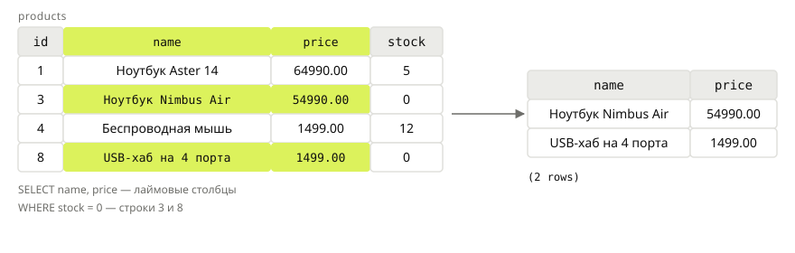

## Теория
`SELECT` читает данные. Самая короткая форма — `SELECT столбцы FROM таблица`: после `SELECT` перечисляют через запятую, что вывести, после `FROM` — откуда. Запрос завершают точкой с запятой. Ключевые слова пишут в любом регистре; заглавными — по привычке, чтобы их было видно на фоне имён.

В списке `SELECT` могут стоять не только столбцы, но и **выражения**: арифметика (`price * stock`), строковые константы (`'RUB'`), функции. Выражение считается для каждой строки отдельно, а таблица при этом не меняется — результат существует только в ответе на запрос.

У каждой колонки результата есть имя. У столбца это его собственное имя, а выражению PostgreSQL придумывает имя сам: `?column?` или имя функции. Поэтому выражениям дают **псевдоним** через `AS`: `price * 1.2 AS price_with_vat`. Псевдоним действует только в результате, в таблице ничего не переименовывается. Под этим именем значение потом достанет и код на Python: `row["price_with_vat"]`.

Кавычки в SQL разные. **Одинарные** — строковое значение: `'Москва'`. **Двойные** — имя (столбца, таблицы, псевдонима), которое иначе не написать: с пробелом или заглавными буквами, `AS "Цена с НДС"`. Перепутать их — частая ошибка: `"RUB"` PostgreSQL будет искать как столбец.

## Наглядно
**Рисунок 1.** `SELECT` оставляет столбцы, `WHERE` — строки (о `WHERE` — в следующей теме).



**Таблица 1.** Что можно написать в списке `SELECT`.

| В `SELECT` | Пример | Имя колонки в результате |
|---|---|---|
| все столбцы | `*` | имена столбцов таблицы |
| столбец | `name` | `name` |
| выражение | `price * 1.2` | `?column?` |
| выражение с псевдонимом | `price * 1.2 AS price_with_vat` | `price_with_vat` |
| строковая константа | `'RUB' AS currency` | `currency` |
| имя с пробелом | `price AS "Цена"` | `Цена` |

## На практике
Задача: показать менеджеру ноутбуки (категория 3) с ценой, ценой с НДС и стоимостью остатков на складе.

### Шаг 1. Нужные столбцы
Перечисляем столбцы в нужном порядке:
```sql
SELECT name, price
FROM products
WHERE category_id = 3;
```
Результат:
```
         name         |  price
----------------------+----------
 Ноутбук Aster 14     | 64990.00
 Ноутбук Aster 16 Pro | 89990.00
 Ноутбук Nimbus Air   | 54990.00
(3 rows)
```
Строку `WHERE category_id = 3` пока примем как есть: она оставляет только ноутбуки.

### Шаг 2. Выражение с псевдонимом
Цена с НДС 20 % — это цена, умноженная на 1.2:
```sql
SELECT name, price, price * 1.2 AS price_with_vat
FROM products
WHERE category_id = 3;
```
Результат:
```
         name         |  price   | price_with_vat
----------------------+----------+----------------
 Ноутбук Aster 14     | 64990.00 |      77988.000
 Ноутбук Aster 16 Pro | 89990.00 |     107988.000
 Ноутбук Nimbus Air   | 54990.00 |      65988.000
(3 rows)
```
Без `AS` колонка называлась бы `?column?`. Три знака после точки — так PostgreSQL умножает `numeric`: знаки множителей складываются. Округлять научимся в теме про функции.

### Шаг 3. Выражение из двух столбцов и константа
Стоимость остатков — цена на количество; валюта — одна строка на всех:
```sql
SELECT name, price * stock AS stock_value, 'RUB' AS currency
FROM products
WHERE category_id = 3;
```
Результат:
```
         name         | stock_value | currency
----------------------+-------------+----------
 Ноутбук Aster 14     |   324950.00 | RUB
 Ноутбук Aster 16 Pro |   179980.00 | RUB
 Ноутбук Nimbus Air   |        0.00 | RUB
(3 rows)
```
Константа повторяется в каждой строке результата.

## Частые ошибки
- **Двойные кавычки у строки.** `SELECT "RUB"` → `ERROR: column "RUB" does not exist`. Строки — в одинарных кавычках.
- **Выражение без имени.** Колонка `?column?` неудобна и в отчёте, и в коде. Каждому выражению — `AS`.
- **Запятая после последнего столбца.** `SELECT name, price, FROM products` — синтаксическая ошибка у `FROM`.
- **Ждать, что выражение изменит таблицу.** `SELECT price * 1.2` только показывает число; цены в `products` остаются прежними. Менять данные — `UPDATE`.

## Итог
**SELECT … FROM**
- `SELECT` — что вывести, `FROM` — из какой таблицы.
- В списке — столбцы, выражения, константы, функции; считаются для каждой строки.

**Имена**
- Псевдоним — `выражение AS имя`; без него у выражения имя `?column?`.
- Одинарные кавычки — строки, двойные — имена.

## Вопросы на собеседовании
<details><summary>Что такое псевдоним колонки и где он действует?</summary>

Имя колонки результата, заданное через `AS`. Он нужен для выражений и для понятных имён в отчётах и коде. Действует в результате и в `ORDER BY`, но не в `WHERE` — `WHERE` выполняется раньше, чем вычисляется список `SELECT`.
</details>

<details><summary>Чем одинарные кавычки отличаются от двойных в PostgreSQL?</summary>

Одинарные обозначают строковое значение (`'Москва'`). Двойные — идентификатор: имя столбца, таблицы или псевдонима, причём с учётом регистра и с любыми символами (`"Цена с НДС"`). Без двойных кавычек имена приводятся к нижнему регистру.
</details>

<details><summary>Почему в коде приложения не пишут `SELECT *`?</summary>

Запрос тянет лишние столбцы, а код начинает зависеть от их состава и порядка. Явный список показывает, какие данные нужны, и не ломается, когда в таблицу добавят столбец.
</details>
