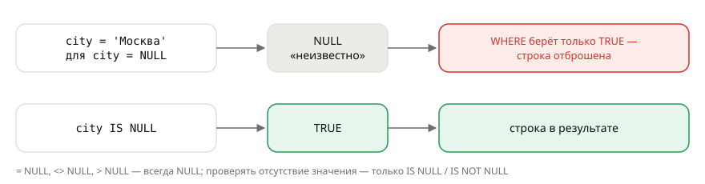

## Теория
**NULL** — отметка «значения нет»: покупатель не указал город, у заказа нет промокода, отзыв без текста. Это не пустая строка `''` и не ноль: пустая строка — известное значение «пусто», `0` — число, а NULL означает «неизвестно».

Из «неизвестно» вытекает главное правило: **любое сравнение с NULL даёт не TRUE и не FALSE, а NULL**. `city = 'Москва'` для покупателя без города — «неизвестно, может быть, и Москва». Даже `NULL = NULL` — NULL: два неизвестных значения не обязаны совпадать. `WHERE` пропускает в результат только строки, где условие **TRUE**; строки с NULL-условием отбрасываются так же, как с FALSE. Поэтому:
- `WHERE city = NULL` не найдёт ни одной строки — для проверки есть `IS NULL` и `IS NOT NULL`;
- `WHERE city <> 'Москва'` не вернёт покупателей без города — для них сравнение тоже «неизвестно».

Логика с тремя значениями работает по смыслу. `NULL AND FALSE` — FALSE (одного ложного хватает), `NULL OR TRUE` — TRUE (одного истинного хватает), а `NULL AND TRUE` и `NULL OR FALSE` — NULL.

Арифметика и склейка строк с NULL тоже дают NULL: `price + NULL` — NULL, `'Город: ' || NULL` — NULL. Чтобы подставить значение вместо NULL, есть функция **`COALESCE(a, b, …)`** — возвращает первый аргумент, который не NULL: `COALESCE(city, 'не указан')`. В других СУБД встречаются `IFNULL` и `ISNULL`, в PostgreSQL их нет — только `COALESCE`.

## Наглядно
**Рисунок 1.** Почему `= NULL` не работает.



**Таблица 1.** Выражения с NULL.

| Выражение | Результат |
|---|---|
| `NULL = NULL` | NULL |
| `NULL <> 'Москва'` | NULL |
| `NULL IS NULL` | TRUE |
| `NULL AND FALSE` | FALSE |
| `NULL OR TRUE` | TRUE |
| `NULL AND TRUE` | NULL |
| `5 + NULL` | NULL |
| `'Город: ' \|\| NULL` | NULL |
| `COALESCE(NULL, 'не указан')` | `'не указан'` |

## На практике
Задача: найти покупателей без города и показать список с городом, где пропуски заменены текстом.

### Шаг 1. Кто без города
Проверка на отсутствие значения — только `IS NULL`:
```sql
SELECT id, name
FROM users
WHERE city IS NULL;
```
Результат:
```
 id |      name
----+----------------
  5 | Дарья Соколова
 10 | Кирилл Волков
(2 rows)
```
С `city = NULL` результат был бы пустым.

### Шаг 2. «Не из Москвы» теряет NULL
Покупатели не из Москвы:
```sql
SELECT id, name, city
FROM users
WHERE city <> 'Москва';
```
Результат:
```
 id |      name      |      city
----+----------------+-----------------
  2 | Борис Иванов   | Санкт-Петербург
  4 | Глеб Попов     | Казань
  6 | Егор Лебедев   | Новосибирск
  8 | Захар Новиков  | Екатеринбург
  9 | Ирина Морозова | Санкт-Петербург
 11 | Лидия Павлова  | Казань
 13 | Нина Орлова    | Краснодар
(7 rows)
```
Всего покупателей 13, москвичей 4 — а строк 7, не 9. Дарья и Кирилл пропали: для них условие «неизвестно». Если они нужны, пишут явно: `WHERE city <> 'Москва' OR city IS NULL`.

### Шаг 3. Подставляем значение
Для рассылки нужен город у каждого — пропуски заменяем текстом:
```sql
SELECT id, name, COALESCE(city, 'не указан') AS city
FROM users
WHERE id IN (4, 5, 10);
```
Результат:
```
 id |      name      |   city
----+----------------+-----------
  4 | Глеб Попов     | Казань
  5 | Дарья Соколова | не указан
 10 | Кирилл Волков  | не указан
(3 rows)
```
`COALESCE` меняет только результат запроса; в таблице у Дарьи по-прежнему NULL.

## Частые ошибки
- **`= NULL` вместо `IS NULL`.** Сравнение с NULL всегда «неизвестно» — ни одной строки в ответе.
- **`<>` и `NOT IN` теряют строки с NULL.** «Не из Москвы» не включает покупателей без города. Нужны они — добавляют `OR city IS NULL`.
- **Склейка строк с NULL.** `name || ', ' || city` у покупателя без города даёт NULL целиком. Помогает `COALESCE(city, '…')`.
- **NULL — это «пусто».** Пустая строка и NULL — разное: `'' IS NULL` — FALSE.
- **`IFNULL` и `ISNULL`.** Это функции других СУБД; в PostgreSQL — `COALESCE`.

## Итог
**Что такое NULL**
- «Значения нет / неизвестно»; не `''` и не `0`.

**Сравнения**
- Любое сравнение с NULL — NULL; `WHERE` берёт только TRUE.
- Проверка — `IS NULL` / `IS NOT NULL`.
- `<>`, `NOT IN` не возвращают строки с NULL — добавлять `OR … IS NULL`.
- Логика: `NULL AND FALSE` — FALSE, `NULL OR TRUE` — TRUE, остальное с NULL — NULL.

**Значения**
- Арифметика и `||` с NULL дают NULL.
- `COALESCE(a, b, …)` — первое значение, которое не NULL.

## Вопросы на собеседовании
<details><summary>Почему `WHERE city = NULL` ничего не возвращает?</summary>

Сравнение с NULL даёт не TRUE и не FALSE, а NULL — «неизвестно». `WHERE` оставляет только строки с TRUE. Для проверки отсутствия значения есть `IS NULL`.
</details>

<details><summary>Что такое трёхзначная логика в SQL?</summary>

Условие может быть TRUE, FALSE или NULL (неизвестно). `AND` даёт FALSE, если хоть один операнд FALSE, `OR` даёт TRUE, если хоть один TRUE; в остальных случаях с участием NULL результат — NULL. `NOT`, применённый к NULL, — тоже NULL.
</details>

<details><summary>Что делает `COALESCE`?</summary>

Возвращает первый аргумент, который не NULL: `COALESCE(phone, email, 'нет контакта')`. Применяется, чтобы подставить значение по умолчанию в результат, в склейку строк или в вычисления.
</details>
