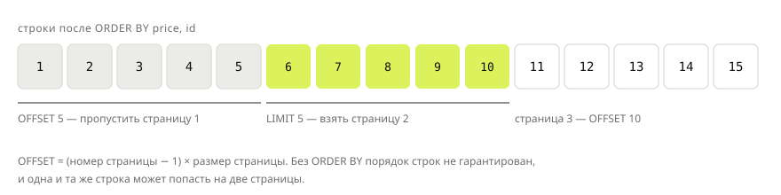

## Теория
У строк таблицы нет порядка. Без **`ORDER BY`** база возвращает их так, как ей удобно: сегодня по `id`, завтра — после обновления строки или с другим планом запроса — иначе. Если порядок важен, его задают явно.

`ORDER BY` перечисляет, по чему сортировать: `ORDER BY price` — по возрастанию (`ASC`, по умолчанию), `ORDER BY price DESC` — по убыванию. Можно указать несколько столбцов: `ORDER BY city, name` — сначала по городу, а внутри одного города — по имени. Направление пишут у каждого столбца отдельно: `ORDER BY price DESC, id` сортирует цену по убыванию, а `id` — по возрастанию. Сортировать можно по выражению и по псевдониму из `SELECT`.

Где окажутся NULL? В PostgreSQL NULL считается **больше** любого значения: при `ASC` — в конце, при `DESC` — в начале. Порядок задают явно: `NULLS FIRST` или `NULLS LAST`.

**`LIMIT n`** оставляет первые `n` строк результата, **`OFFSET m`** пропускает `m` строк перед ними. Вместе они дают **пагинацию**: страница `p` размером `n` — это `LIMIT n OFFSET (p - 1) * n`. Пагинация имеет смысл только с `ORDER BY`, причём порядок должен быть **однозначным**. Если у двух товаров одинаковая цена, `ORDER BY price` может поставить их то так, то эдак, и на границе страниц один товар покажется дважды, а другой пропадёт. Последним в `ORDER BY` добавляют уникальный столбец — обычно `id`.

`OFFSET` не бесплатен: чтобы пропустить 10 000 строк, базе нужно их прочитать. На больших таблицах далёкие страницы делают «по ключу» (`WHERE id > последний_показанный`) — об этом в разделе про производительность.

## Наглядно
**Рисунок 1.** `OFFSET` пропускает предыдущие страницы, `LIMIT` берёт текущую.



**Таблица 1.** Варианты `ORDER BY`.

| Запись | Порядок |
|---|---|
| `ORDER BY price` | цена по возрастанию |
| `ORDER BY price DESC` | цена по убыванию |
| `ORDER BY price DESC, id` | цена по убыванию, при равной — `id` по возрастанию |
| `ORDER BY city NULLS FIRST` | сначала покупатели без города |
| `ORDER BY price_with_vat` | по псевдониму из `SELECT` |

## На практике
Задача: топ дорогих товаров, вторая страница каталога и список покупателей по городам.

### Шаг 1. Пять самых дорогих
Сортировка по убыванию и первые пять строк:
```sql
SELECT id, name, price
FROM products
ORDER BY price DESC
LIMIT 5;
```
Результат:
```
 id |          name          |  price
----+------------------------+----------
  2 | Ноутбук Aster 16 Pro   | 89990.00
  1 | Ноутбук Aster 14       | 64990.00
  3 | Ноутбук Nimbus Air     | 54990.00
 11 | Смартфон Pixelon 8 Max | 49990.00
 10 | Смартфон Pixelon 8     | 39990.00
(5 rows)
```
`LIMIT` без `ORDER BY` вернул бы «какие-то пять» товаров, а не самые дорогие.

### Шаг 2. Вторая страница каталога
Каталог по 5 товаров от дешёвых к дорогим; страница 2 — пропустить 5:
```sql
SELECT id, name, price
FROM products
ORDER BY price, id
LIMIT 5 OFFSET 5;
```
Результат:
```
 id |          name           |  price
----+-------------------------+---------
 16 | Футболка базовая чёрная | 1290.00
  4 | Беспроводная мышь       | 1499.00
  8 | USB-хаб на 4 порта      | 1499.00
 20 | Книга «SQL на практике» | 1590.00
 17 | Футболка с принтом      | 1790.00
(5 rows)
```
Футболки 15 и 16 стоят одинаково — 1290 ₽, и граница страниц проходит ровно между ними. Только `id` в `ORDER BY` гарантирует, что футболка 15 всегда на первой странице, а 16 — на второй.

### Шаг 3. Несколько столбцов и NULL
Покупатели по городу, внутри города — по имени, покупатели без города — первыми:
```sql
SELECT id, name, city
FROM users
ORDER BY city NULLS FIRST, name;
```
Результат:
```
 id |      name      |      city
----+----------------+-----------------
  5 | Дарья Соколова |
 10 | Кирилл Волков  |
  8 | Захар Новиков  | Екатеринбург
  4 | Глеб Попов     | Казань
 11 | Лидия Павлова  | Казань
 13 | Нина Орлова    | Краснодар
  1 | Анна Смирнова  | Москва
  3 | Вера Кузнецова | Москва
  7 | Жанна Козлова  | Москва
 12 | Максим Фёдоров | Москва
  6 | Егор Лебедев   | Новосибирск
  2 | Борис Иванов   | Санкт-Петербург
  9 | Ирина Морозова | Санкт-Петербург
(13 rows)
```
Без `NULLS FIRST` они оказались бы в конце.

## Частые ошибки
- **`LIMIT` без `ORDER BY`.** «Первые пять» — какие-то пять; на другой день — другие.
- **Неоднозначная сортировка при пагинации.** Строки с одинаковым значением меняются местами между запросами, и товар «прыгает» между страницами. Последним в `ORDER BY` — уникальный `id`.
- **`OFFSET = номер × размер`.** Для страницы 2 по 5 строк нужно `OFFSET 5`, а не `10`: первая страница — `OFFSET 0`.
- **`DESC` действует на все столбцы.** В `ORDER BY price DESC, id` убывание относится только к `price`.
- **NULL «внезапно» сверху.** При `DESC` NULL идут первыми — задайте `NULLS LAST`.

## Итог
**ORDER BY**
- Без него порядок строк не гарантирован.
- `ASC` по умолчанию, `DESC` — у каждого столбца свой.
- Несколько столбцов — сортировка внутри равных; можно по выражению и псевдониму.
- NULL при `ASC` — в конце, при `DESC` — в начале; `NULLS FIRST`/`NULLS LAST`.

**Пагинация**
- `LIMIT n OFFSET (p - 1) * n`.
- Однозначный порядок: в конце `ORDER BY` — `id`.
- Далёкие страницы через `OFFSET` медленные.

## Вопросы на собеседовании
<details><summary>Гарантирует ли PostgreSQL порядок строк без `ORDER BY`?</summary>

Нет. Порядок зависит от физического расположения строк и плана запроса и может измениться после `UPDATE`, `VACUUM` или при параллельном выполнении. Нужен порядок — нужен `ORDER BY`.
</details>

<details><summary>Почему пагинация через `OFFSET` медленная на больших таблицах?</summary>

Чтобы пропустить `m` строк, база должна их найти и отсортировать — работа растёт с номером страницы. Альтернатива — keyset-пагинация: `WHERE (price, id) > (последняя_цена, последний_id) ORDER BY price, id LIMIT n`; она идёт по индексу и не зависит от глубины страницы.
</details>

<details><summary>Зачем добавлять `id` в `ORDER BY` при пагинации?</summary>

Чтобы порядок был однозначным. При равных значениях сортировки строки могут возвращаться в разном порядке, и на стыке страниц одна строка дублируется, а другая пропадает.
</details>
