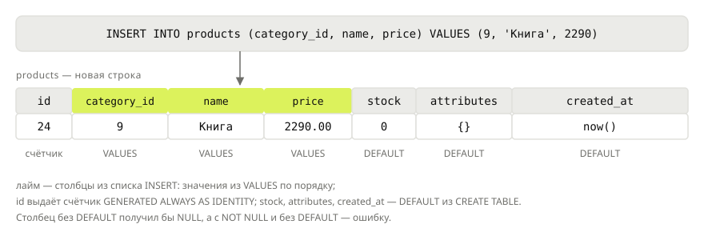

## Теория
`INSERT` добавляет строки в таблицу:
```sql
INSERT INTO таблица (столбец1, столбец2, …)
VALUES (значение1, значение2, …);
```
Значения идут в том же порядке, что столбцы в скобках, и должны подходить по типу: число — в числовой столбец, текст в кавычках — в текстовый.

**Список столбцов пишут всегда.** Без него `VALUES` должен перечислить все столбцы таблицы в порядке их создания. Такой запрос ломается, как только в таблицу добавят столбец, и его трудно читать: непонятно, какое число — цена, а какое — остаток.

**Столбцы, которых нет в списке**, получают значение по умолчанию (`DEFAULT` из определения таблицы), а если его нет — NULL. У `products` остаток `stock` по умолчанию `0`, `attributes` — `'{}'`, `created_at` — `now()`. Если у столбца `NOT NULL` и нет `DEFAULT`, пропустить его нельзя — будет ошибка. Значение по умолчанию можно попросить и явно — словом `DEFAULT` на месте значения.

**`id` не передают.** В учебной базе первичные ключи объявлены как `GENERATED ALWAYS AS IDENTITY`: база сама берёт следующее число из счётчика. Попытка указать `id` — ошибка. В старых проектах и конспектах вместо этого встречается `SERIAL` — он работает похоже, но позволяет записать `id` вручную и сбить счётчик; в новых таблицах берут `IDENTITY`.

**Несколько строк за раз** — через запятую: `VALUES (…), (…), (…)`. Это одна команда, и она выполняется целиком или не выполняется совсем: если хоть одна строка нарушает ограничение (`NOT NULL`, `UNIQUE`, `CHECK`, внешний ключ), не добавится ни одна.

**`RETURNING`** в конце возвращает добавленные строки, как `SELECT`: `RETURNING id` сообщает `id`, который выдала база. Приложение сразу узнаёт номер нового заказа без второго запроса — и без угадывания «последнего `id`».

## Наглядно
**Рисунок 1.** Откуда берутся значения новой строки.



**Таблица 1.** Варианты `INSERT`.

| Запрос | Что происходит |
|---|---|
| `INSERT INTO tags (name) VALUES ('эко')` | одна строка, `id` выдаёт база |
| `… VALUES ('эко'), ('для дома')` | две строки одной командой |
| `… (category_id, name, price) VALUES (9, 'Книга', 2290)` | `stock` = 0, `attributes` = `{}` — по умолчанию |
| `… VALUES (9, 'Книга', 2290, DEFAULT)` | `DEFAULT` явно — то же значение по умолчанию |
| `… RETURNING id` | вернуть `id` новой строки |
| `INSERT INTO categories (id, …) VALUES (10, …)` | ошибка: `id` — `GENERATED ALWAYS` |

## На практике
Задача: добавить в каталог новые товары и теги и узнать их `id`.

### Шаг 1. Новый товар
Подставка для ноутбука в «Аксессуары» (категория 4), 15 штук на складе. `RETURNING` показывает, что получилось:
```sql
INSERT INTO products (category_id, name, price, stock)
VALUES (4, 'Подставка для ноутбука', 1990, 15)
RETURNING id, name, price, stock, attributes;
```
Результат:
```
 id |          name          |  price  | stock | attributes
----+------------------------+---------+-------+------------
 23 | Подставка для ноутбука | 1990.00 |    15 | {}
(1 row)

INSERT 0 1
```
`id` 23 выдала база: в таблице было 22 товара. Цену `1990` мы передали целым числом, а столбец `numeric(10,2)` хранит её как `1990.00`. `attributes` не указан — сработал `DEFAULT '{}'`. Строка `INSERT 0 1` — отчёт psql: добавлена одна строка (`0` — устаревшее поле, оно всегда ноль).

### Шаг 2. Значения по умолчанию
Новая книга, которой пока нет на складе, — `stock` не указываем:
```sql
INSERT INTO products (category_id, name, price)
VALUES (9, 'Книга «Django изнутри»', 2290)
RETURNING id, name, stock, attributes;
```
Результат:
```
 id |          name          | stock | attributes
----+------------------------+-------+------------
 24 | Книга «Django изнутри» |     0 | {}
(1 row)

INSERT 0 1
```

### Шаг 3. Несколько строк
Два новых тега одной командой:
```sql
INSERT INTO tags (name)
VALUES ('эко'), ('для дома')
RETURNING id, name;
```
Результат:
```
 id |   name
----+----------
  7 | эко
  8 | для дома
(2 rows)

INSERT 0 2
```

### Шаг 4. Одна плохая строка — ни одной новой
Ещё два тега, но «хит» уже есть, а `name` у тегов `UNIQUE`:
```sql
INSERT INTO tags (name) VALUES ('кабели'), ('хит');
```
Результат:
```
ERROR:  duplicate key value violates unique constraint "tags_name_key"
DETAIL:  Key (name)=(хит) already exists.
```
«Кабели» тоже не добавились — команда отменена целиком:
```sql
SELECT id, name FROM tags WHERE id > 6;
```
Результат:
```
 id |   name
----+----------
  7 | эко
  8 | для дома
(2 rows)
```
При этом счётчик `id` успел выдать номера 9 и 10, и обратно он их не забирает: если теперь добавить «кабели» отдельно, тег получит `id` 11. Пропуски в `id` — нормально; `id` — это метка строки, а не порядковый номер без дыр.

### Шаг 5. id вручную
Новая категория с выбранным вручную `id`:
```sql
INSERT INTO categories (id, name, parent_id) VALUES (10, 'Кроссовки', 8);
```
Результат:
```
ERROR:  cannot insert a non-DEFAULT value into column "id"
DETAIL:  Column "id" is an identity column defined as GENERATED ALWAYS.
HINT:  Use OVERRIDING SYSTEM VALUE to override.
```
Подсказка `OVERRIDING SYSTEM VALUE` нужна для переноса данных из другой базы, когда `id` уже заняты ссылками, — так заполнены учебные данные. В обычном коде `id` просто убирают из списка столбцов.

## Частые ошибки
- **`INSERT` без списка столбцов.** Значения встают по порядку столбцов таблицы; добавят столбец — запрос сломается или запишет цену в остаток.
- **`id` в списке столбцов.** `GENERATED ALWAYS` не даёт задать его вручную; номер выдаёт база, узнать его — `RETURNING id`.
- **«Последний `id` + 1».** Номер нового заказа угадывают по `max(id)` или по тому, что видели раньше. Между запросами другой покупатель мог создать свой заказ, а счётчик мог пропустить номера. Правильно — `RETURNING id`.
- **Кавычки.** Текст — в одинарных кавычках: `'эко'`. Двойные кавычки — имя столбца: `"эко"` — ошибка `column "эко" does not exist`.
- **Ждать, что добавятся «хорошие» строки.** Многострочный `INSERT` атомарен: одна ошибка отменяет всю команду.

## Итог
**Синтаксис**
- `INSERT INTO t (столбцы) VALUES (…), (…)` — список столбцов всегда.
- Пропущенный столбец — `DEFAULT` или NULL; `NOT NULL` без `DEFAULT` пропустить нельзя.
- `DEFAULT` на месте значения — значение по умолчанию явно.

**id и RETURNING**
- `GENERATED ALWAYS AS IDENTITY` — `id` выдаёт база, вручную нельзя.
- `RETURNING id, …` — добавленные строки сразу в ответе.
- Счётчик не откатывается: пропуски в `id` — нормально.

**Ограничения**
- `NOT NULL`, `UNIQUE`, `CHECK`, внешний ключ проверяются на каждой строке.
- Одна ошибка — отменена вся команда.

## Вопросы на собеседовании
<details><summary>Как получить `id` только что вставленной строки?</summary>

В PostgreSQL — `INSERT … RETURNING id`: значение приходит в ответе того же запроса. Запрос `SELECT max(id)` после вставки ненадёжен: между запросами строку мог добавить кто-то ещё. ORM (Django, SQLAlchemy) на PostgreSQL используют именно `RETURNING`.
</details>

<details><summary>Чем `GENERATED … AS IDENTITY` отличается от `SERIAL`?</summary>

Оба берут значения из последовательности. `SERIAL` — старая запись PostgreSQL: тип плюс `DEFAULT nextval(…)`, и ничто не мешает вставить `id` вручную, после чего счётчик однажды выдаст уже занятый номер. `IDENTITY` — стандарт SQL; вариант `ALWAYS` запрещает ручной `id` (кроме явного `OVERRIDING SYSTEM VALUE`), `BY DEFAULT` — разрешает. Последовательность `IDENTITY` принадлежит столбцу и удаляется вместе с ним.
</details>

<details><summary>Почему в `id` бывают пропуски?</summary>

Последовательность выдаёт номер до того, как строка проверена и сохранена, и не возвращает его при ошибке или откате транзакции: иначе параллельным транзакциям пришлось бы ждать друг друга. Поэтому `id` уникален и растёт, но идёт с пропусками, и считать по нему количество строк нельзя.
</details>
