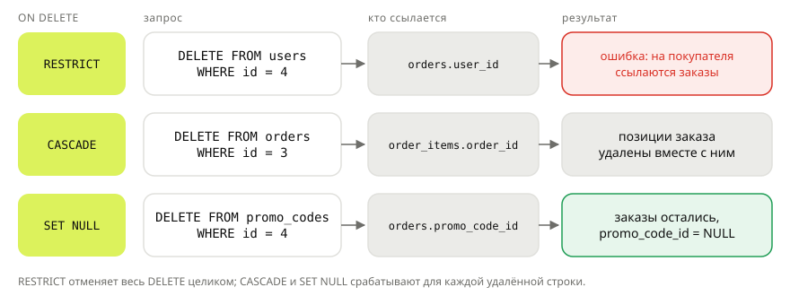

## Теория
`DELETE` удаляет строки, подходящие под условие:
```sql
DELETE FROM таблица
WHERE условие;
```
Правила те же, что у `UPDATE`: без `WHERE` удаляются **все** строки (сама таблица остаётся, пустая), `DELETE 0` — не ошибка, а знак, что условие ничего не нашло, `RETURNING` возвращает удалённые строки. Перед удалением — `SELECT` с тем же условием.

**Что будет со ссылками.** На удаляемую строку могут ссылаться внешние ключи других таблиц. Что тогда делать, записано в определении внешнего ключа (`ON DELETE`), и в базе магазина есть все три варианта:
- **`RESTRICT`** (и `NO ACTION` — поведение по умолчанию) — удаление запрещено, пока есть ссылки. Покупателя с заказами удалить нельзя: `orders.user_id` объявлен `ON DELETE RESTRICT`.
- **`CASCADE`** — вместе со строкой удаляются ссылающиеся на неё. Удалили заказ — удалились его позиции в `order_items`.
- **`SET NULL`** — в ссылающихся строках ключ становится NULL. Удалили промокод — у заказов с ним `promo_code_id` стал NULL, сами заказы остались.

**Мягкое удаление.** Покупателей, товары и заказы в магазинах обычно не удаляют, а помечают: `is_active = false`, `status = 'cancelled'`, столбец `deleted_at`. Так сохраняется история заказов и отчёты за прошлые месяцы. По-настоящему удаляют временные и служебные данные — и персональные данные по просьбе владельца (в учебной базе у пользователя с заказами для этого пришлось бы стереть или обезличить email и имя).

**`TRUNCATE`** очищает таблицу целиком: `TRUNCATE reviews`. Он не перебирает строки, а освобождает файлы таблицы, поэтому на больших таблицах намного быстрее `DELETE` без `WHERE`. Условия у него нет. На таблицу, на которую ссылаются внешние ключи, `TRUNCATE` не сработает — нужно чистить и ссылающиеся таблицы (`TRUNCATE … CASCADE` очищает их **целиком**). `RESTART IDENTITY` заодно сбрасывает счётчики `id`. В PostgreSQL `TRUNCATE` можно отменить внутри транзакции, как и `DELETE`.

## Наглядно
**Рисунок 1.** Три ответа внешнего ключа на удаление строки, на которую он ссылается.



**Таблица 1.** `DELETE` и `TRUNCATE`.

| | `DELETE` | `TRUNCATE` |
|---|---|---|
| Условие | `WHERE` | нет — вся таблица |
| Скорость на большой таблице | строка за строкой | сразу |
| Внешние ключи | `ON DELETE` для каждой строки | ошибка, если на таблицу ссылаются; `CASCADE` — очистить и их |
| `RETURNING` | есть | нет |
| Счётчик `id` | не меняется | сбрасывается с `RESTART IDENTITY` |
| Отмена в транзакции | да | да (в PostgreSQL) |

## На практике
Задача: убрать старые отменённые заказы, удалить промокод и разобраться, почему не удаляется покупатель.

### Шаг 1. Посмотреть, что удалим
Отменённые заказы до 2026 года:
```sql
SELECT id, user_id, created_at
FROM orders
WHERE status = 'cancelled' AND created_at < '2026-01-01';
```
Результат:
```
 id | user_id |       created_at
----+---------+------------------------
  3 |       3 | 2025-11-29 18:05:00+03
  9 |       2 | 2025-12-24 11:20:00+03
(2 rows)
```

### Шаг 2. Удалить
То же условие — в `DELETE`:
```sql
DELETE FROM orders
WHERE status = 'cancelled' AND created_at < '2026-01-01'
RETURNING id, user_id, created_at;
```
Результат:
```
 id | user_id |       created_at
----+---------+------------------------
  3 |       3 | 2025-11-29 18:05:00+03
  9 |       2 | 2025-12-24 11:20:00+03
(2 rows)

DELETE 2
```
Позиции этих заказов исчезли вместе с ними — `order_items.order_id` объявлен `ON DELETE CASCADE`:
```sql
SELECT id, order_id, product_id
FROM order_items
WHERE order_id IN (3, 9);
```
Результат:
```
 id | order_id | product_id
----+----------+------------
(0 rows)
```

### Шаг 3. SET NULL
Промокод BLACKFRIDAY давно закончился — удаляем его:
```sql
DELETE FROM promo_codes WHERE code = 'BLACKFRIDAY';
```
Результат:
```
DELETE 1
```
Заказы, оформленные с ним, остались, но ссылка обнулилась (`ON DELETE SET NULL`):
```sql
SELECT id, promo_code_id
FROM orders
WHERE id IN (1, 2, 4);
```
Результат:
```
 id | promo_code_id
----+---------------
  1 |
  2 |
  4 |
(3 rows)
```
Заодно потерялась информация, что заказы шли со скидкой 30 %. Поэтому в реальном магазине такой промокод скорее выключили бы, чем удалили.

### Шаг 4. RESTRICT
Покупатель 4 просит удалить аккаунт:
```sql
DELETE FROM users WHERE id = 4;
```
Результат:
```
ERROR:  update or delete on table "users" violates foreign key constraint "orders_user_id_fkey" on table "orders"
DETAIL:  Key (id)=(4) is still referenced from table "orders".
```
На покупателя ссылаются его заказы, а `RESTRICT` не даёт оставить их «ничьими». Вместо удаления аккаунт отключают: `UPDATE users SET is_active = false WHERE id = 4`.

## Частые ошибки
- **`DELETE` без `WHERE`.** Пустая таблица. Сначала `SELECT` с тем же условием.
- **Неожиданный каскад.** Удаление одной строки через `CASCADE` уносит строки других таблиц — смотрите `ON DELETE` у внешних ключей до удаления.
- **`NOT IN` с подзапросом, где есть NULL.** `WHERE id NOT IN (SELECT promo_code_id FROM orders)` удалит **0** строк: среди значений есть NULL, и `NOT IN` ни для одной строки не даёт TRUE — только FALSE или «неизвестно». Нужен `WHERE promo_code_id IS NOT NULL` в подзапросе.
- **Удаление вместо пометки.** Удалили покупателя, товар или промокод — потеряли историю заказов и отчётов. Чаще нужен `is_active = false`.
- **`TRUNCATE … CASCADE` ради одной таблицы.** Он очищает ссылающиеся таблицы полностью, а не только связанные строки.

## Итог
**DELETE**
- `DELETE FROM t WHERE …`; без `WHERE` — все строки.
- `DELETE n`, `RETURNING` — как у `UPDATE`.

**Внешние ключи**
- `RESTRICT` / `NO ACTION` — ошибка, пока есть ссылки.
- `CASCADE` — удаляются ссылающиеся строки.
- `SET NULL` — ссылка становится NULL.

**Практика**
- Важные данные помечают (`is_active`, `deleted_at`), а не удаляют.
- `TRUNCATE` — очистить таблицу целиком быстро, без условия.

## Вопросы на собеседовании
<details><summary>Чем `DELETE` отличается от `TRUNCATE`?</summary>

`DELETE` удаляет строки по условию одну за другой, проверяет внешние ключи для каждой, может вернуть удалённые строки через `RETURNING`. `TRUNCATE` очищает таблицу целиком без условия и без перебора строк — намного быстрее на больших таблицах, может сбросить счётчики (`RESTART IDENTITY`), но не работает, если на таблицу ссылаются внешние ключи (без `CASCADE`). В PostgreSQL оба откатываются в транзакции; `TRUNCATE` при этом блокирует таблицу целиком.
</details>

<details><summary>Чем `ON DELETE CASCADE` отличается от `ON DELETE SET NULL`?</summary>

`CASCADE` удаляет ссылающиеся строки вместе с удаляемой: подходит для «частей» — позиций заказа, профиля пользователя. `SET NULL` оставляет ссылающиеся строки и обнуляет в них ключ: подходит для необязательной связи — промокод у заказа. Для `SET NULL` столбец должен допускать NULL.
</details>

<details><summary>Что такое мягкое удаление и какие у него минусы?</summary>

Строку не удаляют, а помечают: `deleted_at = now()` или `is_active = false`. История и связи сохраняются, удаление можно отменить. Минусы: каждый запрос должен отфильтровывать удалённые строки (легко забыть), `UNIQUE` мешает завести новую запись с тем же email, таблица растёт. Первое решают представлениями или менеджером в ORM, второе — частичным уникальным индексом `… WHERE deleted_at IS NULL`.
</details>
