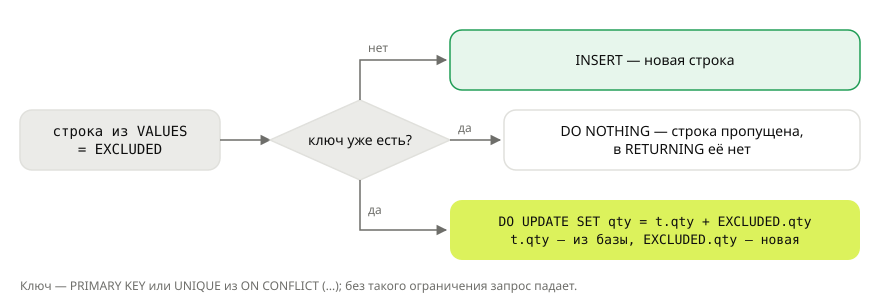

## Теория
Частая задача: «добавь строку, а если такая уже есть — обнови её». Покупатель кладёт в заказ товар, который там уже лежит, — нужно увеличить количество, а не завести вторую позицию. Импорт прайса: новые промокоды добавить, существующие — обновить. Это называют **UPSERT** (update + insert).

Решение «в лоб» — сначала `SELECT`, есть ли строка, потом `INSERT` или `UPDATE` — ломается при одновременных запросах: два запроса одновременно видят «строки нет», оба делают `INSERT`, и второй падает на `UNIQUE` (или, если ограничения нет, появляется дубль). В PostgreSQL для этого есть одна команда, которая решает всё атомарно:
```sql
INSERT INTO таблица (столбцы) VALUES (…)
ON CONFLICT (столбцы_ключа) DO UPDATE SET столбец = EXCLUDED.столбец;
```
**Конфликт** — это нарушение `PRIMARY KEY` или `UNIQUE`: строка с таким ключом уже есть. В скобках после `ON CONFLICT` перечисляют столбцы, по которым ищется совпадение, и на них обязательно должно быть уникальное ограничение. Иначе — ошибка `there is no unique or exclusion constraint matching the ON CONFLICT specification`: без него база не может гарантировать, что совпадение одно.

Варианты действия:
- **`DO NOTHING`** — строку не вставлять и не менять, без ошибки. Подходит для «добавь, если нет»: тег товару, подписка. Столбцы конфликта здесь можно не указывать — тогда годится любой уникальный ключ.
- **`DO UPDATE SET …`** — обновить существующую строку. В `SET` доступны две версии: **`EXCLUDED`** — строка, которую пытались вставить, и имя таблицы — строка, которая уже лежит в базе. `SET phone = EXCLUDED.phone` — заменить новым значением; `SET quantity = order_items.quantity + EXCLUDED.quantity` — прибавить к старому. После `SET` можно добавить `WHERE` — обновлять не всегда, а при условии.

`RETURNING` возвращает только вставленные и обновлённые строки; строки, пропущенные через `DO NOTHING`, в ответ не попадают. Счётчик `id` тратит номер и на строку, которая ушла в конфликт, — в `id` появляются пропуски.

В одной команде одна и та же существующая строка может обновиться только один раз: если в `VALUES` два раза один и тот же ключ, `DO UPDATE` падает с `cannot affect row a second time`.

## Наглядно
**Рисунок 1.** Что делает `INSERT … ON CONFLICT` с каждой строкой.



**Таблица 1.** Варианты `ON CONFLICT`.

| Запись | Что происходит при конфликте |
|---|---|
| `ON CONFLICT DO NOTHING` | строка пропускается без ошибки |
| `ON CONFLICT (user_id) DO UPDATE SET phone = EXCLUDED.phone` | значение заменяется новым |
| `… SET quantity = order_items.quantity + EXCLUDED.quantity` | к старому значению прибавляется новое |
| `… DO UPDATE SET … WHERE promo_codes.is_active` | обновить, только если условие верно |
| `ON CONFLICT (name)` без `UNIQUE (name)` | ошибка — не по чему искать совпадение |

## На практике
Задача: три сценария магазина — тег товару, телефон в профиле и товар в заказ.

### Шаг 1. Добавить, если нет
Беспроводной мыши (товар 4) нужны теги «хит» (1) и «скидка» (3). «Хит» у неё уже есть, первичный ключ `product_tags` — пара `(product_id, tag_id)`:
```sql
INSERT INTO product_tags (product_id, tag_id)
VALUES (4, 1), (4, 3)
ON CONFLICT DO NOTHING
RETURNING product_id, tag_id;
```
Результат:
```
 product_id | tag_id
------------+--------
          4 |      3
(1 row)

INSERT 0 1
```
Без `ON CONFLICT` команда упала бы на первой строке и не добавила бы и вторую. Запрос можно выполнить сколько угодно раз — результат один.

### Шаг 2. Заменить значение
Покупатели указали телефоны. У Егора (6) профиль есть, но без телефона, у Нины (13) профиля ещё нет:
```sql
INSERT INTO profiles (user_id, phone)
VALUES (6, '+79006667788'), (13, '+79013334455')
ON CONFLICT (user_id) DO UPDATE SET phone = EXCLUDED.phone
RETURNING user_id, phone, birth_date;
```
Результат:
```
 user_id |    phone     | birth_date
---------+--------------+------------
       6 | +79006667788 | 1990-09-09
      13 | +79013334455 |
(2 rows)

INSERT 0 2
```
У Егора обновился только `phone` — дата рождения осталась, потому что `SET` её не трогает. Для Нины профиль создан.

### Шаг 3. Прибавить к старому
В заказе 34 уже лежит смартфон (товар 10), покупатель добавляет ещё один:
```sql
INSERT INTO order_items (order_id, product_id, quantity, price)
VALUES (34, 10, 1, 39990.00)
ON CONFLICT (order_id, product_id)
DO UPDATE SET quantity = order_items.quantity + EXCLUDED.quantity
RETURNING id, order_id, product_id, quantity;
```
Результат:
```
 id | order_id | product_id | quantity
----+----------+------------+----------
 58 |       34 |         10 |        2
(1 row)

INSERT 0 1
```
`order_items.quantity` — старое значение (1), `EXCLUDED.quantity` — новое (1). Если написать `SET quantity = EXCLUDED.quantity`, в позиции осталась бы одна штука. `id` позиции прежний — 58, строка обновлена, а не создана.

Номер 59 при этом потрачен: следующая новая позиция получит `id` 60.

## Частые ошибки
- **`SELECT`, потом `INSERT`.** Работает, пока запрос один; при одновременных запросах — дубли или ошибки `UNIQUE`. Одна команда `INSERT … ON CONFLICT` атомарна.
- **`ON CONFLICT` по столбцу без `UNIQUE`.** Ошибка: совпадение ищется только по уникальному ограничению.
- **`DO NOTHING` вместо `DO UPDATE`.** Существующие строки молча остаются старыми — импорт «прошёл», а цены не обновились.
- **`EXCLUDED` вместо старого значения.** `SET quantity = EXCLUDED.quantity` заменяет количество, а не прибавляет. Старое значение — через имя таблицы.
- **Один ключ дважды в `VALUES`.** `DO UPDATE` не обновляет одну строку два раза за команду — ошибка; повторы собирают заранее.

## Итог
**ON CONFLICT**
- Конфликт — нарушение `PRIMARY KEY` или `UNIQUE`; в скобках — столбцы такого ограничения.
- `DO NOTHING` — пропустить строку; `DO UPDATE SET …` — обновить существующую.
- `EXCLUDED.столбец` — что пытались вставить, `таблица.столбец` — что лежит в базе.

**Поведение**
- Одна атомарная команда — без гонки между `SELECT` и `INSERT`.
- `RETURNING` — только вставленные и обновлённые строки.
- Номера `id` тратятся и на строки с конфликтом.

## Вопросы на собеседовании
<details><summary>Почему UPSERT не делают через `SELECT`, а потом `INSERT` или `UPDATE`?</summary>

Между проверкой и вставкой другой запрос может вставить ту же строку: оба увидят «строки нет», и второй упадёт на `UNIQUE` (или, без ограничения, создаст дубль). `INSERT … ON CONFLICT` проверяет и вставляет атомарно, опираясь на уникальный индекс. Альтернатива — блокировки или повтор при ошибке, но это сложнее.
</details>

<details><summary>Что такое `EXCLUDED`?</summary>

Специальное имя внутри `ON CONFLICT DO UPDATE`: строка, которую пытались вставить и которая ушла в конфликт. Существующая строка доступна по имени таблицы (или её псевдониму). `SET qty = t.qty + EXCLUDED.qty` прибавляет новое к старому.
</details>

<details><summary>Чем `INSERT … ON CONFLICT` отличается от `MERGE`?</summary>

`MERGE` (в PostgreSQL с версии 15) сопоставляет таблицу с источником строк по произвольному условию и для каждого случая — совпало, не совпало — выполняет `INSERT`, `UPDATE` или `DELETE`. Уникальный ключ ему не нужен, но и защиты от одновременной вставки той же строки он не даёт: возможна ошибка `UNIQUE`. `ON CONFLICT` проще и надёжнее для «вставить или обновить по ключу», `MERGE` — для синхронизации таблиц.
</details>
