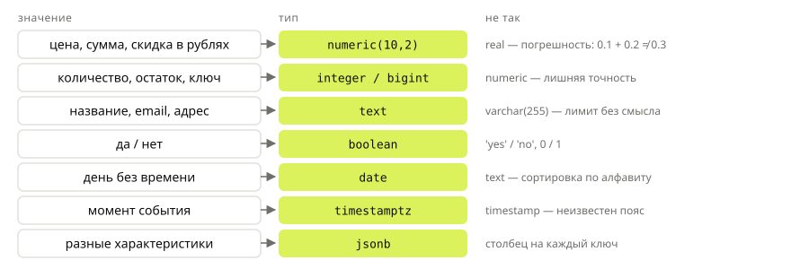

## Теория
`CREATE TABLE` описывает новую таблицу: имя и столбцы, у каждого — тип и, при необходимости, ограничения. Общий вид:
```sql
CREATE TABLE имя_таблицы (
    столбец тип [ограничения],
    столбец тип [ограничения]
);
```
Имена — латиницей в `snake_case`, таблица во множественном числе: `orders`, `order_items`, `promo_codes`. Имена без кавычек PostgreSQL приводит к нижнему регистру: `CREATE TABLE Orders` создаст `orders`.

Тип столбца — главное решение: он определяет, что в столбце может лежать и как с этим работать. Основные типы PostgreSQL:

- **Целые:** `integer` (до ~2,1 млрд) — для количества и ключей; `bigint` — для ключей больших таблиц (события, логи), где 2 млрд строк реально кончаются; `smallint` (до 32 767) — для маленьких значений вроде оценки 1–5.
- **Деньги и точные дроби:** `numeric(p, s)` — `p` цифр всего, `s` после запятой: `numeric(10,2)` хранит до 99 999 999.99. Считает точно, как на бумаге. Типы `real` и `double precision` — двоичные дроби с погрешностью: `0.1 + 0.2` у них не равно `0.3`. Для денег — только `numeric`.
- **Строки:** `text` — строка любой длины; `varchar(n)` — не длиннее `n` символов: более длинная строка — **ошибка**, а не обрезка. В PostgreSQL `text` и `varchar` работают одинаково быстро, поэтому `varchar(n)` берут, только когда ограничение длины — правило данных (код страны — 2 символа). `char(n)` дополняет строку пробелами — его не используют.
- **Логический:** `boolean` — `true`/`false` (и NULL, если столбец его допускает).
- **Дата и время:** `date` — только дата; `timestamptz` — **момент времени**: PostgreSQL переводит его в UTC и хранит без пояса, а показывает в часовом поясе сессии. `timestamp` — «показания часов» без пояса: `12:00` без уточнения, где. Для событий — заказов, регистраций — всегда `timestamptz`.
- **JSON:** `jsonb` — документ JSON в разобранном виде, с поиском по ключам и индексами (так хранятся `products.attributes`). `json` хранит текст как есть и нужен редко.

**Ключ `id`.** Современная запись — `id integer GENERATED ALWAYS AS IDENTITY PRIMARY KEY`: база сама выдаёт номера, и вписать свой нельзя. В конспектах и старых проектах встречается `id SERIAL PRIMARY KEY` — это `integer` со значением по умолчанию из последовательности: номер можно записать вручную и потом получить конфликт со счётчиком. Django с версии 4.1 тоже создаёт для PostgreSQL `IDENTITY` (вариант `BY DEFAULT`).

`DEFAULT` задаёт значение для столбца, которого нет в `INSERT`: `DEFAULT true`, `DEFAULT 0`, `DEFAULT now()`. `CREATE TABLE IF NOT EXISTS` не падает, если таблица уже есть, — но и не проверяет, что у неё те же столбцы.

## Наглядно
**Рисунок 1.** Тип выбирают по смыслу значения.



**Таблица 1.** Типы для таблиц магазина.

| Значение | Тип | Почему не другой |
|---|---|---|
| `id` | `integer GENERATED ALWAYS AS IDENTITY` | `SERIAL` разрешает ручной `id` |
| цена, сумма | `numeric(10,2)` | `real` и `double precision` считают с погрешностью |
| остаток, количество | `integer` | дробных штук не бывает |
| название, email | `text` | `varchar(n)` — только если длина и правда ограничена |
| флаг «активен» | `boolean` | не `'yes'`/`'no'` строкой и не `0`/`1` |
| дата рождения | `date` | время не нужно |
| время заказа | `timestamptz` | `timestamp` не знает, в каком поясе время |
| характеристики товара | `jsonb` | набор ключей разный у разных товаров |

## На практике
Задача: таблица пунктов выдачи заказов и проверка того, как типы ведут себя на деле.

### Шаг 1. Создать таблицу
У пункта выдачи — город, адрес, признак «работает» и время добавления:
```sql
CREATE TABLE delivery_points (
    id         integer GENERATED ALWAYS AS IDENTITY PRIMARY KEY,
    city       text        NOT NULL,
    address    text        NOT NULL,
    is_open    boolean     NOT NULL DEFAULT true,
    created_at timestamptz NOT NULL DEFAULT now()
);
```
Результат:
```
CREATE TABLE
```
Новая таблица появляется в полосе «Схема базы» тренажёра. `NOT NULL` — обязательный столбец; подробно ограничения — в следующей теме.

### Шаг 2. Первая строка
Добавляем пункт выдачи — `is_open` и `created_at` заполнятся сами:
```sql
INSERT INTO delivery_points (city, address)
VALUES ('Казань', 'ул. Баумана, 12')
RETURNING id, city, address, is_open;
```
Результат:
```
 id |  city  |     address     | is_open
----+--------+-----------------+---------
  1 | Казань | ул. Баумана, 12 | t
(1 row)

INSERT 0 1
```

### Шаг 3. Почему деньги — в numeric
Сложим 0.1 и 0.2 в двух типах:
```sql
SELECT 0.1::double precision + 0.2::double precision AS float_sum,
       0.1::numeric + 0.2::numeric AS numeric_sum;
```
Результат:
```
      float_sum      | numeric_sum
---------------------+-------------
 0.30000000000000004 |         0.3
(1 row)
```
Двоичная дробь не может точно записать 0.1, и ошибка вылезает при сложении. В корзине из тысячи позиций такие копейки складываются в расхождение с бухгалтерией.

### Шаг 4. varchar(n) не обрезает
Размер одежды — не длиннее трёх символов:
```sql
CREATE TABLE sizes (code varchar(3) NOT NULL);
INSERT INTO sizes (code) VALUES ('XXXL');
```
Результат:
```
CREATE TABLE
ERROR:  value too long for type character varying(3)
```
Строка длиннее ограничения — ошибка, ничего не записано.

### Шаг 5. timestamptz — момент
Один и тот же момент в двух часовых поясах:
```sql
SELECT '2026-04-15 12:00+03'::timestamptz AS moment;
SET TIME ZONE 'Asia/Novosibirsk';
SELECT '2026-04-15 12:00+03'::timestamptz AS moment;
```
Результат:
```
         moment
------------------------
 2026-04-15 12:00:00+03
(1 row)

SET
         moment
------------------------
 2026-04-15 16:00:00+07
(1 row)
```
Хранится одно и то же: момент в UTC. Меняется только то, как его показывают. Часовой пояс сессии в тренажёре — московский.

## Частые ошибки
- **Деньги в `real` или `double precision`.** Копейки теряются при сложении. Только `numeric(p, s)`.
- **`timestamp` для событий.** Время без пояса непонятно, когда сервер и покупатели в разных поясах. Для событий — `timestamptz`.
- **`varchar(255)` «на всякий случай».** Ограничение без смысла: в PostgreSQL оно не ускоряет, а длинное значение ломает вставку. Нужен лимит по правилам данных — `varchar(n)` или `CHECK`.
- **`SERIAL` в новой таблице.** Работает, но допускает ручной `id`. В новых таблицах — `GENERATED ALWAYS AS IDENTITY`.
- **Числа и даты в `text`.** Сортировка и сравнение пойдут по алфавиту: `'10' < '9'`. Тип выбирают по смыслу значения.

## Итог
**CREATE TABLE**
- `CREATE TABLE t (столбец тип ограничения, …)`; имена — `snake_case`.
- `id integer GENERATED ALWAYS AS IDENTITY PRIMARY KEY` — ключ, номера выдаёт база.
- `DEFAULT` — значение для пропущенного в `INSERT` столбца.

**Типы**
- Целые: `integer`, `bigint`, `smallint`.
- Деньги: `numeric(p, s)`; `real`/`double precision` — с погрешностью.
- Строки: `text`; `varchar(n)` — ошибка при превышении длины.
- `boolean`, `date`, `timestamptz` (момент), `jsonb`.

## Вопросы на собеседовании
<details><summary>Почему деньги не хранят во float?</summary>

`real` и `double precision` — двоичные дроби: большинство десятичных значений (0.1, 0.2) в них записываются приближённо, и при сложении и умножении ошибки накапливаются. `numeric` хранит десятичные цифры и считает точно. Альтернатива — хранить целое число копеек в `bigint`.
</details>

<details><summary>Чем `timestamp` отличается от `timestamptz`?</summary>

`timestamptz` — момент времени: при записи переводится в UTC, при чтении показывается в часовом поясе сессии. Сам пояс не хранится. `timestamp` — дата и время «без пояса», которые никуда не переводятся. Для событий берут `timestamptz`; `timestamp` подходит для «локального» времени вроде «открытие магазина в 10:00 по местному».
</details>

<details><summary>`text` или `varchar(n)` в PostgreSQL?</summary>

Хранятся и работают одинаково, разница только в проверке длины. Поэтому по умолчанию — `text`, а ограничение длины задают, когда оно — правило данных: `varchar(2)` для кода страны или `CHECK (length(code) <= 20)`, которое проще поменять.
</details>
