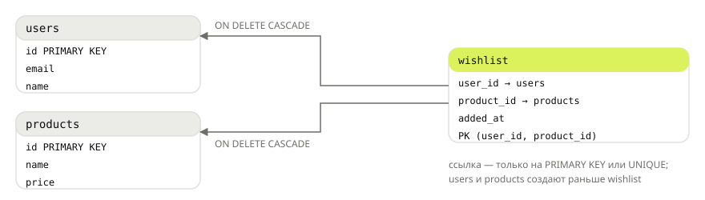

## Теория
**Внешний ключ** (foreign key) связывает столбец одной таблицы со строками другой: значение `orders.user_id` обязано быть `id` существующего покупателя. Без внешнего ключа база запишет заказ покупателя 999, которого нет, — и отчёты, и страницы заказов потом сломаются.

Запись у столбца:
```sql
user_id integer NOT NULL REFERENCES users (id) ON DELETE CASCADE
```
Или отдельной строкой — обязательно так, если ключ составной:
```sql
FOREIGN KEY (user_id) REFERENCES users (id) ON DELETE CASCADE
```
Правила:
- Ссылаться можно только на столбец с `PRIMARY KEY` или `UNIQUE` — иначе ошибка `there is no unique constraint matching given keys`. Если столбец не указан (`REFERENCES users`), берётся первичный ключ.
- Типы столбцов должны совпадать: `integer` ссылается на `integer`.
- Таблица, на которую ссылаются, должна уже существовать: сначала `users`, потом `orders`.
- Внешний ключ не запрещает NULL. Необязательная связь (промокод у заказа) — столбец без `NOT NULL`; обязательная (покупатель у заказа) — с `NOT NULL`.

**`ON DELETE`** — что делать со ссылающимися строками, когда удаляют строку, на которую они ссылаются (в разделе «Изменение данных» видели, как это работает).

**Таблица 1.** Варианты `ON DELETE`.

| Вариант | Поведение | Когда |
|---|---|---|
| `NO ACTION` (по умолчанию), `RESTRICT` | удаление запрещено | заказы покупателя, позиции с товаром |
| `CASCADE` | удалить и ссылающиеся строки | части целого: позиции заказа, профиль, избранное |
| `SET NULL` | ссылка становится NULL | необязательная связь: промокод у заказа |
| `SET DEFAULT` | ссылка становится `DEFAULT` | редко |

`SET NULL` у столбца с `NOT NULL` таблица примет, но удаление упадёт: записать NULL не даст `NOT NULL`. Аналогичное `ON UPDATE` срабатывает при изменении ключа; так как `id` не меняют, его почти не пишут.

Внешний ключ **не создаёт индекс** на ссылающемся столбце (`orders.user_id`). Запросы «заказы покупателя» и проверка при удалении покупателя без индекса просматривают всю таблицу, поэтому на такие столбцы индекс добавляют отдельно — об этом в разделе про производительность.

## Наглядно
**Рисунок 1.** Таблица `wishlist` ссылается на две таблицы.



## На практике
Задача: таблица избранного с настоящими связями — покупатель и товар обязаны существовать, а при их удалении записи в избранном исчезают.

### Шаг 1. Создать таблицу
Обе ссылки обязательные, с каскадным удалением:
```sql
CREATE TABLE wishlist (
    user_id    integer     NOT NULL REFERENCES users (id) ON DELETE CASCADE,
    product_id integer     NOT NULL REFERENCES products (id) ON DELETE CASCADE,
    added_at   timestamptz NOT NULL DEFAULT now(),
    PRIMARY KEY (user_id, product_id)
);
```
Результат:
```
CREATE TABLE
```

### Шаг 2. Ссылка на несуществующий товар
Ирина (9) откладывает два товара, Глеб (4) — один, а потом Ирина пытается отложить товар 99:
```sql
INSERT INTO wishlist (user_id, product_id) VALUES (9, 2), (9, 11), (4, 2);
INSERT INTO wishlist (user_id, product_id) VALUES (9, 99);
```
Результат:
```
INSERT 0 3
ERROR:  insert or update on table "wishlist" violates foreign key constraint "wishlist_product_id_fkey"
DETAIL:  Key (product_id)=(99) is not present in table "products".
```

### Шаг 3. Каскад
У Ирины нет заказов, поэтому её аккаунт удаляется (заказы ссылались бы на неё с `RESTRICT`). Её строки в избранном уходят вместе с ней:
```sql
DELETE FROM users WHERE id = 9;
SELECT user_id, product_id FROM wishlist;
```
Результат:
```
DELETE 1
 user_id | product_id
---------+------------
       4 |          2
(1 row)
```
Её отзыв в `reviews` тоже удалён — там `ON DELETE CASCADE`.

### Шаг 4. Ссылка не на ключ
Попробуем сослаться на столбец без `UNIQUE`:
```sql
CREATE TABLE city_stats (city text REFERENCES users (city));
```
Результат:
```
ERROR:  there is no unique constraint matching given keys for referenced table "users"
```
В `users.city` города повторяются — непонятно, на какую строку указывает ссылка.

## Частые ошибки
- **Нет внешнего ключа.** «Связь» только в голове разработчика: база примет заказ несуществующего покупателя.
- **Таблицы в неправильном порядке.** `CREATE TABLE supplies (… REFERENCES suppliers …)` до `suppliers` — ошибка `relation "suppliers" does not exist`.
- **`ON DELETE` не задан.** По умолчанию удаление запрещено — если нужен каскад, его пишут явно.
- **`CASCADE` не к месту.** Каскад от покупателя к заказам уничтожит историю продаж. Каскад — для частей целого.
- **`SET NULL` у `NOT NULL`.** Таблица создаётся, а удаление потом падает.
- **Нет индекса на ссылающемся столбце.** Внешний ключ его не создаёт.

## Итог
**Синтаксис**
- `столбец тип REFERENCES таблица (столбец) ON DELETE …` или `FOREIGN KEY (…) REFERENCES …`.
- Ссылка — только на `PRIMARY KEY` или `UNIQUE`, тип совпадает.
- Сначала создают таблицу, на которую ссылаются.

**ON DELETE**
- `NO ACTION`/`RESTRICT` (по умолчанию) — запрет; `CASCADE` — удалить следом; `SET NULL` — обнулить ссылку.
- Обязательная связь — `NOT NULL`; необязательная — без него.
- Индекс на ссылающийся столбец — отдельно.

## Вопросы на собеседовании
<details><summary>Зачем внешние ключи, если связи можно проверять в коде?</summary>

Код проверяет только свои пути записи, а в базу пишут ещё админка, импорт, миграции, ручные запросы. Внешний ключ гарантирует, что ссылка указывает на существующую строку, при любой записи и при удалении — в том числе при одновременных запросах, где проверка в коде легко пропускает гонку.
</details>

<details><summary>Чем `RESTRICT` отличается от `NO ACTION`?</summary>

Оба запрещают удалить строку, на которую ссылаются. `NO ACTION` проверяет это в конце команды (или транзакции, если ограничение отложенное — `DEFERRABLE`), поэтому успевают сработать другие действия той же команды; `RESTRICT` проверяет сразу. В обычных запросах разницы не видно.
</details>

<details><summary>Создаёт ли внешний ключ индекс?</summary>

Нет. Индекс есть у столбца, на который ссылаются (`PRIMARY KEY` или `UNIQUE`), а на ссылающемся столбце — нет. Без него медленные и выборки «все заказы покупателя», и удаление покупателя: базе нужно найти ссылающиеся строки. Django для `ForeignKey` создаёт такой индекс сам.
</details>
