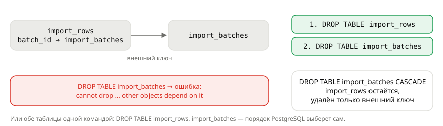

## Теория
`DROP TABLE имя` удаляет таблицу целиком: структуру, данные, индексы и ограничения. В отличие от `DELETE` и `TRUNCATE`, после него таблицы больше нет — запросы к ней падают с `relation … does not exist`. Отменить `DROP` можно только в незавершённой транзакции; после — только из бэкапа.

**`IF EXISTS`.** `DROP TABLE таблица` падает, если таблицы нет. `DROP TABLE IF EXISTS таблица` в этом случае выдаёт замечание (`NOTICE`) и продолжает работу — так пишут скрипты, которые запускают повторно: очистка временных таблиц, тестовые данные.

**Зависимости.** Если на таблицу ссылается внешний ключ другой таблицы, `DROP` падает: `cannot drop table … because other objects depend on it`. Варианты:
- удалить таблицы **в обратном порядке**: сначала ссылающиеся, потом ту, на которую ссылаются (`order_items` раньше `orders`);
- удалить их **одной командой**: `DROP TABLE import_rows, import_batches` — PostgreSQL сам разберётся с порядком;
- **`DROP TABLE … CASCADE`** — удалить таблицу и всё, что от неё зависит. Важно: `CASCADE` удаляет **внешние ключи** в других таблицах (и представления, о них позже), но **не сами таблицы** и не их строки. После `DROP TABLE promo_codes CASCADE` таблица `orders` остаётся, в `promo_code_id` остаются старые номера, только теперь они ни на что не ссылаются, и база примет любой номер.

Сравнение трёх способов «удалить»:
- `DELETE` — строки по условию, таблица остаётся;
- `TRUNCATE` — все строки, таблица остаётся;
- `DROP TABLE` — таблицы больше нет.

## Наглядно
**Рисунок 1.** Порядок удаления таблиц со ссылками.



## На практике
Задача: удалить временные таблицы импорта и посмотреть, что `CASCADE` делает с основной схемой.

### Шаг 1. Временные таблицы
Импорт хранит партии файлов и строки из них:
```sql
CREATE TABLE import_batches (
    id          integer     GENERATED ALWAYS AS IDENTITY PRIMARY KEY,
    file_name   text        NOT NULL,
    uploaded_at timestamptz NOT NULL DEFAULT now()
);
CREATE TABLE import_rows (
    id       integer GENERATED ALWAYS AS IDENTITY PRIMARY KEY,
    batch_id integer NOT NULL REFERENCES import_batches (id) ON DELETE CASCADE,
    name     text    NOT NULL,
    price    numeric(10,2)
);
```
Результат:
```
CREATE TABLE
CREATE TABLE
```

### Шаг 2. Не в том порядке
Импорт закончен — удаляем партии:
```sql
DROP TABLE import_batches;
```
Результат:
```
ERROR:  cannot drop table import_batches because other objects depend on it
DETAIL:  constraint import_rows_batch_id_fkey on table import_rows depends on table import_batches
HINT:  Use DROP ... CASCADE to drop the dependent objects too.
```
`ON DELETE CASCADE` тут не помогает: он про удаление строк, а не таблицы.

### Шаг 3. Обе таблицы
Нужны обе — удаляем одной командой:
```sql
DROP TABLE import_rows, import_batches;
DROP TABLE IF EXISTS import_rows;
```
Результат:
```
DROP TABLE
NOTICE:  table "import_rows" does not exist, skipping
DROP TABLE
```
Повторное удаление с `IF EXISTS` не падает — только замечание.

### Шаг 4. Что делает CASCADE
Удалим промокоды с `CASCADE` и посмотрим на заказы:
```sql
DROP TABLE promo_codes CASCADE;
SELECT id, promo_code_id FROM orders WHERE id IN (1, 18);
```
Результат:
```
NOTICE:  drop cascades to constraint orders_promo_code_id_fkey on table orders
DROP TABLE
 id | promo_code_id
----+---------------
  1 |             4
 18 |             1
(2 rows)
```
`orders` на месте, номера промокодов в заказах тоже — но промокодов 4 и 1 больше нет, а внешний ключ удалён. Теперь `INSERT INTO orders (user_id, promo_code_id) VALUES (1, 77)` пройдёт без ошибки. `CASCADE` перечисляет удалённое в `NOTICE` — его стоит читать.

## Частые ошибки
- **`CASCADE` «чтобы не мешало».** Молча удаляются внешние ключи в других таблицах, и данные остаются без проверки.
- **Неверный порядок.** Сначала удаляют таблицу, которая ссылается, потом ту, на которую ссылаются, — или обе одной командой.
- **`DROP` вместо `TRUNCATE`.** Нужно очистить данные, а таблица ещё понадобится — `TRUNCATE` или `DELETE`.
- **Скрипт без `IF EXISTS`.** Повторный запуск падает на уже удалённой таблице.
- **`ON DELETE CASCADE` спасёт от ошибки `DROP`.** Не спасёт: он срабатывает при удалении строк, а не таблиц.

## Итог
**DROP TABLE**
- Удаляет таблицу целиком: структуру и данные.
- `IF EXISTS` — без ошибки, если таблицы нет.
- Несколько таблиц одной командой: `DROP TABLE a, b`.

**Зависимости**
- На таблицу ссылаются — `DROP` падает.
- Порядок: сначала ссылающиеся таблицы.
- `CASCADE` удаляет внешние ключи (и представления), а не ссылающиеся таблицы.

## Вопросы на собеседовании
<details><summary>Чем отличаются `DELETE`, `TRUNCATE` и `DROP`?</summary>

`DELETE` удаляет строки по условию, проверяя внешние ключи для каждой; `TRUNCATE` быстро очищает таблицу целиком; `DROP` удаляет саму таблицу вместе со структурой, индексами и ограничениями. После `DELETE` и `TRUNCATE` таблица остаётся пустой, после `DROP` её нет. В PostgreSQL все три можно откатить в транзакции.
</details>

<details><summary>Что удаляет `DROP TABLE … CASCADE`?</summary>

Таблицу и объекты, которые без неё не могут существовать: внешние ключи других таблиц, ссылающиеся на неё, представления на её основе. Сами ссылающиеся таблицы и их строки остаются — только без ограничения. Что именно удалено, PostgreSQL перечисляет в `NOTICE`.
</details>

<details><summary>Как безопасно удалить таблицу в рабочем проекте?</summary>

Сначала убрать её использование из кода и выкатить, убедиться по логам, что к таблице нет запросов, сделать бэкап, затем удалить — без `CASCADE`, чтобы ошибка показала забытые зависимости. В Django удаление модели превращается в миграцию с `DROP TABLE`, и порядок миграций учитывает связи между моделями.
</details>
