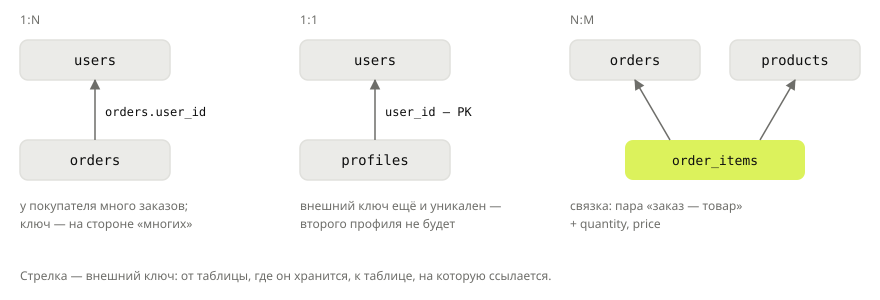

## Теория
Данные магазина разложены по таблицам так, чтобы каждый факт хранился **один раз**: имя покупателя — в `users`, название товара — в `products`. Таблицы связаны внешними ключами, и по тому, сколько строк с каждой стороны может участвовать в связи, различают три вида.

**Один ко многим (1:N)** — самая частая связь. У покупателя много заказов, у заказа один покупатель. Внешний ключ ставят на стороне «многих»: `orders.user_id` ссылается на `users.id`. Наоборот не получится — в строке покупателя не поместится список заказов. Так же устроены «категория — товары», «товар — отзывы».

**Один к одному (1:1)** — у строки не больше одной пары. Профиль покупателя (`profiles`) — телефон и дата рождения — вынесен из `users` в отдельную таблицу. Связь 1:1 получается, когда внешний ключ ещё и уникален: `profiles.user_id` — одновременно первичный ключ и ссылка на `users`, поэтому второго профиля у покупателя быть не может. Зачем разделять: необязательные или редко нужные данные, данные с другими правами доступа.

**Многие ко многим (N:M)** — в заказе много товаров, и один товар есть во многих заказах. Ни в `orders`, ни в `products` такую связь не записать, поэтому заводят **таблицу-связку**: каждая строка `order_items` — пара «заказ — товар», два внешних ключа. В связке хранят то, что относится к паре: количество и цену на момент покупки. Если дополнительных полей нет, ключ связки — сама пара (`product_tags`, первичный ключ `(product_id, tag_id)`).

Отдельный случай — **самосвязь**: таблица ссылается сама на себя. `categories.parent_id` указывает на другую категорию — так хранится дерево «Электроника → Компьютеры → Ноутбуки».

Почему не записать товары заказа строкой `'1,4,7'` в `orders`? Такое значение нельзя проверить внешним ключом (товара 99 может не быть), к нему не приложишь количество и цену, по нему неудобно искать («все заказы с товаром 4») и невозможно построить индекс. Одно значение в ячейке — первое правило проектирования таблиц (первая нормальная форма).

Чтобы собрать связанные данные обратно в один ответ — «заказ с именем покупателя и названиями товаров», — таблицы **соединяют** в запросе: `JOIN`. Этому посвящён весь раздел.

## Наглядно
**Рисунок 1.** Три вида связей в базе магазина.



**Таблица 1.** Связи в учебной базе.

| Связь | Вид | Где внешний ключ |
|---|---|---|
| покупатель — заказы | 1:N | `orders.user_id` |
| покупатель — профиль | 1:1 | `profiles.user_id` (он же первичный ключ) |
| заказы — товары | N:M | связка `order_items` (+ количество, цена) |
| товары — теги | N:M | связка `product_tags` |
| категория — товары | 1:N | `products.category_id` |
| категория — подкатегории | 1:N, самосвязь | `categories.parent_id` |
| промокод — заказы | 1:N, необязательная | `orders.promo_code_id` (может быть NULL) |

## На практике
Задача: посмотреть, как связи выглядят в самих таблицах, — пока без соединений.

### Шаг 1. Связка N:M
Что лежит в заказе 1 — строки `order_items` с `order_id = 1`:
```sql
SELECT order_id, product_id, quantity, price
FROM order_items
WHERE order_id = 1;
```
Результат:
```
 order_id | product_id | quantity |  price
----------+------------+----------+----------
        1 |          1 |        1 | 59990.00
        1 |          4 |        1 |  1290.00
        1 |          7 |        1 |   490.00
(3 rows)
```
Три строки — три товара заказа. Вместо названий — номера товаров: чтобы получить названия, `order_items` соединяют с `products`.

### Шаг 2. Связка без своих полей
Теги ноутбука 1:
```sql
SELECT product_id, tag_id
FROM product_tags
WHERE product_id = 1;
```
Результат:
```
 product_id | tag_id
------------+--------
          1 |      1
          1 |      2
(2 rows)
```

### Шаг 3. Связь 1:1
Профиль Анны — не больше одной строки, потому что `user_id` — первичный ключ `profiles`:
```sql
SELECT user_id, phone, birth_date
FROM profiles
WHERE user_id = 1;
```
Результат:
```
 user_id |    phone     | birth_date
---------+--------------+------------
       1 | +79001112233 | 1994-03-12
(1 row)
```

## Частые ошибки
- **Внешний ключ не на той стороне.** `users.order_id` позволил бы покупателю только один заказ. При 1:N ключ — у «многих».
- **Список в ячейке.** `product_ids = '1,4,7'` — ни проверки, ни количества, ни индекса. Нужна связка.
- **N:M без связки.** Два внешних ключа «друг на друга» в `orders` и `products` связь N:M не выражают.
- **1:1 без уникальности.** Если `profiles.user_id` не уникален, у покупателя может оказаться два профиля.
- **Повтор данных вместо связи.** Имя покупателя, скопированное в каждый заказ, расходится после смены имени.

## Итог
**Виды связей**
- 1:N — внешний ключ на стороне «многих».
- 1:1 — внешний ключ, который ещё и `UNIQUE` / `PRIMARY KEY`.
- N:M — таблица-связка с двумя внешними ключами; в ней — поля пары.
- Самосвязь — ссылка на свою же таблицу (дерево категорий).

**Проектирование**
- Каждый факт — в одном месте, одно значение — в одной ячейке.
- Собрать данные обратно — `JOIN`.

## Вопросы на собеседовании
<details><summary>Как реализовать связь многие-ко-многим?</summary>

Через промежуточную таблицу с двумя внешними ключами — на каждую из связываемых таблиц. Первичный ключ — пара внешних ключей или отдельный `id` плюс `UNIQUE` на паре. В связку кладут атрибуты самой связи: количество и цену позиции заказа, дату добавления в избранное. В Django это `ManyToManyField` (связку создаёт сам) или `through`-модель, если нужны свои поля.
</details>

<details><summary>Зачем выносить данные в связь 1:1, если можно добавить столбцы?</summary>

Необязательные данные (профиль есть не у всех), редко читаемые или тяжёлые данные (чтобы не тащить их в каждом запросе), данные с другим доступом (паспорт, платёжные реквизиты), данные другого модуля приложения. Если данные обязательные и читаются всегда вместе — лучше столбцы в той же таблице.
</details>

<details><summary>Что такое первая нормальная форма?</summary>

Каждая ячейка хранит одно значение, без списков и повторяющихся групп столбцов (`phone1`, `phone2`, `phone3`). Список выносят в отдельную таблицу со связью 1:N или N:M. Следующие нормальные формы убирают дублирование фактов — например, название товара не хранится в каждой позиции заказа.
</details>
