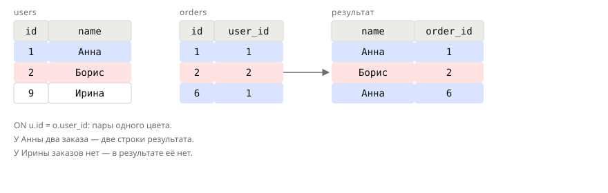

## Теория
`JOIN` соединяет строки двух таблиц в одну строку результата по условию:
```sql
SELECT o.id, o.status, u.email
FROM orders o
JOIN users u ON u.id = o.user_id;
```
`FROM orders o` — первая таблица, `JOIN users u` — вторая, `ON` — условие, при котором строки считаются парой. Обычно условие — равенство внешнего ключа и первичного: `u.id = o.user_id`. `JOIN` без уточнения — это **`INNER JOIN`**.

Как думать о результате: база перебирает все пары «строка из `orders` × строка из `users`» и оставляет те, где `ON` истинно. Каждая такая пара — одна строка результата, в ней доступны столбцы обеих таблиц. (Внутри база делает это гораздо умнее, через индексы, но результат именно такой.) Отсюда два свойства INNER JOIN:
- **Строка без пары исчезает.** Покупатель без заказов в соединении `users JOIN orders` не появится.
- **Строка с несколькими парами повторяется.** У Анны 6 заказов — в результате 6 строк с её именем.

**Псевдонимы** таблиц (`orders o`, `users u`) сокращают запрос. Когда псевдоним задан, обращаться к таблице надо через него. Столбцы с одинаковыми именами в двух таблицах (`id`, `name`, `created_at`) обязательно уточняют: `o.id`, `u.id`. Без уточнения — ошибка `column reference "id" is ambiguous`. Хорошая привычка — уточнять **все** столбцы в запросе с `JOIN`: читателю сразу видно, откуда каждый.

Условие соединения пишут в `ON`, фильтры строк — в `WHERE`. Для `INNER JOIN` результат не изменится, если фильтр перенести в `ON`, но читается запрос лучше, когда `ON` — только про связь. (Для `LEFT JOIN` разница есть — в следующей теме.)

Если столбцы связи называются одинаково, можно писать `JOIN … USING (столбец)`. В учебной базе ключи называются `id`, а ссылки — `user_id`, поэтому используется `ON`.

Тренажёр показывает соединение двух таблиц наглядно: исходные таблицы, совпавшие пары одним цветом и результат.

## Наглядно
**Рисунок 1.** INNER JOIN: пары по условию, строки без пары не попадают в результат.



## На практике
Задача: показать заказы с почтой покупателя и товары категории по её названию.

### Шаг 1. Заказы с email
Заказы за апрель 2026 и почта, на которую слать уведомление:
```sql
SELECT o.id, o.status, u.email
FROM orders o
JOIN users u ON u.id = o.user_id
WHERE o.created_at >= '2026-04-01'
ORDER BY o.id;
```
Результат:
```
 id | status |            email
----+--------+-----------------------------
 28 | paid   | anna.smirnova@example.com
 29 | paid   | gleb.popov@example.com
 30 | paid   | zakhar.novikov@example.com
 31 | paid   | vera.kuznetsova@example.com
 32 | new    | maksim.fedorov@example.com
 33 | new    | boris.ivanov@example.com
 34 | new    | anna.smirnova@example.com
(7 rows)
```

### Шаг 2. Неоднозначный столбец
`id` есть в обеих таблицах:
```sql
SELECT id, email
FROM orders o
JOIN users u ON u.id = o.user_id;
```
Результат:
```
ERROR:  column reference "id" is ambiguous
```
База не знает, какой `id` нужен — заказа или покупателя. Пишем `o.id`.

### Шаг 3. Строка повторяется
Все заказы Анны с её именем:
```sql
SELECT u.name, o.id AS order_id, o.created_at
FROM users u
JOIN orders o ON o.user_id = u.id
WHERE u.id = 1
ORDER BY o.id;
```
Результат:
```
     name      | order_id |       created_at
---------------+----------+------------------------
 Анна Смирнова |        1 | 2025-11-28 10:15:00+03
 Анна Смирнова |        6 | 2025-12-05 12:00:00+03
 Анна Смирнова |       14 | 2026-01-20 19:30:00+03
 Анна Смирнова |       22 | 2026-03-01 09:00:00+03
 Анна Смирнова |       28 | 2026-04-02 08:50:00+03
 Анна Смирнова |       34 | 2026-04-15 20:10:00+03
(6 rows)
```
Одна строка `users` — шесть строк результата, по одной на каждый заказ.

### Шаг 4. Фильтр по соседней таблице
Ноутбуки — по названию категории, а не по её номеру:
```sql
SELECT p.name, p.price
FROM products p
JOIN categories c ON c.id = p.category_id
WHERE c.name = 'Ноутбуки';
```
Результат:
```
         name         |  price
----------------------+----------
 Ноутбук Aster 14     | 64990.00
 Ноутбук Aster 16 Pro | 89990.00
 Ноутбук Nimbus Air   | 54990.00
(3 rows)
```
Столбцы `categories` в `SELECT` не выводятся, но участвуют в `WHERE`.

## Частые ошибки
- **Неуточнённые столбцы.** `id`, `name`, `created_at` есть в нескольких таблицах — ошибка `ambiguous`. Пишите `таблица.столбец` или `псевдоним.столбец`.
- **Не те столбцы в `ON`.** `ON p.id = r.id` вместо `ON p.id = r.product_id` выполняется без ошибки и соединяет случайные строки: отзыв 4 «приклеится» к товару 4. Связь — всегда внешний ключ = первичный ключ.
- **Ожидание «одна строка на покупателя».** `JOIN` с таблицей «многих» повторяет строку столько раз, сколько у неё пар.
- **Потерянные строки.** `INNER JOIN` выбрасывает строки без пары; нужны все — `LEFT JOIN`.
- **Таблица по имени после псевдонима.** После `FROM orders o` запись `orders.id` — ошибка: таблица теперь называется `o`.

## Итог
**INNER JOIN**
- `FROM a JOIN b ON условие` — пары строк, для которых условие истинно.
- Строка без пары исчезает; строка с N парами даёт N строк.
- Условие связи — внешний ключ = первичный ключ.

**Запись**
- Псевдонимы: `orders o`, `users u`.
- Одинаковые имена столбцов уточняют: `o.id`.
- `ON` — связь, `WHERE` — фильтр.

## Вопросы на собеседовании
<details><summary>Что вернёт INNER JOIN для строки, у которой нет пары?</summary>

Ничего: строка не попадёт в результат. Покупатель без заказов исчезнет из `users JOIN orders`. Если такие строки нужны — `LEFT JOIN`, где на месте столбцов второй таблицы будет NULL.
</details>

<details><summary>Почему после JOIN строк больше, чем в исходной таблице?</summary>

Каждая пара, удовлетворяющая условию, — отдельная строка. Если у одной строки первой таблицы несколько пар во второй (у покупателя несколько заказов), она повторяется. Это нормально для 1:N; неожиданное «размножение» обычно значит, что условие соединения неполное.
</details>

<details><summary>Есть ли разница между условием в `ON` и в `WHERE`?</summary>

Для `INNER JOIN` — нет: строка останется в результате, только если выполнены оба условия, где бы они ни стояли. Для `LEFT JOIN` разница принципиальная: условие в `ON` решает, какая строка справа станет парой, а условие в `WHERE` фильтрует уже готовый результат и может выбросить строки без пары.
</details>
