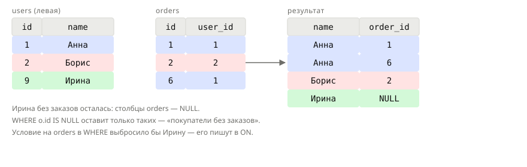

## Теория
`INNER JOIN` выбрасывает строки без пары. Но часто нужны как раз все строки одной таблицы: все покупатели — с заказами и без, все товары — с отзывами и без. Для этого есть **внешние соединения**.

**`LEFT JOIN`** (полностью `LEFT OUTER JOIN`) сохраняет **все строки левой таблицы** — той, что в `FROM`. Строки с парами соединяются как обычно; строка без пары попадает в результат один раз, а на месте столбцов правой таблицы — NULL.

**`RIGHT JOIN`** — то же, но сохраняется правая таблица. `FROM a RIGHT JOIN b` — то же самое, что `FROM b LEFT JOIN a`. На практике пишут `LEFT JOIN`, ставя главную таблицу первой: запрос читается сверху вниз «берём все … и добавляем к ним …».

**Поиск отсутствующих** (анти-соединение). Раз у строки без пары правые столбцы — NULL, по ним её и находят:
```sql
SELECT u.id, u.name
FROM users u
LEFT JOIN orders o ON o.user_id = u.id
WHERE o.id IS NULL;
```
«Покупатели без заказов», «товары без отзывов», «категории без товаров» — один и тот же шаблон. Проверяют на NULL столбец, который **не может быть NULL** в самой правой таблице: её первичный ключ или столбец с `NOT NULL`. Иначе строка с настоящим NULL (заказ без промокода) спутается с «пары нет».

**Условие на правую таблицу — в `ON`, а не в `WHERE`.** `WHERE` выполняется после соединения и видит у строк без пары NULL. Условие `WHERE o.status = 'new'` для такой строки — `NULL = 'new'`, то есть «неизвестно», и строка отбрасывается: `LEFT JOIN` тихо превращается в `INNER JOIN`. Если нужно «все покупатели, а из заказов — только новые», условие ставят в `ON`: `LEFT JOIN orders o ON o.user_id = u.id AND o.status = 'new'`. Тогда оно решает, какой заказ считается парой, а покупатели остаются все. Условия на **левую** таблицу — в `WHERE`, как обычно.

## Наглядно
**Рисунок 1.** LEFT JOIN сохраняет все строки левой таблицы.



**Таблица 1.** INNER и LEFT JOIN `users` и `orders`.

| Покупатель | INNER JOIN | LEFT JOIN |
|---|---|---|
| с 4 заказами | 4 строки | 4 строки |
| с 1 заказом | 1 строка | 1 строка |
| без заказов | нет строк | 1 строка, столбцы заказа — NULL |

## На практике
Задача: список покупателей с заказами, поиск покупателей без заказов и товаров без отзывов.

### Шаг 1. Все покупатели
Покупатели с номерами от 9 и их заказы:
```sql
SELECT u.id, u.name, o.id AS order_id
FROM users u
LEFT JOIN orders o ON o.user_id = u.id
WHERE u.id >= 9
ORDER BY u.id, o.id;
```
Результат:
```
 id |      name      | order_id
----+----------------+----------
  9 | Ирина Морозова |
 10 | Кирилл Волков  |
 11 | Лидия Павлова  |
 12 | Максим Фёдоров |        7
 12 | Максим Фёдоров |       15
 12 | Максим Фёдоров |       23
 12 | Максим Фёдоров |       32
 13 | Нина Орлова    |
(8 rows)
```
С `INNER JOIN` остались бы только четыре строки Максима.

### Шаг 2. Покупатели без заказов
Оставляем строки, у которых пары не нашлось:
```sql
SELECT u.id, u.name
FROM users u
LEFT JOIN orders o ON o.user_id = u.id
WHERE o.id IS NULL
ORDER BY u.id;
```
Результат:
```
 id |      name
----+----------------
  9 | Ирина Морозова
 10 | Кирилл Волков
 11 | Лидия Павлова
 13 | Нина Орлова
(4 rows)
```
Им можно отправить промокод на первый заказ.

### Шаг 3. Товары без отзывов
Тот же шаблон для другой пары таблиц:
```sql
SELECT p.id, p.name
FROM products p
LEFT JOIN reviews r ON r.product_id = p.id
WHERE r.id IS NULL
ORDER BY p.id;
```
Результат:
```
 id |           name
----+---------------------------
  2 | Ноутбук Aster 16 Pro
  3 | Ноутбук Nimbus Air
  8 | USB-хаб на 4 порта
 11 | Смартфон Pixelon 8 Max
 14 | Зарядное устройство 65 Вт
 17 | Футболка с принтом
 18 | Лонгслив
 21 | Книга «Алгоритмы просто»
 22 | Носки, 3 пары
(9 rows)
```

### Шаг 4. Условие в WHERE и в ON
Москвичи и их новые заказы. Сначала — условие на статус в `WHERE`:
```sql
SELECT u.id, u.name, o.id AS order_id
FROM users u
LEFT JOIN orders o ON o.user_id = u.id
WHERE u.city = 'Москва' AND o.status = 'new'
ORDER BY u.id, o.id;
```
Результат:
```
 id |      name      | order_id
----+----------------+----------
  1 | Анна Смирнова  |       34
 12 | Максим Фёдоров |       32
(2 rows)
```
Москвичей четыре, а в ответе двое: у Веры и Жанны новых заказов нет, и `WHERE` их выбросил. Переносим условие на заказы в `ON`:
```sql
SELECT u.id, u.name, o.id AS order_id
FROM users u
LEFT JOIN orders o ON o.user_id = u.id AND o.status = 'new'
WHERE u.city = 'Москва'
ORDER BY u.id, o.id;
```
Результат:
```
 id |      name      | order_id
----+----------------+----------
  1 | Анна Смирнова  |       34
  3 | Вера Кузнецова |
  7 | Жанна Козлова  |
 12 | Максим Фёдоров |       32
(4 rows)
```
Условие на город (левая таблица) осталось в `WHERE`, на статус (правая) — ушло в `ON`.

## Частые ошибки
- **`INNER JOIN` + `IS NULL`.** У `INNER JOIN` нет строк без пары — поиск «отсутствующих» вернёт пустой результат.
- **Условие на правую таблицу в `WHERE`.** Строки без пары отбрасываются, и `LEFT JOIN` работает как `INNER`.
- **`IS NULL` по столбцу, который бывает NULL.** `WHERE o.promo_code_id IS NULL` найдёт и заказы без промокода. Проверяют первичный ключ правой таблицы.
- **`RIGHT JOIN` там, где проще `LEFT`.** Запрос читается хуже; поменяйте таблицы местами.
- **Таблицы не в том порядке.** `FROM orders LEFT JOIN users` сохраняет все заказы, а не всех покупателей.

## Итог
**LEFT / RIGHT JOIN**
- `LEFT JOIN` сохраняет все строки левой таблицы; без пары — NULL справа.
- `RIGHT JOIN` — зеркально; обычно заменяют на `LEFT`, переставив таблицы.

**Шаблоны**
- «Нет пары»: `LEFT JOIN … WHERE правая.id IS NULL`.
- Условие на правую таблицу — в `ON`, на левую — в `WHERE`.

## Вопросы на собеседовании
<details><summary>Как найти покупателей без заказов?</summary>

`SELECT u.* FROM users u LEFT JOIN orders o ON o.user_id = u.id WHERE o.id IS NULL`. Другие варианты — `WHERE NOT EXISTS (SELECT 1 FROM orders o WHERE o.user_id = u.id)` (часто самый понятный и быстрый) и `WHERE u.id NOT IN (SELECT user_id FROM orders)` — последний опасен, если в подзапросе может оказаться NULL.
</details>

<details><summary>Почему `LEFT JOIN` с условием в `WHERE` ведёт себя как `INNER JOIN`?</summary>

`WHERE` применяется к результату соединения. У строк без пары столбцы правой таблицы — NULL, и любое сравнение с ними даёт NULL, поэтому `WHERE` их отбрасывает. Условие, которое должно выбирать пару, а не фильтровать результат, пишут в `ON`.
</details>

<details><summary>Зачем нужен `RIGHT JOIN`, если есть `LEFT JOIN`?</summary>

Для полноты стандарта: они взаимозаменяемы перестановкой таблиц. Иногда `RIGHT JOIN` удобен в длинной цепочке соединений, чтобы не переписывать её, но в большинстве команд принято писать только `LEFT JOIN`.
</details>
