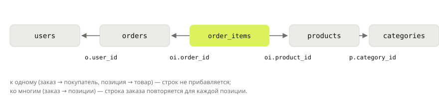

## Теория
Ответ на вопрос «что купили и в каких категориях» лежит в четырёх таблицах: `orders` → `order_items` → `products` → `categories`. Соединений в запросе может быть сколько угодно — их пишут подряд:
```sql
FROM order_items oi
JOIN products p ON p.id = oi.product_id
JOIN categories c ON c.id = p.category_id
```
Каждый следующий `JOIN` присоединяет таблицу к **уже собранному** результату, поэтому в `ON` можно ссылаться на любую из предыдущих таблиц. Удобно идти по схеме вдоль стрелок внешних ключей: от позиции к товару, от товара к категории. Для `INNER JOIN` порядок записи на результат не влияет — база сама выбирает, в каком порядке соединять.

**Размножение строк.** Каждое соединение с таблицей «многих» умножает строки. Это ожидаемо, когда идём по одной цепочке (заказ → его позиции). Но если присоединить к товару **две независимые** таблицы «многих» — теги и отзывы, — получатся все сочетания: 2 тега × 3 отзыва = 6 строк, и каждый отзыв повторится дважды. Посчитанные по такому результату суммы и количества будут завышены. Соединяйте в одном запросе только одну ветку «многих» или сначала сворачивайте данные (агрегация — в следующем разделе).

**Внешние соединения в цепочке.** Если первое соединение `LEFT`, а следующее — обычный `JOIN`, строки без пары снова теряются: у покупателя без заказов `o.id` — NULL, и `JOIN order_items oi ON oi.order_id = o.id` для него не находит пары. Правило: после `LEFT JOIN` все соединения, которые зависят от правой таблицы, тоже `LEFT`.

## Наглядно
**Рисунок 1.** Цепочка соединений идёт вдоль внешних ключей.



**Таблица 1.** Сколько строк даёт цепочка.

| Соединение | Строк для заказа 25 |
|---|---|
| `orders` | 1 |
| `… JOIN users` | 1 — у заказа один покупатель |
| `… JOIN order_items` | 3 — три позиции |
| `… JOIN products` | 3 — у позиции один товар |

## На практике
Задача: состав заказа с категориями, заказ с покупателем и товарами, и две ловушки — размножение строк и потеря строк в цепочке.

### Шаг 1. Позиции с товарами и категориями
Состав заказа 1:
```sql
SELECT oi.order_id, p.name AS product, c.name AS category, oi.quantity, oi.price
FROM order_items oi
JOIN products p ON p.id = oi.product_id
JOIN categories c ON c.id = p.category_id
WHERE oi.order_id = 1;
```
Результат:
```
 order_id |      product      |  category  | quantity |  price
----------+-------------------+------------+----------+----------
        1 | Ноутбук Aster 14  | Ноутбуки   |        1 | 59990.00
        1 | Беспроводная мышь | Аксессуары |        1 |  1290.00
        1 | Коврик для мыши   | Аксессуары |        1 |   490.00
(3 rows)
```
Цена — из `order_items`: столько заплатили в «чёрную пятницу». Сейчас ноутбук стоит 64990.00 (`products.price`).

### Шаг 2. Четыре таблицы
Заказ 25 — кто купил и что:
```sql
SELECT o.id, u.name AS customer, p.name AS product, oi.quantity
FROM orders o
JOIN users u ON u.id = o.user_id
JOIN order_items oi ON oi.order_id = o.id
JOIN products p ON p.id = oi.product_id
WHERE o.id = 25
ORDER BY p.name;
```
Результат:
```
 id |   customer   |         product         | quantity
----+--------------+-------------------------+----------
 25 | Борис Иванов | Книга «SQL на практике» |        1
 25 | Борис Иванов | Футболка базовая белая  |        1
 25 | Борис Иванов | Футболка базовая чёрная |        1
(3 rows)
```

### Шаг 3. Две ветки «многих»
К белой футболке присоединяем и теги, и отзывы:
```sql
SELECT p.name, t.name AS tag, r.rating
FROM products p
JOIN product_tags pt ON pt.product_id = p.id
JOIN tags t ON t.id = pt.tag_id
JOIN reviews r ON r.product_id = p.id
WHERE p.id = 15
ORDER BY t.name, r.rating;
```
Результат:
```
          name          |  tag   | rating
------------------------+--------+--------
 Футболка базовая белая | скидка |      3
 Футболка базовая белая | скидка |      4
 Футболка базовая белая | скидка |      5
 Футболка базовая белая | хит    |      3
 Футболка базовая белая | хит    |      4
 Футболка базовая белая | хит    |      5
(6 rows)
```
У футболки 2 тега и 3 отзыва, а строк 6: каждый отзыв сочетается с каждым тегом. Средняя оценка по такому результату ещё совпадёт, а вот «число отзывов» получится 6 вместо 3.

### Шаг 4. LEFT, а потом JOIN
Покупатели из Казани и купленные ими товары — покупатели без покупок тоже нужны:
```sql
SELECT u.name, p.name AS product
FROM users u
LEFT JOIN orders o ON o.user_id = u.id
JOIN order_items oi ON oi.order_id = o.id
JOIN products p ON p.id = oi.product_id
WHERE u.city = 'Казань';
```
Результат:
```
    name    |         product
------------+-------------------------
 Глеб Попов | Футболка базовая белая
 Глеб Попов | Футболка базовая чёрная
 Глеб Попов | Беспроводная мышь
 Глеб Попов | Механическая клавиатура
 Глеб Попов | Коврик для мыши
 Глеб Попов | Книга «Python с нуля»
(6 rows)
```
Лидия Павлова из Казани без заказов пропала: второй `JOIN` не нашёл пары для её NULL. Делаем всю цепочку `LEFT`:
```sql
SELECT u.name, p.name AS product
FROM users u
LEFT JOIN orders o ON o.user_id = u.id
LEFT JOIN order_items oi ON oi.order_id = o.id
LEFT JOIN products p ON p.id = oi.product_id
WHERE u.city = 'Казань'
ORDER BY u.name, p.name;
```
Результат:
```
     name      |         product
---------------+-------------------------
 Глеб Попов    | Беспроводная мышь
 Глеб Попов    | Книга «Python с нуля»
 Глеб Попов    | Коврик для мыши
 Глеб Попов    | Механическая клавиатура
 Глеб Попов    | Футболка базовая белая
 Глеб Попов    | Футболка базовая чёрная
 Лидия Павлова |
(7 rows)
```

## Частые ошибки
- **`JOIN` после `LEFT JOIN`.** Строки без пары теряются дальше по цепочке. После `LEFT` — тоже `LEFT`.
- **Две ветки «многих» в одном запросе.** Теги × отзывы, позиции × платежи — строки размножаются, суммы и количества завышены.
- **Не та цена.** В составе заказа цена — `order_items.price` (на момент покупки), а не `products.price`.
- **Пропущенное звено.** `orders` и `products` напрямую не связаны — между ними `order_items`.
- **Одинаковые имена в результате.** `p.name` и `c.name` оба называются `name`; дайте им `AS`.

## Итог
**Цепочка**
- `JOIN` пишут подряд; каждый присоединяет таблицу к собранному результату.
- Идут по внешним ключам: позиция → товар → категория.
- Порядок `INNER JOIN` на результат не влияет.

**Ловушки**
- Две независимые таблицы «многих» — строки перемножаются.
- После `LEFT JOIN` зависимые соединения — тоже `LEFT`.
- Одинаковые имена столбцов — `AS`.

## Вопросы на собеседовании
<details><summary>Влияет ли порядок таблиц в цепочке JOIN на результат?</summary>

Для `INNER JOIN` — нет: результат одинаковый, а порядок выполнения выбирает планировщик. Для внешних соединений — да: `LEFT JOIN` сохраняет строки таблицы слева от себя, и перестановка меняет, какие строки сохранятся. Производительность от порядка записи обычно не зависит, пока соединений немного.
</details>

<details><summary>Почему после нескольких JOIN сумма заказов получилась больше настоящей?</summary>

Скорее всего, к строке присоединены две независимые таблицы «многих» (например, позиции и платежи заказа), и строки перемножились: каждая позиция повторилась по числу платежей. Лечится агрегацией каждой ветки отдельно (подзапрос или CTE) и только потом соединением.
</details>

<details><summary>Как ORM решает, сколько JOIN делать?</summary>

В Django `select_related` делает `JOIN` по внешним ключам «к одному» (позиция → товар → категория) — строки не размножаются. Для связей «ко многим» `prefetch_related` делает отдельный запрос на каждую связь и собирает результат в Python, как раз чтобы избежать размножения.
</details>
