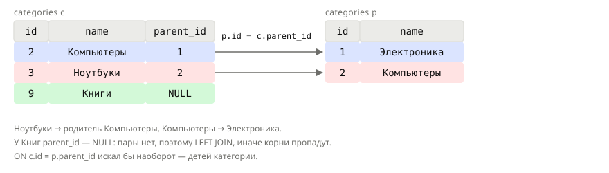

## Теория
Три соединения встречаются реже, но у каждого — своя задача.

**Самосвязь (self-join)** — соединение таблицы с самой собой. В `categories` у подкатегории есть `parent_id` — ссылка на другую строку той же таблицы. Чтобы рядом с категорией показать название родителя, таблицу берут дважды под разными псевдонимами: `categories c` — сама категория, `categories p` — её родитель. Направление условия важно: `p.id = c.parent_id` — «родитель категории `c`»; `c.id = p.parent_id` — наоборот, «дети категории `c`». У корневых категорий родителя нет, поэтому соединение — `LEFT`. Так же строят «сотрудник — руководитель», «комментарий — ответ на комментарий».

**`CROSS JOIN`** — все сочетания строк двух таблиц, без условия: 3 размера × 2 цвета = 6 вариантов товара. Число строк — произведение размеров таблиц, поэтому на больших таблицах `CROSS JOIN` опасен. Частая **случайная** форма — перечисление таблиц через запятую без условия связи: `FROM orders, users WHERE o.status = 'new'` соединяет каждый заказ с каждым покупателем. Запятая в `FROM` — это старая запись соединения, условие для неё пишут в `WHERE`; забыли условие — получили декартово произведение. Явный `JOIN … ON` такую ошибку не допускает: без `ON` он не выполнится.

**`FULL JOIN`** (`FULL OUTER JOIN`) сохраняет строки **обеих** таблиц: пары соединяются, строки без пары с любой стороны дополняются NULL. Нужен для **сверки** двух списков: товары в базе и результаты инвентаризации, заказы в магазине и платежи в банке. Строки с NULL слева — «есть только во втором списке», с NULL справа — «только в первом». Внешние ключи учебной базы не дают появиться ссылке «в никуда», поэтому `FULL JOIN` по ним равен `LEFT JOIN`; он нужен там, где связь не защищена ключом.

В примерах ниже встречается запись `(VALUES ('S'), ('M')) AS s (size)` — маленькая таблица прямо в запросе: строки в скобках, имя таблицы и столбцов после `AS`.

## Наглядно
**Рисунок 1.** Самосвязь: одна таблица под двумя псевдонимами.



**Таблица 1.** Внешние и перекрёстные соединения.

| Соединение | Строки результата | Применение |
|---|---|---|
| `LEFT JOIN` | все слева + пары | все покупатели с заказами |
| `RIGHT JOIN` | все справа + пары | то же, наоборот |
| `FULL JOIN` | все слева + все справа + пары | сверка двух списков |
| `CROSS JOIN` | каждая с каждой, n × m | сочетания размеров и цветов |
| `FROM a, b` без условия | каждая с каждой — обычно ошибка | — |

## На практике
Задача: дерево категорий, варианты футболки и сверка склада с инвентаризацией.

### Шаг 1. Категория и родитель
Таблица `categories` — дважды: `c` — категория, `p` — её родитель:
```sql
SELECT c.id, c.name AS category, p.name AS parent
FROM categories c
LEFT JOIN categories p ON p.id = c.parent_id
ORDER BY c.id;
```
Результат:
```
 id |  category   |   parent
----+-------------+-------------
  1 | Электроника |
  2 | Компьютеры  | Электроника
  3 | Ноутбуки    | Компьютеры
  4 | Аксессуары  | Компьютеры
  5 | Смартфоны   | Электроника
  6 | Одежда      |
  7 | Футболки    | Одежда
  8 | Обувь       | Одежда
  9 | Книги       |
(9 rows)
```
Без `LEFT` корневые «Электроника», «Одежда» и «Книги» исчезли бы.

### Шаг 2. Все сочетания
Футболка в трёх размерах и двух цветах:
```sql
SELECT s.size, c.color
FROM (VALUES ('S'), ('M'), ('L')) AS s (size)
CROSS JOIN (VALUES ('black'), ('white')) AS c (color)
ORDER BY c.color, s.size;
```
Результат:
```
 size | color
------+-------
 L    | black
 M    | black
 S    | black
 L    | white
 M    | white
 S    | white
(6 rows)
```
Размеры отсортированы по алфавиту, а не по росту: для базы это просто строки.

### Шаг 3. Запятая без условия
Сколько строк даст «соединение» заказов и покупателей без условия:
```sql
SELECT count(*) AS total
FROM orders, users;
```
Результат:
```
 total
-------
   442
(1 row)
```
`count(*)` считает строки результата (подробно — в разделе «Агрегация»). 34 заказа × 13 покупателей = 442: каждый заказ «принадлежит» каждому.

### Шаг 4. Сверка с инвентаризацией
Склад пересчитал аксессуары и прислал таблицу. Сравним с остатками в базе:
```sql
CREATE TABLE stock_count (product_id integer PRIMARY KEY, counted integer NOT NULL);
INSERT INTO stock_count VALUES (4, 12), (5, 28), (6, 7), (7, 50), (9, 9), (99, 3);

SELECT p.id, p.name, p.stock, s.product_id, s.counted
FROM products p
FULL JOIN stock_count s ON s.product_id = p.id
WHERE p.category_id = 4 OR p.id IS NULL
ORDER BY p.id, s.product_id;
```
Результат:
```
CREATE TABLE
INSERT 0 6
 id |          name           | stock | product_id | counted
----+-------------------------+-------+------------+---------
  4 | Беспроводная мышь       |    12 |          4 |      12
  5 | Проводная мышь          |    30 |          5 |      28
  6 | Механическая клавиатура |     7 |          6 |       7
  7 | Коврик для мыши         |    50 |          7 |      50
  8 | USB-хаб на 4 порта      |     0 |            |
  9 | Веб-камера              |     9 |          9 |       9
    |                         |       |         99 |       3
(7 rows)
```
Три вида расхождений в одном ответе: у проводной мыши не сходится количество, USB-хаб склад не считал, а товара 99 в базе нет. Условие `p.id IS NULL` в `WHERE` сохраняет строки, которые есть только в инвентаризации.

## Частые ошибки
- **Самосвязь в обратную сторону.** `ON c.id = p.parent_id` вместо `p.id = c.parent_id` выводит детей вместо родителя — и строк становится больше.
- **Самосвязь без `LEFT`.** Корневые строки (без родителя) пропадают.
- **Запятая в `FROM` без условия.** Декартово произведение: 34 × 13 строк. Пишите `JOIN … ON`.
- **`CROSS JOIN` больших таблиц.** 100 000 × 100 000 = 10 млрд строк.
- **Фильтр по одной стороне `FULL JOIN` в `WHERE`.** `WHERE p.category_id = 4` выбросит строки, которых нет в `products`; нужен `OR p.id IS NULL` или условие в `ON`.

## Итог
**Самосвязь**
- Одна таблица под двумя псевдонимами; направление `ON` — по смыслу.
- Корни дерева — через `LEFT JOIN`.

**CROSS JOIN**
- Все сочетания, n × m строк.
- `FROM a, b` без условия — то же самое, обычно по ошибке.

**FULL JOIN**
- Все строки обеих таблиц, без пары — NULL.
- Для сверки двух списков.

## Вопросы на собеседовании
<details><summary>Что такое self-join и когда он нужен?</summary>

Соединение таблицы с самой собой под разными псевдонимами — для связи строк одной таблицы: категория и родительская категория, сотрудник и руководитель, товар и аналог. Для иерархии произвольной глубины одного соединения мало — используют рекурсивный CTE (`WITH RECURSIVE`).
</details>

<details><summary>Чем `CROSS JOIN` отличается от `INNER JOIN` без условия?</summary>

`INNER JOIN` без `ON` в PostgreSQL — синтаксическая ошибка. `CROSS JOIN` — декартово произведение: каждая строка с каждой. То же самое даёт `FROM a, b` без условия в `WHERE` и `JOIN … ON true`. Число строк результата — произведение размеров таблиц.
</details>

<details><summary>Когда нужен `FULL JOIN`?</summary>

Когда важны строки без пары с обеих сторон: сверка двух источников (база и выгрузка, заказы и платежи), объединение двух отчётов по ключу. В схеме с внешними ключами по связи «ссылка — ключ» он не нужен: ссылка без строки невозможна, и `FULL` совпадает с `LEFT`.
</details>
