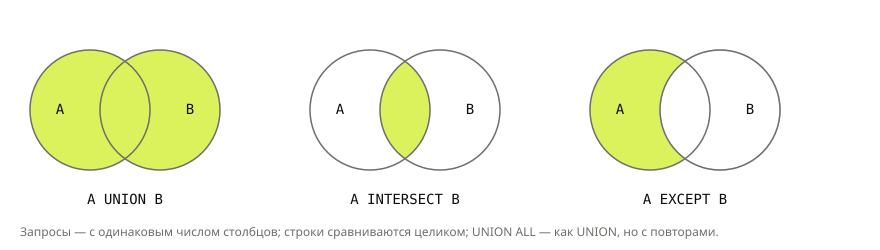

## Теория
`JOIN` ставит столбцы двух таблиц **рядом**. Операции над множествами работают иначе: складывают результаты двух запросов **друг под другом** или сравнивают их как наборы строк.
- **`UNION`** — строки обоих запросов, повторы убраны: «покупатели **или** авторы отзывов».
- **`UNION ALL`** — строки обоих запросов как есть, с повторами. Быстрее: не надо искать дубли. Берут, когда повторов быть не может или они нужны.
- **`INTERSECT`** — строки, которые есть в обоих результатах: «покупали **и** писали отзывы».
- **`EXCEPT`** — строки первого результата, которых нет во втором: «покупали, **но** не писали отзывов». Порядок запросов важен: `A EXCEPT B` ≠ `B EXCEPT A`.

Правила:
- в обоих запросах **одинаковое число столбцов**, и столбцы на одних местах — совместимых типов (текст с текстом, число с числом);
- имена столбцов результата берутся из **первого** запроса;
- сравниваются строки целиком; NULL при этом считаются равными друг другу;
- `ORDER BY` пишут один раз, в конце — он сортирует весь результат; по имени столбца из первого запроса.

`UNION` убирает повторы, как `DISTINCT`, — в том числе внутри одного запроса. Если нужны все строки (например, потом их считать), пишут `UNION ALL`.

## Наглядно
**Рисунок 1.** Три операции над двумя наборами.



**Таблица 1.** Операции над множествами.

| Операция | Результат | Повторы |
|---|---|---|
| `A UNION B` | строки A и B | убраны |
| `A UNION ALL B` | строки A и B | остаются |
| `A INTERSECT B` | строки, которые есть и в A, и в B | убраны |
| `A EXCEPT B` | строки A, которых нет в B | убраны |

## На практике
Задача: список для рассылки и сравнение купленных товаров с товарами, у которых есть отзывы.

### Шаг 1. Покупатели или авторы отзывов
Номера пользователей, у которых есть заказ или отзыв, — каждый один раз:
```sql
SELECT user_id FROM orders
UNION
SELECT user_id FROM reviews
ORDER BY user_id;
```
Результат:
```
 user_id
---------
       1
       2
       3
       4
       5
       6
       7
       8
       9
      12
(10 rows)
```
Девять покупателей и Ирина (9), которая заказов не делала, но оставила отзыв. С `UNION ALL` строк было бы 55: 34 заказа и 21 отзыв, с повторами.

### Шаг 2. И то, и другое
Товары, которые покупали и на которые есть отзывы:
```sql
SELECT product_id FROM order_items
INTERSECT
SELECT product_id FROM reviews
ORDER BY product_id;
```
Результат:
```
 product_id
------------
          1
          4
          5
          6
          7
          9
         10
         12
         13
         15
         16
         19
         20
(13 rows)
```

### Шаг 3. Одно без другого
Товары, которые покупали, но отзывов на них нет, — им пригодится письмо «оцените покупку»:
```sql
SELECT product_id FROM order_items
EXCEPT
SELECT product_id FROM reviews
ORDER BY product_id;
```
Результат:
```
 product_id
------------
          2
         11
         14
(3 rows)
```
Если поменять запросы местами, получится «есть отзыв, но никто не покупал» — в учебных данных таких товаров нет (Ирина купила книгу в другом магазине, но книгу покупали и у нас), результат пустой.

### Шаг 4. Разные типы
Столбцы на одном месте должны быть совместимы:
```sql
SELECT name FROM users
UNION
SELECT id FROM tags;
```
Результат:
```
ERROR:  UNION types text and integer cannot be matched
```

## Частые ошибки
- **`UNION` вместо `UNION ALL`.** Повторы пропадают — и количество строк, и суммы по результату станут меньше.
- **`UNION ALL` вместо `UNION`.** Один адрес получит рассылку дважды.
- **`EXCEPT` в обратном порядке.** `A EXCEPT B` и `B EXCEPT A` — разные вопросы.
- **Разное число или типы столбцов.** Ошибка `each UNION query must have the same number of columns` или `types … cannot be matched`.
- **`ORDER BY` в первом запросе.** Сортировка относится ко всему результату и пишется в конце.

## Итог
**Операции**
- `UNION` — или (без повторов), `UNION ALL` — с повторами.
- `INTERSECT` — и, `EXCEPT` — первое без второго.

**Правила**
- Одинаковое число столбцов, совместимые типы по позициям.
- Имена — из первого запроса; `ORDER BY` — один, в конце.
- Сравниваются строки целиком.

## Вопросы на собеседовании
<details><summary>Чем `UNION` отличается от `UNION ALL`?</summary>

`UNION` убирает повторяющиеся строки (для этого база сортирует или хеширует весь результат), `UNION ALL` просто склеивает результаты. `UNION ALL` быстрее и не теряет строки; `UNION` нужен, когда повторы действительно лишние.
</details>

<details><summary>Чем `UNION` отличается от `JOIN`?</summary>

`JOIN` соединяет строки двух таблиц по условию, и столбцы встают рядом — результат «шире». `UNION` ставит строки двух запросов друг под другом — результат «длиннее», а число столбцов не меняется.
</details>

<details><summary>Чем `EXCEPT` отличается от `LEFT JOIN … IS NULL` и `NOT IN`?</summary>

Все три отвечают на вопрос «что есть в A, но нет в B». `EXCEPT` сравнивает строки целиком и убирает повторы; NULL для него равен NULL. `LEFT JOIN … WHERE b.id IS NULL` и `NOT EXISTS` сравнивают по выбранным столбцам и позволяют вывести любые столбцы A. `NOT IN` ломается, если во втором наборе есть NULL.
</details>
