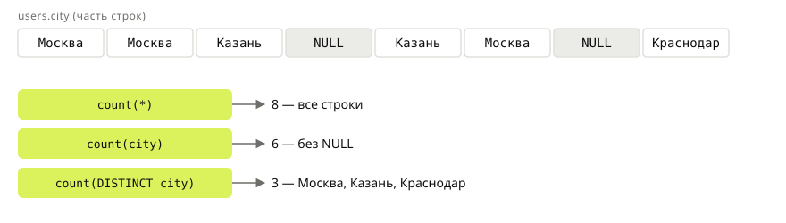

## Теория
Обычные функции (`round`, `upper`) работают с одной строкой и возвращают значение для каждой. **Агрегатные** функции берут много строк и сворачивают их в одно значение: «сколько товаров», «средняя цена», «самый поздний заказ».

**Таблица 1.** Агрегатные функции.

| Функция | Что считает |
|---|---|
| `count(*)` | число строк |
| `count(столбец)` | число строк, где в столбце **не** NULL |
| `count(DISTINCT столбец)` | число разных значений, не считая NULL |
| `sum(столбец)` | сумму |
| `avg(столбец)` | среднее арифметическое |
| `min(столбец)`, `max(столбец)` | наименьшее и наибольшее — для чисел, строк, дат |

**NULL агрегаты пропускают.** `count(city)` не считает покупателей без города, `avg(rating)` делит на число непустых оценок, а не на число строк. Только `count(*)` считает строки целиком, независимо от значений.

**Пустой набор.** Если `WHERE` не оставил ни одной строки, `count` возвращает `0`, а `sum`, `avg`, `min`, `max` — **NULL**: суммы «ничего» нет. Для отчётов NULL заменяют нулём: `COALESCE(sum(stock), 0)`.

**Типы результата.** `count` — `bigint`. `avg` от целых чисел — `numeric` с десятками знаков после запятой: `4.1904761904761905`; для вывода его округляют `round(avg(x), 2)`. `sum` от `numeric` — `numeric`, от `integer` — `bigint`, так что переполнения при сложении не бывает.

Без `GROUP BY` вся таблица (или всё, что прошло `WHERE`) — **одна группа**, и результат — одна строка. Поэтому в одном `SELECT` нельзя смешать агрегат и обычный столбец: `SELECT name, max(price)` — непонятно, имя какой из 22 строк показать. PostgreSQL отвечает ошибкой `must appear in the GROUP BY clause or be used in an aggregate function`. «Самый дорогой товар» ищут сортировкой: `ORDER BY price DESC LIMIT 1`.

## Наглядно
**Рисунок 1.** Агрегат сворачивает столбец в одно значение; NULL не участвует.



## На практике
Задача: сводка по каталогу и покупателям для главной страницы админки.

### Шаг 1. Каталог в цифрах
Сколько товаров, средняя, минимальная и максимальная цена и сколько всего штук на складе:
```sql
SELECT count(*) AS products,
       round(avg(price), 2) AS avg_price,
       min(price) AS min_price,
       max(price) AS max_price,
       sum(stock) AS total_stock
FROM products;
```
Результат:
```
 products | avg_price | min_price | max_price | total_stock
----------+-----------+-----------+-----------+-------------
       22 |  16113.55 |    490.00 |  89990.00 |         323
(1 row)
```
Средняя цена 16 тысяч при медиане 1890 ₽: три ноутбука тянут её вверх. Среднее — не «типичная» цена.

### Шаг 2. Три вида count
Сколько покупателей, сколько указали город и сколько разных городов:
```sql
SELECT count(*) AS all_users,
       count(city) AS with_city,
       count(DISTINCT city) AS cities
FROM users;
```
Результат:
```
 all_users | with_city | cities
-----------+-----------+--------
        13 |        11 |      6
(1 row)
```
Покупателей 13, город указали 11, разных городов 6.

### Шаг 3. Среднее без округления
Средняя оценка в отзывах:
```sql
SELECT avg(rating) AS avg_rating
FROM reviews;
```
Результат:
```
     avg_rating
--------------------
 4.1904761904761905
(1 row)
```
`rating` — целое, а среднее — `numeric` с 16 знаками. Для показа — `round(avg(rating), 2)`.

### Шаг 4. Пустой набор
Сколько на складе обуви (категория 8, товаров в ней нет):
```sql
SELECT sum(stock) AS total, count(*) AS products
FROM products
WHERE category_id = 8;
```
Результат:
```
 total | products
-------+----------
       |        0
(1 row)
```
Строка одна, `count` — ноль, а `sum` — NULL. В отчёте вместо пустой ячейки нужен ноль:
```sql
SELECT COALESCE(sum(stock), 0) AS total
FROM products
WHERE category_id = 8;
```
Результат:
```
 total
-------
     0
(1 row)
```

## Частые ошибки
- **`count(столбец)` вместо `count(*)`.** Строки с NULL в столбце не считаются.
- **`sum` пустого набора.** Возвращает NULL, а не 0 — и `NULL + 100` в коде или запросе даёт NULL. Нужен `COALESCE`.
- **Агрегат рядом с обычным столбцом.** `SELECT name, max(price)` без `GROUP BY` — ошибка.
- **`avg` без округления.** Длинная дробь в интерфейсе; округляют при выводе.
- **Среднее как «обычная цена».** Несколько дорогих товаров сильно сдвигают среднее.

## Итог
**Функции**
- `count(*)` — строки; `count(x)` — непустые `x`; `count(DISTINCT x)` — разные `x`.
- `sum`, `avg`, `min`, `max`.

**NULL и пустые наборы**
- Агрегаты, кроме `count(*)`, пропускают NULL.
- На пустом наборе `count` — 0, остальные — NULL; `COALESCE(…, 0)`.

**Без GROUP BY**
- Всё — одна группа, результат — одна строка.
- Обычный столбец рядом с агрегатом — ошибка.

## Вопросы на собеседовании
<details><summary>Чем `count(*)` отличается от `count(column)`?</summary>

`count(*)` считает строки, `count(column)` — строки, где `column` не NULL. `count(DISTINCT column)` — число разных непустых значений. `count(1)` — то же, что `count(*)`; разницы в скорости в PostgreSQL нет.
</details>

<details><summary>Что вернёт `sum` для пустой таблицы?</summary>

NULL, а не 0: суммировать нечего. `count` в той же ситуации вернёт 0. Если результат идёт в вычисления или в интерфейс, пишут `COALESCE(sum(x), 0)`.
</details>

<details><summary>Как агрегаты относятся к NULL?</summary>

Стандартные агрегаты (`count(x)`, `sum`, `avg`, `min`, `max`) пропускают NULL; `avg` делит на число непустых значений. Исключения — `count(*)`, который считает строки, и функции-«собиратели» вроде `array_agg`, которые NULL сохраняют.
</details>
