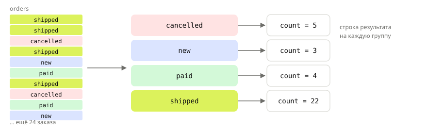

## Теория
Агрегат без `GROUP BY` сворачивает всю таблицу в одну строку. **`GROUP BY`** сначала раскладывает строки по группам — с одинаковым значением выражения, — а агрегаты считает **внутри каждой группы**. Результат — одна строка на группу. Например:
```sql
SELECT status, count(*) AS total
FROM orders
GROUP BY status;
```
Здесь строки `orders` раскладываются по статусам, и для каждого статуса считается число строк.

**Что можно писать в `SELECT`.** После группировки у каждой строки результата есть только значения групповых выражений и агрегаты. Поэтому в `SELECT` — либо то, что перечислено в `GROUP BY`, либо агрегатная функция. Столбец вне `GROUP BY` и вне агрегата — ошибка `must appear in the GROUP BY clause`: в группе «категория 4» шесть разных названий, какое из них показать? Исключение PostgreSQL: если в `GROUP BY` стоит первичный ключ таблицы, остальные её столбцы можно выводить — они однозначно определяются ключом (`GROUP BY u.id` позволяет вывести `u.name`).

**Группировать можно**:
- по нескольким столбцам — группа на каждую **комбинацию**: `GROUP BY user_id, status`;
- по выражению — `GROUP BY date_trunc('month', created_at)` даёт группу на месяц;
- в PostgreSQL — и по псевдониму из `SELECT` (`GROUP BY month`) или по номеру столбца (`GROUP BY 1`), но номер читается хуже.

NULL для `GROUP BY` — обычное значение: все строки с NULL попадают в **одну** группу.

Порядок групп в результате не гарантирован — нужен `ORDER BY`, и сортировать можно по агрегату или его псевдониму: `ORDER BY total DESC`.

## Наглядно
**Рисунок 1.** GROUP BY раскладывает строки по группам и считает агрегат в каждой.



## На практике
Задача: сводки по заказам, товарам и покупателям.

### Шаг 1. Заказы по статусам
Сколько заказов в каждом статусе:
```sql
SELECT status, count(*) AS total
FROM orders
GROUP BY status
ORDER BY status;
```
Результат:
```
  status   | total
-----------+-------
 cancelled |     5
 new       |     3
 paid      |     4
 shipped   |    22
(4 rows)
```

### Шаг 2. По месяцам
Группа — месяц, вычисленный из даты заказа:
```sql
SELECT date_trunc('month', created_at) AS month, count(*) AS total
FROM orders
GROUP BY month
ORDER BY month;
```
Результат:
```
         month          | total
------------------------+-------
 2025-11-01 00:00:00+03 |     4
 2025-12-01 00:00:00+03 |     6
 2026-01-01 00:00:00+03 |     6
 2026-02-01 00:00:00+03 |     5
 2026-03-01 00:00:00+03 |     6
 2026-04-01 00:00:00+03 |     7
(6 rows)
```
Если написать `GROUP BY created_at`, группой станет каждая отдельная секунда — 34 группы по одному заказу.

### Шаг 3. Несколько агрегатов
По категориям — число товаров и средняя цена:
```sql
SELECT category_id, count(*) AS products, round(avg(price), 2) AS avg_price
FROM products
GROUP BY category_id
ORDER BY category_id;
```
Результат:
```
 category_id | products | avg_price
-------------+----------+-----------
           1 |        1 |   2490.00
           3 |        3 |  69990.00
           4 |        6 |   2259.67
           5 |        4 |  28990.00
           6 |        1 |    590.00
           7 |        4 |   1640.00
           9 |        3 |   1790.00
(7 rows)
```
Категорий без товаров (2 и 8) в ответе нет: группы строятся из строк `products`, а таких строк нет. Чтобы показать и их, нужен `LEFT JOIN` от `categories` — в теме «Агрегация с JOIN».

### Шаг 4. Группа NULL
Покупатели по городам, самые частые — первыми:
```sql
SELECT city, count(*) AS total
FROM users
GROUP BY city
ORDER BY total DESC, city;
```
Результат:
```
      city       | total
-----------------+-------
 Москва          |     4
 Казань          |     2
 Санкт-Петербург |     2
                 |     2
 Екатеринбург    |     1
 Краснодар       |     1
 Новосибирск     |     1
(7 rows)
```
Двое без города — отдельная группа с пустым `city`.

## Частые ошибки
- **Столбец вне `GROUP BY` и агрегата.** `SELECT category_id, name, count(*) … GROUP BY category_id` — ошибка: названий в группе много.
- **Группировка по исходному столбцу вместо выражения.** `SELECT date_trunc('month', …) … GROUP BY created_at` — группа на каждый момент, а не на месяц.
- **Ожидание групп без строк.** `GROUP BY` не создаёт пустых групп: категории без товаров не появятся.
- **Без `ORDER BY`.** Порядок групп не гарантирован.
- **`GROUP BY` вместо `DISTINCT`.** Работает, но если агрегатов нет, `SELECT DISTINCT` понятнее.

## Итог
**GROUP BY**
- Строки раскладываются по группам; агрегаты — внутри каждой; строка результата на группу.
- В `SELECT` — групповые выражения и агрегаты (или столбцы таблицы, чей первичный ключ в `GROUP BY`).
- Несколько столбцов — группа на комбинацию; можно по выражению.

**Детали**
- NULL — одна общая группа.
- Пустых групп не бывает.
- Порядок групп — только через `ORDER BY`.

## Вопросы на собеседовании
<details><summary>Почему в `SELECT` нельзя вывести столбец, которого нет в `GROUP BY`?</summary>

После группировки одна строка результата — это целая группа исходных строк, и у столбца вне группировки в ней может быть много разных значений. База не выбирает одно наугад, а требует либо добавить столбец в `GROUP BY`, либо свернуть его агрегатом (`max(name)`, `string_agg(name, ', ')`). PostgreSQL разрешает столбцы, функционально зависящие от первичного ключа, если ключ в `GROUP BY`.
</details>

<details><summary>Чем `GROUP BY` отличается от `DISTINCT`?</summary>

Без агрегатов `SELECT DISTINCT a, b` и `SELECT a, b … GROUP BY a, b` дают одинаковый результат. `GROUP BY` нужен, когда для каждой уникальной комбинации что-то считают: количество, сумму, среднее.
</details>

<details><summary>Как посчитать заказы по месяцам?</summary>

Сгруппировать по месяцу, вычисленному из даты: `GROUP BY date_trunc('month', created_at)`. Месяцы без заказов в результат не попадут; если нужны и они, ряд месяцев строят `generate_series` и присоединяют к нему заказы `LEFT JOIN`.
</details>
