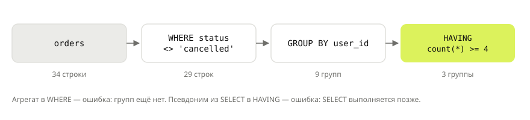

## Теория
`WHERE` отбирает **строки** до группировки. Но условие «покупатели с четырьмя и более заказами» относится к **группе**: число заказов известно только после того, как строки сгруппированы и посчитаны. Для этого есть **`HAVING`** — фильтр групп после `GROUP BY`:
```sql
SELECT user_id, count(*) AS total
FROM orders
GROUP BY user_id
HAVING count(*) >= 4;
```
Порядок такой: `WHERE` выбрасывает строки → `GROUP BY` собирает оставшиеся в группы → агрегаты считаются → `HAVING` выбрасывает группы → `SELECT` формирует вывод.

Отсюда правила:
- **Агрегат в `WHERE` нельзя:** в момент `WHERE` групп ещё нет. Ошибка `aggregate functions are not allowed in WHERE`.
- **Условие на обычный столбец пишут в `WHERE`**, а не в `HAVING`: «не считать отменённые заказы» — это про строки, их убирают до группировки. В `HAVING` такое условие либо не сработает (столбца нет в группе), либо заставит базу сначала сгруппировать лишнее.
- **Псевдоним из `SELECT` в `HAVING` не работает:** `SELECT` выполняется после `HAVING`. `HAVING total >= 4` — ошибка `column "total" does not exist`; агрегат пишут ещё раз: `HAVING count(*) >= 4`. (В некоторых конспектах и в MySQL псевдоним в `HAVING` допускается — в PostgreSQL нет.)
- В `HAVING` можно использовать агрегат, которого нет в `SELECT`: вывести сумму, а отобрать по количеству.

## Наглядно
**Рисунок 1.** WHERE работает со строками, HAVING — с группами.



**Таблица 1.** `WHERE` или `HAVING`.

| Условие | Куда | Почему |
|---|---|---|
| `status <> 'cancelled'` | `WHERE` | про отдельный заказ |
| `count(*) >= 4` | `HAVING` | про группу заказов |
| `created_at >= '2026-01-01'` | `WHERE` | про отдельный заказ |
| `avg(price) > 10000` | `HAVING` | про группу товаров |
| `category_id = 4` | `WHERE` | можно и в `HAVING`, если это столбец группировки, но в `WHERE` дешевле |

## На практике
Задача: найти постоянных покупателей и дорогие категории.

### Шаг 1. Постоянные покупатели
Покупатели, у которых не меньше четырёх заказов, не считая отменённых:
```sql
SELECT user_id, count(*) AS total
FROM orders
WHERE status <> 'cancelled'
GROUP BY user_id
HAVING count(*) >= 4
ORDER BY user_id;
```
Результат:
```
 user_id | total
---------+-------
       1 |     6
       2 |     4
       8 |     4
(3 rows)
```
Без `WHERE` в списке оказались бы ещё Вера (3) и Максим (12): у каждого четыре заказа, но один отменён.

### Шаг 2. Псевдоним в HAVING
То же условие через псевдоним `total`:
```sql
SELECT user_id, count(*) AS total
FROM orders
GROUP BY user_id
HAVING total >= 4;
```
Результат:
```
ERROR:  column "total" does not exist
```
`total` появится только в `SELECT`, который выполняется после `HAVING`.

### Шаг 3. Агрегат в WHERE
Категории со средней ценой больше 10 000 ₽ — попытка через `WHERE`:
```sql
SELECT category_id, round(avg(price), 2) AS avg_price
FROM products
WHERE avg(price) > 10000
GROUP BY category_id;
```
Результат:
```
ERROR:  aggregate functions are not allowed in WHERE
```
То же условие в `HAVING`:
```sql
SELECT category_id, round(avg(price), 2) AS avg_price
FROM products
GROUP BY category_id
HAVING avg(price) > 10000
ORDER BY category_id;
```
Результат:
```
 category_id | avg_price
-------------+-----------
           3 |  69990.00
           5 |  28990.00
(2 rows)
```
Ноутбуки и смартфоны.

## Частые ошибки
- **Агрегат в `WHERE`.** Групп ещё нет — ошибка; условие на агрегат — в `HAVING`.
- **Псевдоним в `HAVING`.** В PostgreSQL не работает; повторите выражение.
- **Условие на строки в `HAVING`.** «Без отменённых» — это `WHERE`: иначе отменённые заказы уже посчитаны в группе.
- **`HAVING` без `GROUP BY`.** Допустимо, но тогда вся таблица — одна группа, и в ответе ноль или одна строка.
- **Сравнение с округлённым значением.** `HAVING round(avg(price), 2) > …` и `HAVING avg(price) > …` иногда отличаются на границе; сравнивают точное значение.

## Итог
**HAVING**
- Фильтр групп после `GROUP BY`, может использовать агрегаты.
- Агрегат, которого нет в `SELECT`, тоже можно.

**WHERE или HAVING**
- Про строку — `WHERE` (до группировки), про группу — `HAVING`.
- Агрегат в `WHERE` — ошибка.
- Псевдоним из `SELECT` в `HAVING` и `WHERE` — ошибка в PostgreSQL.

## Вопросы на собеседовании
<details><summary>Чем `WHERE` отличается от `HAVING`?</summary>

`WHERE` фильтрует строки до группировки и не может использовать агрегаты. `HAVING` фильтрует группы после группировки и обычно содержит агрегат. Условия на отдельные строки лучше писать в `WHERE`: меньше строк попадёт в группировку.
</details>

<details><summary>Можно ли в `HAVING` сослаться на псевдоним из `SELECT`?</summary>

В PostgreSQL — нет: `HAVING` выполняется раньше, чем `SELECT` вычисляет столбцы, и псевдонима ещё нет. Выражение повторяют (`HAVING count(*) > 5`). MySQL такое допускает как расширение, поэтому в примерах из интернета встречается `HAVING cnt > 5`.
</details>

<details><summary>Как найти покупателей, сделавших больше трёх заказов в 2026 году?</summary>

Период — условие на строки, в `WHERE`; число заказов — на группу, в `HAVING`: `SELECT user_id, count(*) FROM orders WHERE created_at >= '2026-01-01' AND created_at < '2027-01-01' GROUP BY user_id HAVING count(*) > 3`.
</details>
