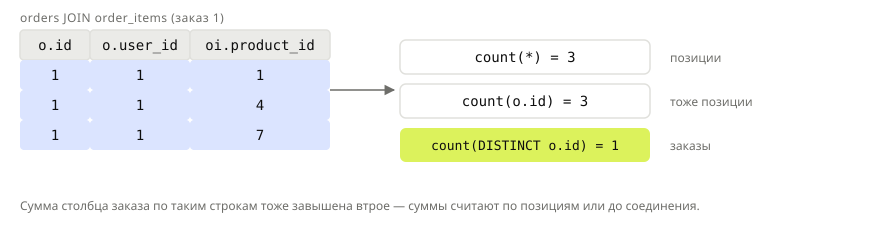

## Теория
Настоящие отчёты почти всегда собирают данные из нескольких таблиц: выручка по категориям — это `orders` + `order_items` + `products` + `categories`. Порядок работы такой: `JOIN` собирает строки, `WHERE` отбирает нужные, `GROUP BY` группирует, агрегаты считают. Агрегат видит строки **после** соединения — и отсюда три ловушки.

**1. `count(*)` после `LEFT JOIN`.** У покупателя без заказов `LEFT JOIN` оставляет одну строку с NULL в столбцах заказа. `count(*)` посчитает эту строку — и покупатель «сделал» один заказ. Считать нужно столбец правой таблицы: `count(o.id)` пропускает NULL и даёт 0.

**2. Размножение строк.** После `JOIN orders` → `order_items` строка заказа повторяется для каждой позиции. `count(*)` или `count(o.id)` посчитает позиции, а не заказы. Число заказов — `count(DISTINCT o.id)`. Ещё хуже с суммами: `sum` по столбцу заказа, повторённому для каждой позиции, завышен, и `DISTINCT` тут не поможет — такие суммы считают до соединения (подзапросом, раздел 7).

**3. Группировка по названию.** Две разные категории могут называться одинаково; группируют по ключу: `GROUP BY c.id, c.name` (или `GROUP BY c.id` — по первичному ключу PostgreSQL разрешает выводить остальные столбцы таблицы).

**`FILTER (WHERE …)`** — условие для одного агрегата. В одном запросе можно посчитать и все заказы, и только отменённые: `count(*) AS total, count(*) FILTER (WHERE o.status = 'cancelled') AS cancelled`. Условие в общем `WHERE` выбросило бы строки для всех агрегатов сразу. В других СУБД то же пишут через `CASE`: `sum(CASE WHEN status = 'cancelled' THEN 1 ELSE 0 END)`.

**Выручка** — сумма по позициям `quantity * price`, причём `price` — из `order_items`: цена на момент покупки.

## Наглядно
**Рисунок 1.** После JOIN строка заказа повторяется для каждой позиции.



**Таблица 1.** Что считать после соединения.

| Вопрос | Запись |
|---|---|
| число заказов покупателя, включая тех, у кого их нет | `LEFT JOIN orders o … count(o.id)` |
| число заказов после соединения с позициями | `count(DISTINCT o.id)` |
| выручка | `sum(oi.quantity * oi.price)` |
| часть строк в одном из агрегатов | `count(*) FILTER (WHERE …)` |
| группа — сущность | `GROUP BY c.id`, а не только `c.name` |

## На практике
Задача: выручка по категориям за март, число заказов у каждого покупателя и доля отмен.

### Шаг 1. Выручка по категориям
Март 2026, без отменённых заказов:
```sql
SELECT c.name AS category, sum(oi.quantity * oi.price) AS revenue
FROM orders o
JOIN order_items oi ON oi.order_id = o.id
JOIN products p ON p.id = oi.product_id
JOIN categories c ON c.id = p.category_id
WHERE o.status <> 'cancelled'
  AND o.created_at >= '2026-03-01' AND o.created_at < '2026-04-01'
GROUP BY c.id, c.name
ORDER BY revenue DESC;
```
Результат:
```
  category   | revenue
-------------+----------
 Ноутбуки    | 64990.00
 Электроника |  4980.00
 Футболки    |  2580.00
 Книги       |  1590.00
 Аксессуары  |  1080.00
(5 rows)
```
«Электроника» здесь — только товары, лежащие прямо в ней (зарядное устройство), а не все её подкатегории: `products.category_id` указывает на конкретную категорию.

### Шаг 2. count(*) и count(o.id)
Покупатели с номерами от 9 и число их заказов:
```sql
SELECT u.id, u.name, count(*) AS wrong, count(o.id) AS total
FROM users u
LEFT JOIN orders o ON o.user_id = u.id
WHERE u.id >= 9
GROUP BY u.id
ORDER BY u.id;
```
Результат:
```
 id |      name      | wrong | total
----+----------------+-------+-------
  9 | Ирина Морозова |     1 |     0
 10 | Кирилл Волков  |     1 |     0
 11 | Лидия Павлова  |     1 |     0
 12 | Максим Фёдоров |     4 |     4
 13 | Нина Орлова    |     1 |     0
(5 rows)
```
`GROUP BY u.id` — по первичному ключу, поэтому `u.name` выводить можно.

### Шаг 3. Позиции вместо заказов
Анна и Борис: строки после соединения с позициями и число заказов:
```sql
SELECT o.user_id, count(*) AS rows, count(DISTINCT o.id) AS orders
FROM orders o
JOIN order_items oi ON oi.order_id = o.id
WHERE o.user_id IN (1, 2)
GROUP BY o.user_id
ORDER BY o.user_id;
```
Результат:
```
 user_id | rows | orders
---------+------+--------
       1 |   11 |      6
       2 |   10 |      5
(2 rows)
```

### Шаг 4. FILTER
Сколько заказов у каждого покупателя и сколько из них отменено:
```sql
SELECT u.id, u.name,
       count(*) AS total,
       count(*) FILTER (WHERE o.status = 'cancelled') AS cancelled
FROM users u
JOIN orders o ON o.user_id = u.id
GROUP BY u.id
ORDER BY u.id;
```
Результат:
```
 id |      name      | total | cancelled
----+----------------+-------+-----------
  1 | Анна Смирнова  |     6 |         0
  2 | Борис Иванов   |     5 |         1
  3 | Вера Кузнецова |     4 |         1
  4 | Глеб Попов     |     3 |         0
  5 | Дарья Соколова |     3 |         1
  6 | Егор Лебедев   |     3 |         0
  7 | Жанна Козлова  |     2 |         1
  8 | Захар Новиков  |     4 |         0
 12 | Максим Фёдоров |     4 |         1
(9 rows)
```

## Частые ошибки
- **`count(*)` после `LEFT JOIN`.** Строка без пары считается как одна. Считайте столбец правой таблицы.
- **`count` после соединения с «многими».** Считаются позиции, а не заказы; нужен `count(DISTINCT …)`.
- **Сумма по повторённым строкам.** `sum` столбца заказа после соединения с позициями завышен.
- **Условие для одного агрегата — в `WHERE`.** Оно убирает строки для всех агрегатов; для одного — `FILTER`.
- **Группировка только по названию.** Одинаковые названия сольются в одну группу; группируйте по ключу.

## Итог
**Счёт после JOIN**
- `LEFT JOIN` + `count(правая.id)` — нули для строк без пары.
- Соединение с «многими» — `count(DISTINCT …)`.
- Выручка — `sum(oi.quantity * oi.price)`.

**Приёмы**
- `FILTER (WHERE …)` — условие для одного агрегата.
- `GROUP BY` по первичному ключу — можно выводить остальные столбцы таблицы.

## Вопросы на собеседовании
<details><summary>Как посчитать число заказов каждого покупателя, включая тех, у кого их нет?</summary>

`SELECT u.id, count(o.id) FROM users u LEFT JOIN orders o ON o.user_id = u.id GROUP BY u.id`. `LEFT JOIN` сохраняет покупателей без заказов, а `count(o.id)` не считает их строку с NULL. `count(*)` здесь дал бы 1.
</details>

<details><summary>Что такое `FILTER` в агрегатах?</summary>

Условие, которое применяется только к одному агрегату: `count(*) FILTER (WHERE status = 'paid')`. Позволяет в одном проходе по таблице посчитать несколько показателей с разными условиями. Стандарт SQL, в PostgreSQL с версии 9.4; в других СУБД то же делают `sum(CASE WHEN … THEN 1 ELSE 0 END)`.
</details>

<details><summary>Почему сумма заказов после JOIN с позициями получилась больше настоящей?</summary>

Строка заказа повторяется для каждой позиции, и её столбцы (сумма заказа, доставка) суммируются несколько раз. Решение — считать агрегат на уровне той таблицы, где он определён (`sum(oi.quantity * oi.price)` по позициям), или сначала свернуть подзапросом, а потом соединять.
</details>
