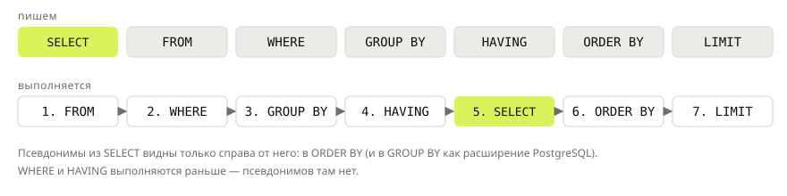

## Теория
`SELECT` пишут первым, но выполняется он почти последним. Логический порядок частей запроса:

1. **`FROM` и `JOIN`** — собрать строки из таблиц.
2. **`WHERE`** — отобрать строки.
3. **`GROUP BY`** — разложить строки по группам.
4. **`HAVING`** — отобрать группы (здесь уже посчитаны агрегаты).
5. **`SELECT`** — вычислить выражения вывода и задать псевдонимы.
6. **`DISTINCT`** — убрать повторы.
7. **`ORDER BY`** — отсортировать.
8. **`LIMIT` / `OFFSET`** — взять нужную часть.

Каждый шаг видит только то, что подготовили предыдущие. Отсюда правила, которые иначе пришлось бы зубрить:
- **Псевдоним из `SELECT` нельзя использовать в `WHERE` и `HAVING`** — на их шаге его ещё нет: `column "price_with_vat" does not exist`. Выражение повторяют или выносят в подзапрос (раздел 7).
- **Псевдоним можно использовать в `ORDER BY`** — сортировка идёт после `SELECT`. PostgreSQL разрешает его и в `GROUP BY` (это расширение, в стандарте нельзя).
- **Агрегат нельзя в `WHERE`** — групп ещё нет; можно в `HAVING`, `SELECT`, `ORDER BY`.
- **`LIMIT` применяется последним** — к уже отсортированному результату; «топ-3» без `ORDER BY` — три случайные строки.
- **С `DISTINCT` сортировать можно только по выведенным столбцам** — после удаления повторов других столбцов уже нет: `for SELECT DISTINCT, ORDER BY expressions must appear in select list`.

Это **логический** порядок — каким должен получиться результат. Физически база может делать иначе: применить условие `WHERE` прямо при чтении индекса, соединять таблицы в другом порядке. Но результат всегда такой, как если бы шаги шли по списку.

## Наглядно
**Рисунок 1.** Порядок написания и порядок выполнения.



**Таблица 1.** Где можно использовать псевдоним и агрегат.

| Часть | Псевдоним из `SELECT` | Агрегат |
|---|---|---|
| `WHERE` | нет | нет |
| `GROUP BY` | да (расширение PostgreSQL) | нет |
| `HAVING` | нет | да |
| `ORDER BY` | да | да |

## На практике
Задача: найти дорогие товары с учётом НДС и самые большие категории, не попав в ловушки порядка выполнения.

### Шаг 1. Псевдоним в WHERE
Товары дороже 50 000 ₽ с НДС:
```sql
SELECT id, name, price * 1.2 AS price_with_vat
FROM products
WHERE price_with_vat > 50000;
```
Результат:
```
ERROR:  column "price_with_vat" does not exist
```
`WHERE` выполняется до `SELECT`. Повторяем выражение, а псевдоним используем там, где он уже есть, — в `ORDER BY`:
```sql
SELECT id, name, price * 1.2 AS price_with_vat
FROM products
WHERE price * 1.2 > 50000
ORDER BY price_with_vat DESC;
```
Результат:
```
 id |          name          | price_with_vat
----+------------------------+----------------
  2 | Ноутбук Aster 16 Pro   |     107988.000
  1 | Ноутбук Aster 14       |      77988.000
  3 | Ноутбук Nimbus Air     |      65988.000
 11 | Смартфон Pixelon 8 Max |      59988.000
(4 rows)
```
Три знака после запятой — от умножения `numeric(10,2)` на `1.2`; для вывода можно округлить `round(price * 1.2, 2)`.

### Шаг 2. Все шаги в одном запросе
Категории, где больше трёх товаров, от больших к меньшим:
```sql
SELECT category_id, count(*) AS total
FROM products
GROUP BY category_id
HAVING count(*) > 3
ORDER BY total DESC;
```
Результат:
```
 category_id | total
-------------+-------
           4 |     6
           5 |     4
           7 |     4
(3 rows)
```
`FROM` → `GROUP BY` (7 групп) → `HAVING` (осталось 3) → `SELECT` (появился `total`) → `ORDER BY total`. В `HAVING` — `count(*)`, в `ORDER BY` — уже псевдоним.

### Шаг 3. DISTINCT и сортировка
Города покупателей в порядке регистрации:
```sql
SELECT DISTINCT city
FROM users
ORDER BY created_at;
```
Результат:
```
ERROR:  for SELECT DISTINCT, ORDER BY expressions must appear in select list
```
После `DISTINCT` у строки «Москва» нет одного `created_at` — в Москве четыре покупателя с разными датами. Порядок нужно выразить через агрегат: `SELECT city FROM users GROUP BY city ORDER BY min(created_at)`.

## Частые ошибки
- **Псевдоним в `WHERE` или `HAVING`.** Повторите выражение.
- **Агрегат в `WHERE`.** Перенесите условие в `HAVING`.
- **`LIMIT` без `ORDER BY`.** Берутся случайные строки.
- **`DISTINCT` и сортировка по невыведенному столбцу.** Ошибка — сортируйте по выведенному или по агрегату через `GROUP BY`.
- **Порядок записи = порядок выполнения.** Запрос читается по-английски сверху вниз, но выполняется от `FROM`.

## Итог
**Логический порядок**
- `FROM`/`JOIN` → `WHERE` → `GROUP BY` → `HAVING` → `SELECT` → `DISTINCT` → `ORDER BY` → `LIMIT`.

**Следствия**
- Псевдонимы — в `ORDER BY` (и в `GROUP BY` в PostgreSQL), не в `WHERE` и `HAVING`.
- Агрегаты — в `HAVING`, `SELECT`, `ORDER BY`, не в `WHERE`.
- `LIMIT` — к отсортированному результату.

## Вопросы на собеседовании
<details><summary>В каком порядке выполняются части SELECT-запроса?</summary>

Логически: `FROM` (и `JOIN`), `WHERE`, `GROUP BY`, `HAVING`, `SELECT`, `DISTINCT`, `ORDER BY`, `LIMIT`/`OFFSET`. Поэтому псевдонимы из `SELECT` недоступны в `WHERE` и `HAVING`, но доступны в `ORDER BY`. Физический план может отличаться, но результат ему равен.
</details>

<details><summary>Почему нельзя использовать псевдоним в `WHERE`?</summary>

`WHERE` вычисляется до `SELECT`, и псевдонима ещё не существует. Выражение повторяют или оборачивают запрос в подзапрос / CTE и фильтруют по его столбцу снаружи.
</details>

<details><summary>Влияет ли порядок условий в `WHERE` на скорость?</summary>

Как правило, нет: планировщик сам решает, какие условия проверять раньше и какие индексы использовать. На скорость влияют индексы, селективность условий и объём данных, а не порядок записи `AND`.
</details>
