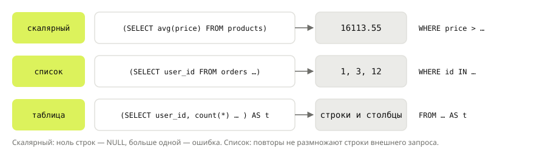

## Теория
**Подзапрос** — `SELECT` в скобках внутри другого запроса. Он нужен, когда ответ зависит от промежуточного результата: «товары дороже **средней цены**» — сначала посчитать среднюю, потом сравнить. По тому, что возвращает подзапрос, различают три вида.

**Скалярный** — одно значение (одна строка, один столбец). Стоит там, где ждут значение: в `WHERE price > (SELECT avg(price) FROM products)`, в `SELECT`. Если он вернул:
- **ноль строк** — значение NULL, и сравнение с ним ничего не пропустит, без ошибки;
- **больше одной строки** — ошибка `more than one row returned by a subquery used as an expression`.

**Список** — один столбец, много строк. Используется с `IN` / `NOT IN`: `WHERE id IN (SELECT user_id FROM orders …)`. Помните ловушку `NOT IN`: если в списке есть NULL, не пройдёт ни одна строка (раздел «Изменение данных»).

**Таблица** — подзапрос в `FROM`, к его результату обращаются как к таблице: `FROM (SELECT user_id, count(*) AS total FROM orders GROUP BY user_id) AS per_user`. Так строят «агрегат от агрегата» — среднее число заказов на покупателя — и фильтруют по псевдониму, который снаружи уже стал обычным столбцом. Подзапросу в `FROM` дают имя (`AS per_user`): в PostgreSQL 16 оно необязательно, но в других СУБД и старых версиях требуется, и без него к столбцам не обратиться по имени таблицы.

Простой подзапрос **не зависит** от внешнего запроса — его можно выделить и выполнить отдельно. Подзапросы, которые ссылаются на строку внешнего запроса, — в следующей теме.

## Наглядно
**Рисунок 1.** Три места для подзапроса.



**Таблица 1.** Виды подзапросов.

| Вид | Возвращает | Где | Пример |
|---|---|---|---|
| скалярный | одно значение | `WHERE`, `SELECT` | `price > (SELECT avg(price) FROM products)` |
| список | один столбец | `IN`, `NOT IN` | `id IN (SELECT user_id FROM orders)` |
| таблица | строки и столбцы | `FROM` | `FROM (SELECT …) AS t` |

## На практике
Задача: дорогие товары, покупатели ноутбуков и среднее число заказов на покупателя.

### Шаг 1. Дороже средней цены
Подзапрос считает среднюю цену, внешний запрос сравнивает с ней:
```sql
SELECT id, name, price
FROM products
WHERE price > (SELECT avg(price) FROM products)
ORDER BY price DESC;
```
Результат:
```
 id |          name          |  price
----+------------------------+----------
  2 | Ноутбук Aster 16 Pro   | 89990.00
  1 | Ноутбук Aster 14       | 64990.00
  3 | Ноутбук Nimbus Air     | 54990.00
 11 | Смартфон Pixelon 8 Max | 49990.00
 10 | Смартфон Pixelon 8     | 39990.00
 12 | Смартфон Lumo S        | 24990.00
(6 rows)
```
`WHERE price > avg(price)` не сработал бы: агрегат в `WHERE` нельзя.

### Шаг 2. Список для IN
Покупатели, которые заказывали ноутбуки (категория 3):
```sql
SELECT id, name
FROM users
WHERE id IN (
    SELECT o.user_id
    FROM orders o
    JOIN order_items oi ON oi.order_id = o.id
    JOIN products p ON p.id = oi.product_id
    WHERE p.category_id = 3
)
ORDER BY id;
```
Результат:
```
 id |      name
----+----------------
  1 | Анна Смирнова
  3 | Вера Кузнецова
 12 | Максим Фёдоров
(3 rows)
```
Анна заказывала ноутбуки трижды, но в результате один раз: `IN` проверяет «есть ли в списке», повторы в подзапросе не размножают строки — в отличие от `JOIN`.

### Шаг 3. Агрегат от агрегата
Сколько заказов в среднем делает покупатель — сначала число заказов каждого, потом среднее:
```sql
SELECT round(avg(total), 2) AS avg_orders
FROM (
    SELECT user_id, count(*) AS total
    FROM orders
    GROUP BY user_id
) AS per_user;
```
Результат:
```
 avg_orders
------------
       3.78
(1 row)
```
`avg(count(*))` в одном запросе написать нельзя — агрегаты не вкладываются.

### Шаг 4. Больше одной строки
Заказы москвичей через `=`:
```sql
SELECT id, user_id
FROM orders
WHERE user_id = (SELECT id FROM users WHERE city = 'Москва');
```
Результат:
```
ERROR:  more than one row returned by a subquery used as an expression
```
Москвичей четверо, а `=` сравнивает с одним значением. Для списка — `IN`.

## Частые ошибки
- **`=` с подзапросом, который возвращает много строк.** Ошибка; нужен `IN`.
- **Скалярный подзапрос без строк.** NULL — и пустой результат без ошибки.
- **`NOT IN` со списком, где есть NULL.** Ни одной строки; фильтруйте NULL в подзапросе или берите `NOT EXISTS`.
- **Агрегат от агрегата в одном запросе.** `avg(count(*))` — ошибка; внутренний агрегат — в подзапрос.
- **Подзапрос в `FROM` без имени.** В PostgreSQL 16 работает, в других СУБД — ошибка; имя делает запрос понятнее.

## Итог
**Виды**
- Скалярный — одно значение; 0 строк — NULL, больше 1 — ошибка.
- Список — с `IN` / `NOT IN`; повторы не размножают строки.
- Таблица — в `FROM`, с именем.

**Зачем**
- Сравнить со вычисленным значением (средним, максимумом).
- Агрегат от агрегата, фильтр по вычисленному столбцу.

## Вопросы на собеседовании
<details><summary>Что будет, если скалярный подзапрос вернёт несколько строк?</summary>

Ошибка во время выполнения: `more than one row returned by a subquery used as an expression`. Скалярный подзапрос обязан вернуть не больше одной строки; если строк может быть несколько, нужен `IN`, агрегат (`max`, `min`) или `LIMIT 1` с `ORDER BY`. Ноль строк ошибкой не считается — получается NULL.
</details>

<details><summary>Чем подзапрос в `WHERE … IN` отличается от подзапроса в `FROM`?</summary>

В `IN` подзапрос даёт список значений одного столбца, с которым сравнивается каждая строка внешнего запроса; строки внешнего запроса не размножаются. В `FROM` подзапрос — временная таблица: у неё могут быть любые столбцы, её соединяют, фильтруют и группируют, как обычную.
</details>

<details><summary>Подзапрос или JOIN?</summary>

Часто они взаимозаменяемы, и PostgreSQL сам переписывает `IN (подзапрос)` в соединение. Подзапрос с `IN` удобен, когда нужен только факт наличия пары и повторы недопустимы; `JOIN` — когда нужны столбцы обеих таблиц. Выбирают то, что понятнее читается, а скорость проверяют `EXPLAIN`.
</details>
