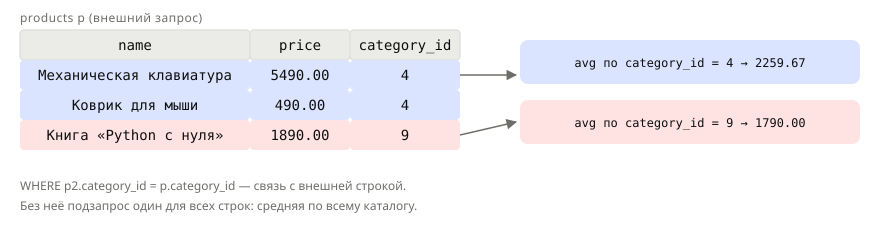

## Теория
**Коррелированный** подзапрос ссылается на строку внешнего запроса и поэтому не выполняется отдельно:
```sql
SELECT p.id, p.name, p.price
FROM products p
WHERE p.price > (
    SELECT avg(p2.price)
    FROM products p2
    WHERE p2.category_id = p.category_id
);
```
`p.category_id` — столбец внешней строки. Логически подзапрос вычисляется заново для каждого товара: «средняя цена **его** категории». Таблица участвует дважды, поэтому псевдонимы разные (`p` и `p2`) — иначе условие `category_id = category_id` сравнит столбец сам с собой. Связь с внешней строкой — самое важное в таком подзапросе: забытая или перепутанная, она делает подзапрос некоррелированным, и запрос молча отвечает на другой вопрос.

**`EXISTS (подзапрос)`** — TRUE, если подзапрос вернул хотя бы одну строку. Что именно он выбирает, не важно, поэтому пишут `SELECT 1`. `NOT EXISTS` — ни одной строки. Это самый прямой способ сказать «есть ли у покупателя новый заказ», «товар, который никто не покупал»:
```sql
WHERE NOT EXISTS (SELECT 1 FROM order_items oi WHERE oi.product_id = p.id)
```

**`EXISTS` или `IN`?** Для «есть» — одинаково: PostgreSQL превращает оба в полусоединение (semi-join), и планы совпадают. Встречающееся утверждение «EXISTS быстрее IN» — наследие старых СУБД. Для «нет» разница есть: `NOT IN` ломается на NULL в подзапросе, а `NOT EXISTS` — нет, и планировщик умеет выполнять его как анти-соединение. Поэтому для «нет» берут `NOT EXISTS`.

Коррелированный подзапрос в `SELECT` даёт значение для каждой строки: `(SELECT max(o.created_at) FROM orders o WHERE o.user_id = u.id) AS last_order`. Для одного-двух столбцов это удобно; для многих агрегатов `LEFT JOIN` + `GROUP BY` обычно быстрее.

## Наглядно
**Рисунок 1.** Коррелированный подзапрос получает значение из текущей строки внешнего запроса.



**Таблица 1.** «Есть» и «нет».

| Вопрос | Запись | Замечание |
|---|---|---|
| есть пара | `EXISTS (…)` или `IN (…)` | одинаково |
| нет пары | `NOT EXISTS (…)` | надёжно с NULL |
| нет пары | `NOT IN (…)` | ломается, если в подзапросе NULL |
| нет пары | `LEFT JOIN … WHERE b.id IS NULL` | то же, что `NOT EXISTS` |

## На практике
Задача: товары дороже средней цены своей категории, покупатели с новыми заказами, товары без покупок и дата последнего заказа.

### Шаг 1. Дороже среднего по категории
Запрос из раздела «Теория»:
```sql
SELECT p.id, p.name, p.price, p.category_id
FROM products p
WHERE p.price > (
    SELECT avg(p2.price)
    FROM products p2
    WHERE p2.category_id = p.category_id
)
ORDER BY p.id;
```
Результат:
```
 id |           name           |  price   | category_id
----+--------------------------+----------+-------------
  2 | Ноутбук Aster 16 Pro     | 89990.00 |           3
  6 | Механическая клавиатура  |  5490.00 |           4
  9 | Веб-камера               |  3990.00 |           4
 10 | Смартфон Pixelon 8       | 39990.00 |           5
 11 | Смартфон Pixelon 8 Max   | 49990.00 |           5
 17 | Футболка с принтом       |  1790.00 |           7
 18 | Лонгслив                 |  2190.00 |           7
 19 | Книга «Python с нуля»    |  1890.00 |           9
 21 | Книга «Алгоритмы просто» |  1890.00 |           9
(9 rows)
```
Клавиатура за 5490 — дорогая для аксессуаров, хотя на фоне всего каталога она дешевле средней.

### Шаг 2. EXISTS
Покупатели, у которых есть новый заказ:
```sql
SELECT u.id, u.name
FROM users u
WHERE EXISTS (
    SELECT 1 FROM orders o
    WHERE o.user_id = u.id AND o.status = 'new'
)
ORDER BY u.id;
```
Результат:
```
 id |      name
----+----------------
  1 | Анна Смирнова
  2 | Борис Иванов
 12 | Максим Фёдоров
(3 rows)
```

### Шаг 3. NOT EXISTS
Товары, которые ни разу не заказывали:
```sql
SELECT p.id, p.name
FROM products p
WHERE NOT EXISTS (
    SELECT 1 FROM order_items oi
    WHERE oi.product_id = p.id
)
ORDER BY p.id;
```
Результат:
```
 id |           name
----+--------------------------
  3 | Ноутбук Nimbus Air
  8 | USB-хаб на 4 порта
 17 | Футболка с принтом
 18 | Лонгслив
 21 | Книга «Алгоритмы просто»
 22 | Носки, 3 пары
(6 rows)
```

### Шаг 4. Подзапрос в SELECT
Дата последнего заказа:
```sql
SELECT u.id, u.name,
       (SELECT max(o.created_at) FROM orders o WHERE o.user_id = u.id) AS last_order
FROM users u
WHERE u.id IN (1, 9, 12)
ORDER BY u.id;
```
Результат:
```
 id |      name      |       last_order
----+----------------+------------------------
  1 | Анна Смирнова  | 2026-04-15 20:10:00+03
  9 | Ирина Морозова |
 12 | Максим Фёдоров | 2026-04-14 16:45:00+03
(3 rows)
```
У Ирины заказов нет — `max` пустого набора даёт NULL.

## Частые ошибки
- **Нет связи с внешней строкой.** `WHERE oi.product_id = oi.product_id` сравнивает столбец сам с собой: подзапрос перестаёт зависеть от товара, и `NOT EXISTS` для всех одинаков.
- **Одна таблица без разных псевдонимов.** `WHERE category_id = category_id` внутри подзапроса по той же таблице — тоже сравнение с собой.
- **`NOT IN` вместо `NOT EXISTS`.** NULL в подзапросе — пустой результат.
- **Тяжёлый коррелированный подзапрос в `SELECT` на тысячах строк.** Часто лучше `LEFT JOIN` с `GROUP BY`; проверяйте `EXPLAIN`.
- **`EXISTS (SELECT count(*) …)`.** Агрегат без `GROUP BY` всегда возвращает строку — `EXISTS` всегда TRUE.

## Итог
**Коррелированный подзапрос**
- Ссылается на строку внешнего запроса; логически — для каждой строки.
- Одна таблица дважды — разные псевдонимы; связь проверять отдельно.

**EXISTS**
- TRUE, если подзапрос вернул хоть одну строку; внутри — `SELECT 1`.
- «Есть» — `EXISTS` или `IN`, планы одинаковые.
- «Нет» — `NOT EXISTS`, не `NOT IN`.

## Вопросы на собеседовании
<details><summary>Что такое коррелированный подзапрос?</summary>

Подзапрос, который использует столбцы внешнего запроса и поэтому не может быть выполнен отдельно. Логически он вычисляется для каждой строки внешнего запроса. Планировщик часто переписывает его в соединение (`EXISTS` → semi-join), но если не может — он действительно выполняется многократно, и на больших таблицах это медленно.
</details>

<details><summary>`EXISTS` быстрее `IN`?</summary>

В современном PostgreSQL для проверки наличия — нет: оба превращаются в semi-join с одинаковым планом. Разница в `NOT`: `NOT IN` даёт пустой результат, если подзапрос вернул NULL, и хуже оптимизируется; `NOT EXISTS` корректен и выполняется как anti-join.
</details>

<details><summary>Что вернёт `EXISTS (SELECT NULL)`?</summary>

TRUE: `EXISTS` проверяет только наличие строк, а подзапрос вернул одну строку (со значением NULL). Поэтому неважно, что писать в `SELECT` подзапроса — принято `SELECT 1`.
</details>
