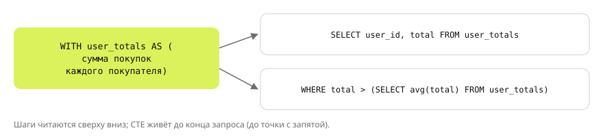

## Теория
Подзапросы в `FROM` быстро превращают запрос в матрёшку: читать его приходится изнутри наружу. **CTE** (common table expression, «общее табличное выражение») выносит подзапрос в начало и даёт ему имя:
```sql
WITH monthly AS (
    SELECT date_trunc('month', o.created_at) AS month,
           sum(oi.quantity * oi.price) AS revenue
    FROM orders o
    JOIN order_items oi ON oi.order_id = o.id
    WHERE o.status <> 'cancelled'
    GROUP BY month
)
SELECT month, revenue
FROM monthly
WHERE revenue > 50000;
```
Дальше в запросе `monthly` используется как обычная таблица. Запрос читается сверху вниз шагами: «сначала посчитай выручку по месяцам, потом выбери месяцы больше 50 тысяч».

Правила:
- **Несколько CTE** перечисляют через запятую после одного `WITH`: `WITH a AS (…), b AS (…) SELECT …`. Второй `WITH` перед `b` — синтаксическая ошибка.
- Каждое следующее CTE может ссылаться на предыдущие.
- Одно CTE можно использовать в основном запросе несколько раз — например, и как таблицу, и в подзапросе для среднего.
- CTE живёт только внутри своего запроса; после `;` его нет. Для повторного использования — представление (последняя тема раздела).
- CTE можно ставить и перед `INSERT`, `UPDATE`, `DELETE`.

**Зачем ещё.** CTE помогают избежать размножения строк из раздела «Связи и JOIN»: каждую ветку «многих» сворачивают в своём CTE, а потом соединяют уже свёрнутые результаты — строка на категорию с каждой стороны, перемножаться нечему.

О скорости: с PostgreSQL 12 CTE, использованное один раз, встраивается в запрос, как подзапрос, — разницы нет. Использованное несколько раз вычисляется один раз и запоминается. Поведение можно задать явно: `AS MATERIALIZED` / `AS NOT MATERIALIZED`.

## Наглядно
**Рисунок 1.** CTE — именованные шаги запроса.



## На практике
Задача: выручка по месяцам, покупатели с суммой покупок выше средней и сводка по категориям без размножения строк.

### Шаг 1. Один шаг
Месяцы с выручкой больше 50 000 ₽ — запрос из раздела «Теория»:
```sql
WITH monthly AS (
    SELECT date_trunc('month', o.created_at) AS month,
           sum(oi.quantity * oi.price) AS revenue
    FROM orders o
    JOIN order_items oi ON oi.order_id = o.id
    WHERE o.status <> 'cancelled'
    GROUP BY month
)
SELECT month, revenue
FROM monthly
WHERE revenue > 50000
ORDER BY month;
```
Результат:
```
         month          |  revenue
------------------------+-----------
 2025-11-01 00:00:00+03 | 113520.00
 2026-01-01 00:00:00+03 | 126798.00
 2026-02-01 00:00:00+03 |  81009.00
 2026-03-01 00:00:00+03 |  75220.00
 2026-04-01 00:00:00+03 | 175098.00
(5 rows)
```
`revenue` в основном запросе — уже обычный столбец, и в `WHERE` его можно использовать: псевдоним «застыл» на шаге CTE.

### Шаг 2. CTE дважды
Покупатели, которые потратили больше среднего покупателя:
```sql
WITH user_totals AS (
    SELECT o.user_id, sum(oi.quantity * oi.price) AS total
    FROM orders o
    JOIN order_items oi ON oi.order_id = o.id
    WHERE o.status <> 'cancelled'
    GROUP BY o.user_id
)
SELECT user_id, total
FROM user_totals
WHERE total > (SELECT avg(total) FROM user_totals)
ORDER BY user_id;
```
Результат:
```
 user_id |   total
---------+-----------
       1 | 179007.00
       3 |  79960.00
       8 | 144220.00
      12 |  93549.00
(4 rows)
```
`user_totals` использовано дважды: как таблица и в подзапросе для среднего (68 157.22).

### Шаг 3. Две ветки без размножения
По каждой категории — число товаров и выручка за всё время. В одном запросе с `JOIN products` и `JOIN order_items` товары размножились бы по числу позиций. Сворачиваем каждую ветку отдельно:
```sql
WITH product_counts AS (
    SELECT category_id, count(*) AS products
    FROM products
    GROUP BY category_id
),
revenues AS (
    SELECT p.category_id, sum(oi.quantity * oi.price) AS revenue
    FROM order_items oi
    JOIN products p ON p.id = oi.product_id
    GROUP BY p.category_id
)
SELECT c.name AS category, pc.products, COALESCE(r.revenue, 0) AS revenue
FROM categories c
JOIN product_counts pc ON pc.category_id = c.id
LEFT JOIN revenues r ON r.category_id = c.id
ORDER BY c.name;
```
Результат:
```
  category   | products |  revenue
-------------+----------+-----------
 Аксессуары  |        6 |  48715.00
 Книги       |        3 |  13720.00
 Ноутбуки    |        3 | 434940.00
 Одежда      |        1 |         0
 Смартфоны   |        4 | 396840.00
 Футболки    |        4 |  14190.00
 Электроника |        1 |   9960.00
(7 rows)
```
Выручка здесь — по всем позициям, включая отменённые заказы: это «спрос», а не деньги.

## Частые ошибки
- **Второй `WITH`.** CTE перечисляют через запятую после одного `WITH`.
- **CTE в следующем запросе.** Оно живёт до `;`.
- **Одна большая выборка вместо шагов.** Две ветки «многих» в одном `JOIN` перемножаются; свёрнутые в CTE — нет.
- **Лишняя запятая перед основным `SELECT`.** `WITH a AS (…), SELECT …` — синтаксическая ошибка.
- **Ожидание, что CTE — «временная таблица» на сессию.** Это часть одного запроса.

## Итог
**CTE**
- `WITH имя AS (запрос) SELECT … FROM имя` — именованный шаг.
- Несколько — через запятую; следующие видят предыдущие.
- Можно использовать несколько раз; живёт до конца запроса.

**Зачем**
- Читаемость: шаги сверху вниз.
- Свернуть ветки до соединения — без размножения строк.
- Использовать вычисленный столбец в `WHERE` основного запроса.

## Вопросы на собеседовании
<details><summary>Чем CTE отличается от подзапроса?</summary>

По результату — ничем: это тот же подзапрос, вынесенный вперёд и названный. CTE читается сверху вниз, может использоваться несколько раз и ссылаться на предыдущие CTE, бывает рекурсивным. С PostgreSQL 12 CTE, использованное один раз, оптимизируется как подзапрос.
</details>

<details><summary>Чем CTE отличается от временной таблицы?</summary>

CTE существует только внутри одного запроса и не хранится. Временная таблица (`CREATE TEMP TABLE`) живёт до конца сессии, в неё можно вставлять данные, строить индексы и использовать её в нескольких запросах.
</details>

<details><summary>Что такое `MATERIALIZED` у CTE?</summary>

Указание вычислить CTE один раз и сохранить результат, а не встраивать его в основной запрос. До PostgreSQL 12 так работали все CTE («барьер оптимизации»), из-за чего условия основного запроса не проталкивались внутрь. Теперь по умолчанию CTE с одним использованием встраивается, а `MATERIALIZED` / `NOT MATERIALIZED` задают поведение явно.
</details>
