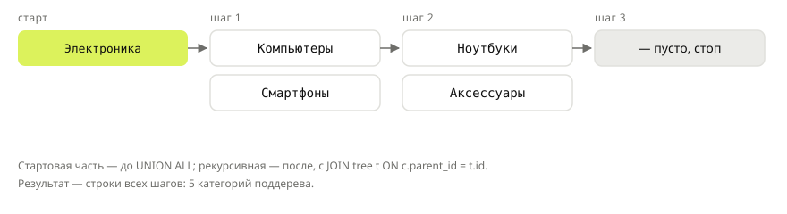

## Теория
Самосвязь из раздела «Связи и JOIN» находит родителя категории — на один уровень. Но «все товары Электроники» включают и подкатегории подкатегорий: Электроника → Компьютеры → Ноутбуки. Глубина дерева заранее неизвестна, и цепочкой `JOIN` её не пройти. Для этого есть **рекурсивный CTE**:
```sql
WITH RECURSIVE tree AS (
    SELECT id, name, parent_id, 1 AS level      -- стартовая часть
    FROM categories
    WHERE id = 1
    UNION ALL
    SELECT c.id, c.name, c.parent_id, t.level + 1  -- рекурсивная часть
    FROM categories c
    JOIN tree t ON c.parent_id = t.id
)
SELECT id, name, level FROM tree;
```
Как это выполняется:
1. **Стартовая часть** (до `UNION ALL`) даёт первые строки — здесь саму «Электронику».
2. **Рекурсивная часть** ссылается на `tree` и видит **только строки, добавленные на прошлом шаге**. Она находит их детей — «Компьютеры» и «Смартфоны».
3. Шаг 2 повторяется с новыми строками: дети «Компьютеров» — «Ноутбуки» и «Аксессуары».
4. Когда очередной шаг не дал ни одной строки, рекурсия останавливается. Результат — все строки всех шагов.

Обе части должны возвращать одинаковые столбцы совместимых типов, как в `UNION`. Столбец-счётчик (`level`) показывает глубину; столбец-путь (`path || ' → ' || c.name`) — «хлебные крошки». Типы должны совпадать точно: если бы `name` был `varchar(50)`, склейка дала бы `varchar` без длины — другой тип, и PostgreSQL отказался бы выполнять запрос (`column 2 has type character varying(50) in non-recursive term but type character varying overall`) — тогда стартовую часть приводят к `text` (`name::text`). В учебной базе `name` уже `text`, и приведение в примере ниже просто подстраховывает.

Направление задаёт условие соединения: `c.parent_id = t.id` — вниз, к детям; `c.id = t.parent_id` — вверх, к родителям («хлебные крошки» для страницы ноутбука).

**Бесконечная рекурсия.** Если в данных цикл (категория — родитель своего родителя), рекурсия не остановится. Защита — ограничение глубины в условии (`WHERE t.level < 10`) или `UNION` вместо `UNION ALL`, который не добавляет уже встречавшиеся строки (помогает, только если строки на цикле полностью совпадают).

## Наглядно
**Рисунок 1.** Шаги рекурсии по дереву категорий.



## На практике
Задача: все подкатегории «Электроники», путь к «Ноутбукам» и дерево каталога целиком.

### Шаг 1. Вниз по дереву
Запрос из раздела «Теория», отсортированный по уровню:
```sql
WITH RECURSIVE tree AS (
    SELECT id, name, parent_id, 1 AS level
    FROM categories
    WHERE id = 1
    UNION ALL
    SELECT c.id, c.name, c.parent_id, t.level + 1
    FROM categories c
    JOIN tree t ON c.parent_id = t.id
)
SELECT id, name, level FROM tree ORDER BY level, id;
```
Результат:
```
 id |    name     | level
----+-------------+-------
  1 | Электроника |     1
  2 | Компьютеры  |     2
  5 | Смартфоны   |     2
  3 | Ноутбуки    |     3
  4 | Аксессуары  |     3
(5 rows)
```

### Шаг 2. Вверх по дереву
Хлебные крошки для «Ноутбуков» (3) — условие соединения в обратную сторону:
```sql
WITH RECURSIVE path AS (
    SELECT id, name, parent_id
    FROM categories
    WHERE id = 3
    UNION ALL
    SELECT c.id, c.name, c.parent_id
    FROM categories c
    JOIN path p ON c.id = p.parent_id
)
SELECT id, name FROM path;
```
Результат:
```
 id |    name
----+-------------
  3 | Ноутбуки
  2 | Компьютеры
  1 | Электроника
(3 rows)
```
У «Электроники» `parent_id` — NULL, следующий шаг пуст, рекурсия закончилась.

### Шаг 3. Всё дерево с путями
Старт — все корневые категории, путь копится в текстовом столбце:
```sql
WITH RECURSIVE tree AS (
    SELECT id, name::text AS path
    FROM categories
    WHERE parent_id IS NULL
    UNION ALL
    SELECT c.id, t.path || ' → ' || c.name
    FROM categories c
    JOIN tree t ON c.parent_id = t.id
)
SELECT id, path FROM tree ORDER BY path;
```
Результат:
```
 id |                 path
----+---------------------------------------
  9 | Книги
  6 | Одежда
  8 | Одежда → Обувь
  7 | Одежда → Футболки
  1 | Электроника
  2 | Электроника → Компьютеры
  4 | Электроника → Компьютеры → Аксессуары
  3 | Электроника → Компьютеры → Ноутбуки
  5 | Электроника → Смартфоны
(9 rows)
```
Сортировка по пути выстраивает дерево: родитель перед детьми.

### Шаг 4. Товары во всём поддереве
Сколько товаров в «Электронике» вместе со всеми подкатегориями:
```sql
WITH RECURSIVE tree AS (
    SELECT id FROM categories WHERE id = 1
    UNION ALL
    SELECT c.id FROM categories c JOIN tree t ON c.parent_id = t.id
)
SELECT count(*) AS total
FROM products
WHERE category_id IN (SELECT id FROM tree);
```
Результат:
```
 total
-------
    14
(1 row)
```
`WHERE category_id = 1` дал бы один товар — зарядное устройство, лежащее прямо в «Электронике».

## Частые ошибки
- **Только один уровень.** `WHERE parent_id = 1` находит детей, но не внуков.
- **Условие соединения не в ту сторону.** `c.id = t.parent_id` идёт к родителям, `c.parent_id = t.id` — к детям.
- **Разные типы частей.** `varchar(50)` в стартовой части и `varchar` после склейки в рекурсивной — ошибка; приведите старт к `text`.
- **Нет защиты от цикла.** Ошибка в данных — бесконечный запрос; ограничьте глубину.
- **Забыли `RECURSIVE`.** Без него CTE не может ссылаться на себя: `relation "tree" does not exist`.

## Итог
**WITH RECURSIVE**
- Стартовая часть `UNION ALL` рекурсивная часть, которая ссылается на CTE.
- Рекурсивная часть видит строки прошлого шага; пустой шаг — конец.
- Столбцы обеих частей совпадают по числу и типам.

**Применение**
- Деревья: подкатегории, хлебные крошки, комментарии-ответы.
- Направление — условием соединения; глубина — счётчиком; путь — склейкой строк.

## Вопросы на собеседовании
<details><summary>Как получить все подкатегории категории произвольной глубины?</summary>

Рекурсивным CTE: стартовая часть выбирает саму категорию, рекурсивная присоединяет к найденным строкам их детей (`c.parent_id = t.id`), пока очередной шаг не окажется пустым. Альтернативы в схеме — хранить путь (`ltree`, materialized path) или вложенные множества: они ускоряют чтение, но усложняют изменение дерева.
</details>

<details><summary>Чем `UNION` отличается от `UNION ALL` в рекурсивном CTE?</summary>

`UNION ALL` добавляет все найденные строки, `UNION` — только те, которых ещё не было в результате. `UNION` может остановить рекурсию на цикле, если строки полностью повторяются; но если в строке есть счётчик глубины или путь, строки различаются, и защиту делают условием на глубину или проверкой пути.
</details>

<details><summary>Почему рекурсивная часть не видит все предыдущие строки?</summary>

Так устроен алгоритм: на каждом шаге рекурсивная часть работает с «рабочей таблицей» — строками, найденными на прошлом шаге. Это и обеспечивает остановку: когда новых строк нет, рабочая таблица пуста. Итоговый результат — объединение всех шагов.
</details>
