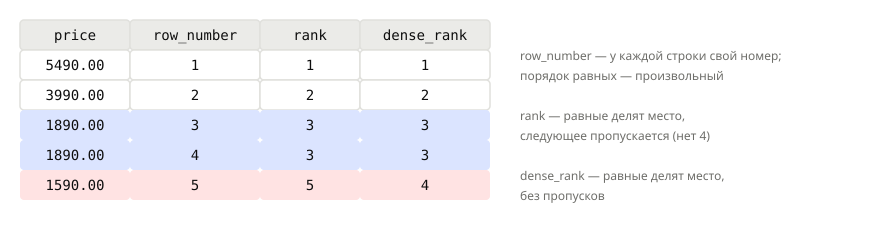

## Теория
`GROUP BY` сворачивает группу в одну строку — отдельные товары пропадают. А часто нужно и то и другое: каждый товар **и** его место в категории, каждый товар **и** доля в выручке категории. Для этого есть **оконные функции**: они считают значение по набору строк — «окну», — но строки не сворачивают.

Окно задаёт `OVER (…)`:
- `OVER ()` — окно — все строки результата;
- `PARTITION BY category_id` — делит строки на группы-«окна», как `GROUP BY`, но без сворачивания;
- `ORDER BY price DESC` — порядок строк внутри окна; для функций ранжирования он обязателен.

Функции ранжирования нумеруют строки окна по порядку из `ORDER BY`. Разница — в одинаковых значениях:
- **`row_number()`** — 1, 2, 3, 4: у каждой строки свой номер, одинаковые цены получают разные номера в произвольном порядке (добавьте в `ORDER BY` `id`, чтобы он был определён);
- **`rank()`** — 1, 2, 2, 4: одинаковые значения делят место, следующее место пропускается — как в спорте;
- **`dense_rank()`** — 1, 2, 2, 3: одинаковые делят место, без пропусков.

Агрегаты тоже работают как оконные: `sum(price) OVER (PARTITION BY category_id)` — сумма цен категории в каждой строке; так считают долю товара в категории.

**Где можно писать.** Оконные функции вычисляются после `WHERE`, `GROUP BY` и `HAVING` — на шаге `SELECT`. Поэтому в `WHERE` их писать нельзя: `window functions are not allowed in WHERE`. Чтобы отобрать «первые места», ранжирование выносят в CTE или подзапрос, а фильтруют снаружи. Это стандартный шаблон **«топ-N в каждой группе»**.

## Наглядно
**Рисунок 1.** Три функции ранжирования на одинаковых ценах.



**Таблица 1.** `GROUP BY` и окно.

| | `GROUP BY` | `OVER (PARTITION BY …)` |
|---|---|---|
| строк в результате | по одной на группу | столько же, сколько было |
| доступны отдельные строки | нет | да |
| где писать | `SELECT`, `HAVING`, `ORDER BY` | `SELECT`, `ORDER BY` |
| фильтр по результату | `HAVING` | внешний запрос (CTE) |

## На практике
Задача: места товаров по цене, самый дорогой товар каждой категории и доля смартфона в своей категории.

### Шаг 1. Три функции рядом
Аксессуары и книги по убыванию цены:
```sql
SELECT name, price,
       row_number() OVER (ORDER BY price DESC, id) AS row_number,
       rank() OVER (ORDER BY price DESC) AS rank,
       dense_rank() OVER (ORDER BY price DESC) AS dense_rank
FROM products
WHERE category_id IN (4, 9)
ORDER BY price DESC, id;
```
Результат:
```
           name           |  price  | row_number | rank | dense_rank
--------------------------+---------+------------+------+------------
 Механическая клавиатура  | 5490.00 |          1 |    1 |          1
 Веб-камера               | 3990.00 |          2 |    2 |          2
 Книга «Python с нуля»    | 1890.00 |          3 |    3 |          3
 Книга «Алгоритмы просто» | 1890.00 |          4 |    3 |          3
 Книга «SQL на практике»  | 1590.00 |          5 |    5 |          4
 Беспроводная мышь        | 1499.00 |          6 |    6 |          5
 USB-хаб на 4 порта       | 1499.00 |          7 |    6 |          5
 Проводная мышь           |  590.00 |          8 |    8 |          6
 Коврик для мыши          |  490.00 |          9 |    9 |          7
(9 rows)
```
Две книги по 1890 у `rank` делят третье место, и четвёртого нет; у `dense_rank` следующая цена — четвёртая.

### Шаг 2. Место внутри категории
`PARTITION BY` начинает нумерацию заново в каждой категории:
```sql
SELECT category_id, name, price,
       rank() OVER (PARTITION BY category_id ORDER BY price DESC) AS place
FROM products
WHERE category_id IN (3, 9)
ORDER BY category_id, place;
```
Результат:
```
 category_id |           name           |  price   | place
-------------+--------------------------+----------+-------
           3 | Ноутбук Aster 16 Pro     | 89990.00 |     1
           3 | Ноутбук Aster 14         | 64990.00 |     2
           3 | Ноутбук Nimbus Air       | 54990.00 |     3
           9 | Книга «Python с нуля»    |  1890.00 |     1
           9 | Книга «Алгоритмы просто» |  1890.00 |     1
           9 | Книга «SQL на практике»  |  1590.00 |     3
(6 rows)
```

### Шаг 3. Топ-1 в каждой категории
Окно в `WHERE` нельзя:
```sql
SELECT id, name
FROM products
WHERE row_number() OVER (ORDER BY price) <= 3;
```
Результат:
```
ERROR:  window functions are not allowed in WHERE
```
Ранжируем в CTE, отбираем снаружи:
```sql
WITH ranked AS (
    SELECT category_id, name, price,
           rank() OVER (PARTITION BY category_id ORDER BY price DESC) AS place
    FROM products
)
SELECT category_id, name, price
FROM ranked
WHERE place = 1
ORDER BY category_id, name;
```
Результат:
```
 category_id |           name            |  price
-------------+---------------------------+----------
           1 | Зарядное устройство 65 Вт |  2490.00
           3 | Ноутбук Aster 16 Pro      | 89990.00
           4 | Механическая клавиатура   |  5490.00
           5 | Смартфон Pixelon 8 Max    | 49990.00
           6 | Носки, 3 пары             |   590.00
           7 | Лонгслив                  |  2190.00
           9 | Книга «Python с нуля»     |  1890.00
           9 | Книга «Алгоритмы просто»  |  1890.00
(8 rows)
```
`rank` оставил обе книги; `row_number` выбрал бы одну из них — какую, зависит от порядка строк.

### Шаг 4. Агрегат как окно
Доля каждого смартфона в сумме цен своей категории:
```sql
SELECT name, price,
       round(price / sum(price) OVER (PARTITION BY category_id) * 100, 1) AS share
FROM products
WHERE category_id = 5
ORDER BY price DESC;
```
Результат:
```
          name          |  price   | share
------------------------+----------+-------
 Смартфон Pixelon 8 Max | 49990.00 |  43.1
 Смартфон Pixelon 8     | 39990.00 |  34.5
 Смартфон Lumo S        | 24990.00 |  21.6
 Чехол для смартфона    |   990.00 |   0.9
(4 rows)
```
С `GROUP BY` пришлось бы отдельно посчитать сумму и соединить её с товарами.

## Частые ошибки
- **Окно в `WHERE`.** Ошибка — ранжируйте в CTE и фильтруйте снаружи.
- **`row_number` при равных значениях.** Выбирает одну строку произвольно; если нужны все равные — `rank`.
- **`row_number` без однозначного порядка.** Добавьте в `ORDER BY` окна уникальный столбец (`id`), иначе номера «плавают» между запусками.
- **Забыли `PARTITION BY`.** Нумерация идёт по всей таблице, а не в каждой категории.
- **`ORDER BY` в окне ≠ `ORDER BY` запроса.** Первый задаёт порядок нумерации, второй — порядок вывода.

## Итог
**Окно**
- `функция() OVER (PARTITION BY … ORDER BY …)` — значение по набору строк без сворачивания.
- `PARTITION BY` — группы; `ORDER BY` — порядок внутри.

**Ранжирование**
- `row_number` — 1 2 3 4; `rank` — 1 2 2 4; `dense_rank` — 1 2 2 3.
- Агрегаты с `OVER` — сумма или среднее группы в каждой строке.

**Топ-N в группе**
- Окно — в CTE, фильтр `WHERE place <= N` — снаружи.

## Вопросы на собеседовании
<details><summary>Чем `row_number`, `rank` и `dense_rank` отличаются друг от друга?</summary>

На одинаковых значениях: `row_number` даёт разные номера (порядок между равными не определён), `rank` даёт равным одно место и пропускает следующие (1, 2, 2, 4), `dense_rank` — одно место без пропусков (1, 2, 2, 3).
</details>

<details><summary>Как найти самый дорогой товар в каждой категории?</summary>

Оконной функцией: `rank() OVER (PARTITION BY category_id ORDER BY price DESC)` в CTE или подзапросе и `WHERE place = 1` снаружи (`rank`, чтобы не потерять равные). В PostgreSQL есть и `DISTINCT ON (category_id) … ORDER BY category_id, price DESC` — он оставит по одной строке.
</details>

<details><summary>Чем оконная функция отличается от `GROUP BY`?</summary>

`GROUP BY` сворачивает группу в одну строку, и отдельные строки недоступны. Оконная функция считает значение по группе (окну), но оставляет каждую строку: товар остаётся в результате вместе со своим местом, суммой категории или средним. Окна вычисляются после `GROUP BY`/`HAVING`, поэтому их нельзя использовать в `WHERE`.
</details>
