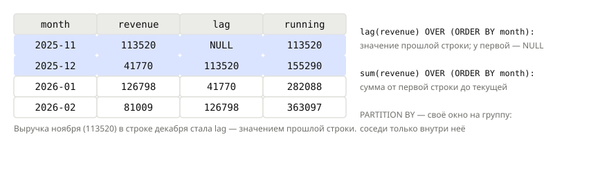

## Теория
Вторая группа оконных функций смотрит на **соседние** строки окна и копит **нарастающие** итоги.

**Смещение:**
- `lag(x)` — значение `x` из **предыдущей** строки окна; у первой строки — NULL;
- `lead(x)` — из **следующей**; у последней — NULL;
- `lag(x, 2)` — на две строки назад; `lag(x, 1, 0)` — с подстановкой 0 вместо NULL;
- `first_value(x)`, `last_value(x)` — первое и последнее значение окна.

Для них порядок обязателен: `lag(revenue) OVER (ORDER BY month)` — «выручка прошлого месяца». Без `ORDER BY` «предыдущая строка» не определена. А `PARTITION BY` ограничивает соседей своей группой: `lag(created_at) OVER (PARTITION BY user_id ORDER BY created_at)` — предыдущий заказ **того же** покупателя; без `PARTITION BY` это был бы предыдущий заказ любого покупателя.

**Нарастающий итог** — агрегат с `ORDER BY` в окне: `sum(revenue) OVER (ORDER BY month)` — сумма от первого месяца до текущего. Тонкость в **рамке окна** (frame) — какие строки окна входят в агрегат для текущей строки. При `ORDER BY` рамка по умолчанию — `RANGE BETWEEN UNBOUNDED PRECEDING AND CURRENT ROW`: от начала до текущей строки **и всех строк с тем же значением сортировки**. Если у двух заказов одна дата, а сортировка по дате, обе строки получат одинаковый итог — «вперёд» на соседа. Чтобы считать строго по строкам, пишут `ROWS BETWEEN UNBOUNDED PRECEDING AND CURRENT ROW` или делают сортировку однозначной (`ORDER BY created_at, id`).

Рамка задаёт и **скользящие** значения: `avg(revenue) OVER (ORDER BY month ROWS BETWEEN 2 PRECEDING AND CURRENT ROW)` — среднее за три последних месяца.

## Наглядно
**Рисунок 1.** lag смотрит на предыдущую строку, нарастающий итог — на все строки от начала окна.



**Таблица 1.** Функции смещения и рамки.

| Запись | Значение для текущей строки |
|---|---|
| `lag(x) OVER (ORDER BY …)` | `x` предыдущей строки, у первой — NULL |
| `lead(x) OVER (ORDER BY …)` | `x` следующей строки |
| `sum(x) OVER (ORDER BY …)` | сумма от начала до текущей строки и её «равных» (`RANGE`) |
| `sum(x) OVER (ORDER BY … ROWS BETWEEN UNBOUNDED PRECEDING AND CURRENT ROW)` | сумма строго до текущей строки |
| `avg(x) OVER (ORDER BY … ROWS BETWEEN 2 PRECEDING AND CURRENT ROW)` | среднее за три строки |

## На практике
Задача: динамика выручки по месяцам и интервалы между заказами покупателей.

### Шаг 1. Месяц к месяцу и нарастающий итог
Помесячная выручка — в CTE; к ней — выручка прошлого месяца, разница и сумма с начала периода:
```sql
WITH monthly AS (
    SELECT date_trunc('month', o.created_at) AS month,
           sum(oi.quantity * oi.price) AS revenue
    FROM orders o
    JOIN order_items oi ON oi.order_id = o.id
    WHERE o.status <> 'cancelled'
    GROUP BY month
)
SELECT month::date AS month, revenue,
       lag(revenue) OVER (ORDER BY month) AS prev,
       revenue - lag(revenue) OVER (ORDER BY month) AS diff,
       sum(revenue) OVER (ORDER BY month) AS running
FROM monthly
ORDER BY month;
```
Результат:
```
   month    |  revenue  |   prev    |   diff    |  running
------------+-----------+-----------+-----------+-----------
 2025-11-01 | 113520.00 |           |           | 113520.00
 2025-12-01 |  41770.00 | 113520.00 | -71750.00 | 155290.00
 2026-01-01 | 126798.00 |  41770.00 |  85028.00 | 282088.00
 2026-02-01 |  81009.00 | 126798.00 | -45789.00 | 363097.00
 2026-03-01 |  75220.00 |  81009.00 |  -5789.00 | 438317.00
 2026-04-01 | 175098.00 |  75220.00 |  99878.00 | 613415.00
(6 rows)
```
У ноября прошлого месяца нет — `lag` дал NULL, и разность тоже NULL.

### Шаг 2. Соседи внутри покупателя
Предыдущий заказ того же покупателя — `PARTITION BY user_id`:
```sql
SELECT user_id, id, created_at::date AS day,
       lag(created_at::date) OVER (PARTITION BY user_id ORDER BY created_at) AS prev_day
FROM orders
WHERE user_id IN (2, 4)
ORDER BY user_id, created_at;
```
Результат:
```
 user_id | id |    day     |  prev_day
---------+----+------------+------------
       2 |  2 | 2025-11-29 |
       2 |  9 | 2025-12-24 | 2025-11-29
       2 | 16 | 2026-01-31 | 2025-12-24
       2 | 25 | 2026-03-15 | 2026-01-31
       2 | 33 | 2026-04-15 | 2026-03-15
       4 |  5 | 2025-12-01 |
       4 | 18 | 2026-02-07 | 2025-12-01
       4 | 29 | 2026-04-05 | 2026-02-07
(8 rows)
```
У первого заказа Глеба (5) предыдущего нет, хотя в общем списке перед ним — заказ Бориса: окно отделено.

### Шаг 3. Равные значения в нарастающем итоге
Номер заказа апреля по порядку — двумя способами:
```sql
SELECT id, created_at::date AS day,
       count(*) OVER (ORDER BY created_at::date) AS by_day,
       count(*) OVER (ORDER BY id) AS by_id
FROM orders
WHERE created_at >= '2026-04-01'
ORDER BY id;
```
Результат:
```
 id |    day     | by_day | by_id
----+------------+--------+-------
 28 | 2026-04-02 |      1 |     1
 29 | 2026-04-05 |      2 |     2
 30 | 2026-04-09 |      3 |     3
 31 | 2026-04-12 |      4 |     4
 32 | 2026-04-14 |      5 |     5
 33 | 2026-04-15 |      7 |     6
 34 | 2026-04-15 |      7 |     7
(7 rows)
```
Заказы 33 и 34 сделаны в один день. При сортировке по дню они «равные», и рамка `RANGE` по умолчанию включает обе строки — у заказа 33 итог 7, хотя он шестой. Сортировка по уникальному `id` (или рамка `ROWS`) считает строго по строкам.

## Частые ошибки
- **`lag` без `PARTITION BY`.** Предыдущая строка — чужой покупатель или чужая категория.
- **Окно без `ORDER BY`.** «Предыдущая» строка не определена; нарастающий итог превращается в сумму всего окна.
- **Равные значения сортировки в нарастающем итоге.** `RANGE` по умолчанию объединяет их; нужен `ROWS` или уникальный столбец в `ORDER BY`.
- **NULL у первой строки.** `lag` первой строки — NULL, и вычисления с ним — NULL; подставьте значение третьим аргументом или `COALESCE`.
- **Ожидание, что `last_value` вернёт последнюю строку окна.** С рамкой по умолчанию «последняя» — текущая строка; нужна рамка `ROWS BETWEEN UNBOUNDED PRECEDING AND UNBOUNDED FOLLOWING`.

## Итог
**Смещение**
- `lag` / `lead` — соседняя строка окна; у края — NULL.
- `PARTITION BY` — соседи только своей группы; `ORDER BY` — обязателен.

**Итоги и рамки**
- `sum(…) OVER (ORDER BY …)` — нарастающий итог.
- Рамка по умолчанию — `RANGE … CURRENT ROW`: равные значения сортировки считаются вместе.
- `ROWS BETWEEN n PRECEDING AND CURRENT ROW` — скользящее окно по строкам.

## Вопросы на собеседовании
<details><summary>Как посчитать изменение выручки к прошлому месяцу?</summary>

Сначала свернуть выручку по месяцам (`GROUP BY`, в CTE), затем `revenue - lag(revenue) OVER (ORDER BY month)`. Для процента — `round((revenue / lag(revenue) OVER (ORDER BY month) - 1) * 100, 1)`. Месяцы без продаж в такой ряд не попадут — их добавляют `generate_series` и `LEFT JOIN`.
</details>

<details><summary>Чем `ROWS` отличается от `RANGE` в рамке окна?</summary>

`ROWS` отсчитывает строки: «две предыдущие строки и текущая». `RANGE` — значения сортировки: «все строки, у которых значение `ORDER BY` в диапазоне», поэтому строки с равным значением попадают в рамку вместе. По умолчанию при `ORDER BY` — `RANGE BETWEEN UNBOUNDED PRECEDING AND CURRENT ROW`.
</details>

<details><summary>Как найти интервал между заказами каждого покупателя?</summary>

`created_at - lag(created_at) OVER (PARTITION BY user_id ORDER BY created_at)` — для каждого заказа время с предыдущего заказа того же покупателя. Средний интервал — агрегат от этого столбца во внешнем запросе.
</details>
